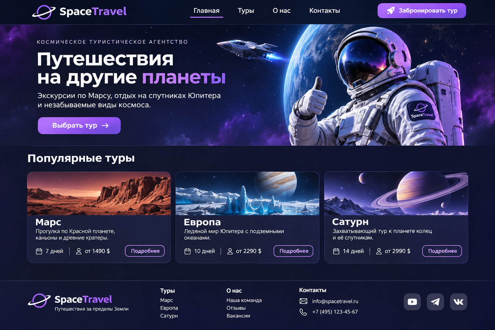

# Что показать на проекторе · Урок 4 — Flex-раскладки

Схема в папке `изображения/`. Внизу — промт картинки-ориентира итоговой.

---

## Схема урока

### `flex-паттерны.svg` — 4 типовые раскладки
**Когда:** Часть 1 (обзор) и далее по ходу каждого паттерна.
**Что сказать:** «Любой сайт собран из этих кусков: шапка, горизонтальная карточка, комментарий, подвал. Каждый — свой flex». Возвращайся к схеме, когда разбираете очередной паттерн.

---

## Живая демонстрация (обязательно)

Открой `материалы/страница-из-паттернов.html` через Live Server:
1. покажи, как страница собрана из блоков: подсвети в DevTools `.top`, `.card-h`, `.comment`, `footer` — у каждого свой `display:flex`.
2. у `.card-h .cover` убери `flex-shrink:0` и сузь окно → картинка сплющится; верни.
3. у `body` убери `flex-direction:column` / `min-height:100vh` → подвал подскочит; верни — уедет вниз.
4. запусти **игру** `игра-flex/игра.html` на проекторе, пройдите пару уровней вместе.

---

## Промпт картинки-ориентира итоговой работы



Покажи перед итоговой работой. Обрати внимание на шапку, две части главного экрана, три одинаковые карточки и подвал. Блок преимуществ ученики добавляют самостоятельно.

**RU:**

```text
Горизонтальный скриншот сайта вымышленного космического туристического агентства SpaceTravel. Тёмный сине-фиолетовый фон, белый текст, фиолетовый акцент. Шапка: логотип, меню, кнопка бронирования. Главный экран: слева заголовок «Путешествия на другие планеты», описание и кнопка, справа космонавт на фоне планеты и корабля. Ниже три одинаковые карточки туров: Марс, Европа, Сатурн, изображения, описание, длительность, условная цена, кнопка «Подробнее». Внизу подвал с названием, ссылками и контактами. Чистая типографика, понятная структура, вид сайта на широком экране.
```

**EN:**

```text
Desktop website mockup for a fictional space tourism agency SpaceTravel, dark navy and purple palette, clean typography. Header with logo, navigation and booking button. Two-column hero with Russian headline and CTA on the left, astronaut and planet on the right. Three equal-width tour cards for Mars, Europa and Saturn with landscape images, descriptions, duration, fictional prices and details buttons. Footer with agency name, links and contacts. Clear layout suitable for a beginner Flexbox project.
```
