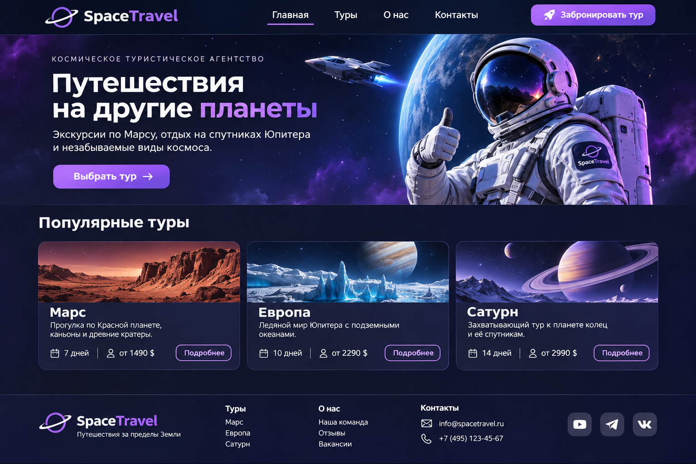

# Практика · Урок 4 — Flex-раскладки на практике

Делай по порядку: уровень 1, уровень 2, уровень 3, затем итоговая работа. Подглядывать в [итого.md](итого.md) и [справочники](../../Справочник.md) можно, копировать чужой код — нет.

>  Все стили — во внешнем `style.css`. Открывай через Live Server. И не забудь поиграть в  [тренажёр](игра-flex/игра.html)!

---

## Уровень 1 — паттерны по одному

**1.1.** Собери **шапку**: логотип слева, меню справа (`justify-content: space-between; align-items: center`).

**1.2.** Собери **горизонтальную карточку**: цветной блок-«обложка» слева (`flex-shrink: 0`), текст справа (`flex: 1`), всё по центру высоты.

**1.3.** Собери **комментарий**: круглый аватар слева (`flex-shrink: 0; border-radius: 50%`), имя и текст справа (`flex: 1`).

**1.4.** Сделай страницу `header` + `main` (пара строк) + `footer` и прижми подвал к низу (`body` в `column` + `main { flex: 1 }`).

**1.5.** В шапке добавь кнопку «Войти» и отодвинь её в самый конец через `margin-left: auto`.

---

## Уровень 2 — вложенный flex

**2.1.** Сделай 3 **горизонтальные карточки** подряд (список товаров/видео): обложка + заголовок + цена + кнопка.

**2.2.** Собери «ленту отзывов»: 4 медиа-объекта (аватар + имя жирным + текст).

**2.3.** Сделай карточку профиля: сверху — строка «аватар + имя + кнопка», ниже — ряд из 3 плиток-статистики (`flex: 1` каждая). Два вложенных flex.

**2.4.** Переверни меню в **столбик** (`flex-direction: column`) — боковое вертикальное меню. Выровняй пункты по центру (`align-items: center` — помни, оси поменялись!).

**2.5.** Сделай «герой-блок» на весь экран: `min-height: 100vh; display:flex; justify-content:center; align-items:center;` — заголовок ровно по центру экрана.

---

## Уровень 3 — цельные экраны

**3.1.** Собери страницу из **всех 4 паттернов**: шапка + лента из 3 горизонтальных карточек + блок отзывов (медиа-объекты) + подвал внизу.

**3.2.** Сделай «шапка + сайдбар + контент + подвал»: шапка сверху, посередине два столбца (`flex: 0 0 240px` меню + `flex: 1` контент), подвал внизу (весь каркас — вложенные flex, `body` в column).

**3.3.** Собери «экран результатов игры»: по центру экрана карточка со счётом, под ней ряд кнопок («Заново», «Меню», «Поделиться») через flex с `gap`.

**3.4.** Сделай адаптивную «галерею + описание»: слева сетка картинок (`flex-wrap: wrap`), справа колонка с текстом (`flex: 1`); на узком экране колонки переносятся.

**3.5.** Пройди все 10 уровней игры-тренажёра [«Выстрой отряд»](игра-flex/игра.html) и запиши, на каком уровне было сложнее всего и почему.

---

## Итоговая работа — «SpaceTravel: космическое туристическое агентство»

Представь, что путешествия за пределы Земли стали обычным делом. Ты работаешь над сайтом агентства, которое продаёт экскурсии на Марс, полёты к Сатурну и путешествия на спутники Юпитера. Твоя задача — сверстать главную страницу агентства так, чтобы посетитель мог познакомиться с маршрутами и выбрать путешествие.

Это вымышленный сайт: цены, сроки и описания можно придумать. Настоящая система бронирования не нужна.

### Образец страницы



Образец нужен для понимания расположения блоков. Не вставляй его целиком вместо сайта. Каждый заголовок, карточку, кнопку и изображение нужно добавить отдельно. Цвета, название агентства и маршруты можно изменить. Блок преимуществ, описанный ниже, добавь самостоятельно: на образце он не показан.

### Подготовка проекта

Создай папку `space-travel` со следующей структурой:

```text
space-travel/
├── index.html
├── style.css
└── images/
    ├── hero.jpg
    ├── mars.jpg
    ├── europa.jpg
    └── saturn.jpg
```

Подбери отдельные изображения для главного экрана и каждого тура. Можно использовать собственные рисунки или изображения из источников, разрешающих использование изображений. Имена файлов могут отличаться — главное, чтобы пути в `src` совпадали с реальными именами. Подключи внешний CSS в `<head>`, укажи `lang="ru"`, кодировку UTF-8, `viewport` и название вкладки.

### Этап 1. Шапка сайта

Создай `<header>` с логотипом SpaceTravel, меню из четырёх ссылок («Главная», «Туры», «О нас», «Контакты») и ссылкой-кнопкой «Забронировать тур». Меню помести в `<nav>`. Ссылки могут вести к секциям этой же страницы, например `href="#tours"` ведёт к элементу с `id="tours"`.

Сначала расположи три части шапки в ряд. Затем сделай само меню отдельным flex-контейнером. Так получится вложенный Flexbox: внешний контейнер управляет логотипом, меню и кнопкой, внутренний — пунктами меню.

Подсказка: `justify-content: space-between` распределяет свободное место между частями шапки, `align-items: center` выравнивает их по высоте, а `gap` задаёт промежутки между ссылками. На узком экране разреши перенос элементов.

### Этап 2. Главный экран

Внутри `<main>` создай секцию с классом `hero`. Слева размести блок текста: единственный `<h1>` «Путешествия на другие планеты», короткое описание и ссылку «Выбрать тур». Справа добавь изображение космонавта, корабля или планеты.

```html
<section class="hero" id="home">
    <div class="hero-text">
        <h1>Путешествия на другие планеты</h1>
        <p>Открой Марс, спутники Юпитера и кольца Сатурна.</p>
        <a href="#tours" class="btn">Выбрать тур</a>
    </div>
    
</section>
```

Это пример структуры одного блока, а не готовая страница. Задай секции `display: flex`, `align-items: center` и `gap`. Текстовому блоку дай `flex: 1`, изображению — подходящую начальную ширину и `max-width: 100%`. Если задаёшь фиксированную ширину изображения на широком экране, используй `flex-shrink: 0`, а для узкого экрана разреши перенос и уменьшение изображения. Не растягивай картинку одновременно по ширине и высоте без сохранения пропорций.

### Этап 3. Популярные туры

Создай секцию `id="tours"` с заголовком `<h2>Популярные туры</h2>`. Внутри размести контейнер `tour-list` и три карточки `<article class="tour-card">`.

| Маршрут | Описание | Длительность | Условная цена |
|---|---|---|---|
| Марс | Экскурсия по красным каньонам | 7 дней | 1490 $ |
| Европа | Путешествие по ледяному спутнику Юпитера | 10 дней | 2290 $ |
| Сатурн | Полёт к кольцам планеты | 14 дней | 2990 $ |

В каждой карточке должны быть изображение с `alt`, заголовок `<h3>`, описание, длительность, цена и ссылка «Подробнее». Можно придумать свои маршруты и данные.

Расположи карточки в ряд с одинаковыми промежутками. Используй `flex: 1 1 240px` для карточек и `flex-wrap: wrap` для родителя. Это позволит карточкам делить доступное пространство и переноситься, когда места недостаточно. Не задавай каждой карточке ширину `33.33%`: три ширины вместе с `gap` могут не поместиться.

Внутри карточки тоже используй Flexbox, но в столбик. Если описания разной длины, нижняя часть с ценой и кнопкой должна оставаться у нижнего края карточки.

```css
.tour-list {
    display: flex;
    flex-wrap: wrap;
    gap: 20px;
}

.tour-card {
    flex: 1 1 240px;
    display: flex;
    flex-direction: column;
    min-width: 0;
}

.tour-bottom {
    margin-top: auto;
}
```

Добавь класс `tour-bottom` общему блоку цены и кнопки. Для изображений карточек можно задать одинаковую высоту, ширину `100%` и `object-fit: cover`. Проверь, что изображение не искажено, а текст не выходит за границы карточки.

### Этап 4. Почему выбирают SpaceTravel

Создай секцию `id="about"` с заголовком «Почему выбирают нас». Добавь три преимущества: опытные пилоты, комфортные корабли, интересные экскурсии. Каждое преимущество — небольшой медиа-объект: слева иконка или цветной квадрат, справа заголовок и короткий текст.

Родительский контейнер расположи в ряд с переносом. Внутри каждого преимущества создай ещё один flex-контейнер с `align-items: center` и `gap`. Иконке задай одинаковые ширину и высоту и `flex-shrink: 0`, текстовому блоку — `flex: 1`. Это тот же паттерн, который использовали для комментария в теории.

### Этап 5. Подвал

После `main` добавь `<footer id="contacts">`. Внутри размести название агентства, ссылки на разделы и вымышленные контакты (например, `hello@spacetravel.example`). Сделай подвал отдельным flex-контейнером с `justify-content: space-between`, `gap` и переносом.

Чтобы подвал оставался внизу даже на короткой странице, используй:

```css
body {
    margin: 0;
    min-height: 100vh;
    display: flex;
    flex-direction: column;
}

main {
    flex: 1;
}
```

`main` занимает свободную высоту между шапкой и подвалом. Не используй `position: fixed`: при длинном содержимом подвал должен находиться после него, а не перекрывать карточки.

### Этап 6. Оформление

Выбери тёмный космический фон, светлый текст и один акцентный цвет, например фиолетовый. Подключи шрифт через Google Fonts или `@font-face` (как в предыдущем уроке). Используй одинаковые промежутки между секциями и одинаковое оформление кнопок. Для основного содержимого можно задать `max-width` и центрировать контейнер через `margin: 0 auto`.

Сначала добейся правильного расположения блоков, затем добавляй оформление. Градиенты, тени и сложные эффекты не обязательны: они будут подробнее разобраны в следующем модуле.

### Проверка результата

- [ ] Есть шапка с логотипом, меню и кнопкой; меню — вложенный flex.
- [ ] Главный экран содержит текст и отдельное изображение в горизонтальной раскладке.
- [ ] Есть три карточки туров одинаковой ширины на широком экране, с переносом при нехватке места.
- [ ] Внутри карточек элементы расположены в столбик, кнопки находятся внизу.
- [ ] Есть три преимущества в виде медиа-объектов, иконки не сжимаются.
- [ ] Подвал расположен после содержимого и при короткой странице остаётся у нижнего края окна.
- [ ] Использованы семантические теги, один `h1`, внешний CSS, подключён шрифт, у изображений есть `alt`.
- [ ] Ссылки на секции работают, при изменении ширины окна нет горизонтальной прокрутки.

### Эксперименты с Flexbox

1. Убери `display: flex` у шапки. Как изменилось расположение её частей? Верни свойство.
2. Убери `flex-wrap: wrap` у списка туров и сузь окно. Что происходит с карточками? Верни перенос.
3. Сделай описание одного тура вдвое длиннее. Проверь, остались ли кнопки на одной высоте.
4. Временно убери `flex-shrink: 0` у иконки преимущества и сузь окно. Объясни, почему иконка может уменьшиться.
5. Временно убери содержимое `main`, оставив сам элемент. Проверь положение подвала, затем верни содержимое.

### Дополнительные задания (по желанию)

- Добавь четвёртый тур и проверь перенос карточек.
- Сделай отдельную горизонтальную карточку «Тур месяца»: изображение слева, описание и цена справа.
- Нарисуй собственный логотип агентства в Illustrator и вставь его на страницу.

После практики — [викторина](викторина.html) и [игра-тренажёр](игра-flex/игра.html). Дальше — [самостоятельная работа модуля](../самостоятельная.md).
