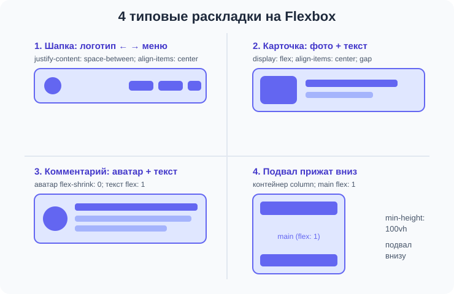

# Урок 4 — Flex-раскладки на практике 🧩

**Модуль 2 · Flexbox, семантика и шрифты · Урок 4 из 4 | 2 ак.ч. (1,5 часа)**

> ⬅️ [Все уроки модуля](../README.md) · [План курса](../../ПЛАН-КУРСА.md) · Предыдущий: [Урок 3 «Гибкие размеры»](../урок-03-гибкость-и-свой-шрифт/урок.md) · Дальше: [Самостоятельная работа модуля](../самостоятельная.md) ➡️

> 🔁 В начале — [разминка/повтор](повторение.md).
> 📌 Быстро вспомнить материал — [итого.md](итого.md). 👨‍🏫 Сценарий — [преподавателю.md](преподавателю.md). 🖼 Проектор — [изображения.md](изображения.md).
> 🆘 **Пропустил урок?** — [самоучитель.md](самоучитель.md). 🧰 Больше трюков — [лайфхак.md](лайфхак.md).

> 🧭 **Как читать урок.** Мы разобрали весь Flexbox: ряд, перенос, выравнивание, гибкость. Сегодня — **практикум**: соберём из этих кирпичиков **типовые раскладки**, которые встречаются на каждом сайте (шапка, горизонтальная карточка, комментарий, подвал внизу страницы), научимся **вкладывать flex во flex** и поиграем в **игру-тренажёр**. После этого урока ты будешь собирать разметку сайтов как конструктор.

---

## 🎮 Что мы сделаем сегодня и что получим

**Задача:** освоить **4 готовых паттерна** на Flexbox и собрать из них цельную страницу, а потом закрепить всё в игре-тренажёре.

**В итоге** у тебя будет «шпаргалка-конструктор»: типовые куски, из которых быстро собирается любой сайт.

**Главные навыки урока:** **вложенный flex** · 4 паттерна (**шапка**, **горизонтальная карточка**, **медиа-объект**, **подвал внизу** через `flex-direction: column`) · сборка цельной страницы · игра-тренажёр по flex.

> 💡 **Главная мысль урока:** большие макеты — это **вложенные** флекс-контейнеры. Разбивай страницу на блоки, каждый блок — свой маленький flex. Весь арсенал ты уже знаешь, осталось собрать.

---

## Часть 1 — Весь арсенал flex на одной странице

Быстрый повтор — что у нас есть (всё это сегодня используем):

| Хочу | Свойство |
|------|----------|
| поставить в ряд | `display: flex` |
| промежутки | `gap` |
| двигать вдоль ряда | `justify-content` |
| выровнять поперёк | `align-items` |
| перенос на новую строку | `flex-wrap: wrap` |
| делить место поровну | `flex: 1` (ребёнку) |
| не сжимать | `flex-shrink: 0` (ребёнку) |
| повернуть в столбик | `flex-direction: column` |



---

## Часть 2 — Паттерн 1: шапка сайта (повтор-основа)

Самый частый паттерн — уже знаком:

```css
.top { display: flex; justify-content: space-between; align-items: center; }
.menu { display: flex; gap: 20px; }   /* вложенный flex! */
```

- 👀 Логотип слева, меню справа. Обрати внимание: `.top` — флекс, и `.menu` внутри — **тоже** флекс. Это вложение.

> ✍️ **Мини-задание 1:** собери шапку с логотипом, меню (3 ссылки) и кнопкой «Войти» справа от меню.
> <details><summary>💡 подсказка</summary>Кнопку положи рядом с <code>nav</code> внутри <code>.top</code>; можно отодвинуть её <code>margin-left: auto</code> или положить меню и кнопку в общий flex.</details>

---

## Часть 3 — Паттерн 2: горизонтальная карточка

Карточка, где **картинка слева, текст справа** (товар, статья, видео в списке):

```html
<article class="card-h">
    
    <div class="body">
        <h3>Space Run</h3>
        <p>Космический раннер с рекордами.</p>
        <a href="#" class="btn">Играть</a>
    </div>
</article>
```
```css
.card-h { display: flex; gap: 16px; align-items: center; }
.cover  { flex-shrink: 0; width: 120px; border-radius: 10px; }  /* не сжимать картинку */
.body   { flex: 1; }                                            /* текст занимает остальное */
```

- 👀 Картинка держит размер (`flex-shrink: 0`), текст занимает всё оставшееся (`flex: 1`). Классическая карточка списка.

> ✍️ **Мини-задание 2:** собери горизонтальную карточку: картинка-обложка слева (не сжимается), справа заголовок, описание и кнопка.
> <details><summary>💡 подсказка</summary>Контейнер <code>display:flex; gap; align-items:center</code>; картинке <code>flex-shrink:0</code>, тексту <code>flex:1</code>.</details>

---

## Часть 4 — Паттерн 3: медиа-объект (аватар + текст)

Комментарий, отзыв, строка пользователя — **круглый аватар слева, текст справа**:

```css
.comment { display: flex; gap: 12px; }
.avatar  { flex-shrink: 0; width: 48px; height: 48px; border-radius: 50%; }
.text    { flex: 1; }
```

- 👀 Тот же приём: маленькое слева не сжимается, текст справа занимает остальное. Этот паттерн — везде (соцсети, чаты, отзывы).

> ✍️ **Мини-задание 3:** сделай 3 комментария подряд: аватар-круг + имя (жирным) + текст.
> <details><summary>💡 подсказка</summary>Каждый комментарий — <code>display:flex; gap</code>; аватар <code>flex-shrink:0; border-radius:50%</code>.</details>

---

## Часть 5 — Паттерн 4: подвал прижат к низу (`flex-direction: column`)

Частая проблема: на короткой странице подвал «подскакивает» к середине. Чиним **вертикальным** флексом:

```css
body {
    min-height: 100vh;         /* растянуть на всю высоту экрана */
    display: flex;
    flex-direction: column;    /* шапка, main, подвал — в столбик */
    margin: 0;
}
main {
    flex: 1;                   /* main занимает всё свободное место */
}
```

- 👀 Теперь `main` «распирает» страницу, а `footer` всегда внизу экрана, даже если контента мало. Это называют **«липкий подвал»** (sticky footer).

> 🧭 **Оси при `column`:** когда `flex-direction: column`, оси **меняются ролями**: `justify-content` двигает по вертикали, `align-items` — по горизонтали.

> ✍️ **Мини-задание 4:** сделай страницу `header` + `main` (мало текста) + `footer`. Прижми подвал к низу через `min-height: 100vh; display:flex; flex-direction:column;` и `main { flex: 1; }`.
> <details><summary>💡 подсказка</summary>Эти стили — у <code>body</code> (контейнер) и у <code>main</code> (<code>flex: 1</code>).</details>

---

## Часть 6 — Мини-проект: собираем страницу из паттернов 🧩

Соберём цельную мини-страницу «Игровой профиль» из знакомых кусков: шапка + горизонтальные карточки + подвал внизу.

```html
<body>
    <header class="top">
        <div class="logo">🎮 GameHub</div>
        <nav class="menu"><a href="#">Лента</a><a href="#">Топ</a><a href="#">Профиль</a></nav>
    </header>

    <main>
        <h1>Новинки</h1>
        <article class="card-h">
            <div class="cover"></div>
            <div class="body"><h3>Space Run</h3><p>Космический раннер.</p><a class="btn" href="#">Играть</a></div>
        </article>
        <article class="card-h">
            <div class="cover"></div>
            <div class="body"><h3>Dungeon Cat</h3><p>Кот в подземельях.</p><a class="btn" href="#">Играть</a></div>
        </article>
    </main>

    <footer><p>© 2026 GameHub</p></footer>
</body>
```
```css
body { min-height: 100vh; display: flex; flex-direction: column; margin: 0;
       font-family: "Segoe UI", sans-serif; background: #0f172a; color: #e2e8f0; }
.top { display: flex; justify-content: space-between; align-items: center; padding: 16px 24px; background: #1e293b; }
.menu { display: flex; gap: 18px; }
.menu a { color: #e2e8f0; text-decoration: none; }
main { flex: 1; padding: 24px; max-width: 760px; }
.card-h { display: flex; gap: 16px; align-items: center; background: #1e293b; border-radius: 14px; padding: 16px; margin-bottom: 16px; }
.cover { flex-shrink: 0; width: 100px; height: 70px; border-radius: 10px; background: linear-gradient(135deg,#6366f1,#38bdf8); }
.body { flex: 1; }
.btn { display: inline-block; margin-top: 8px; padding: 8px 18px; border-radius: 8px; background: #38bdf8; color: #0f172a; text-decoration: none; font-weight: 700; }
footer { text-align: center; padding: 16px; background: #1e293b; }
```

- 👀 Цельная страница собрана из трёх паттернов. Все они — вложенные флекс-контейнеры. Подвал прижат к низу.

> 🎨 **Твой вариант:** собери такую же страницу на свою тему (лента фильмов, список рецептов, доска объявлений) из тех же паттернов.

> 🧩 **Для 5–7 классов (проще):** хватит шапки + двух горизонтальных карточек (без «липкого подвала»).

---

## Часть 7 — 🎮 Игра-тренажёр «Выстрой отряд»

Закрепи flex в игре! Открой **[игра-flex/игра.html](игра-flex/игра.html)** — нужно расставить бойцов на поле, подбирая правильные `justify-content`, `align-items`, `gap` и `flex-direction`. 10 уровней от простого к сложному.

> Играется как разминка или дома. В игре есть подсказка по каждому приёму.

---

## 🎓 Часть 8 — Для тех, кто хочет глубже

- **`margin-left: auto`** во флексе «отталкивает» элемент в конец ряда — удобно для кнопки справа.
- **Вложенность без предела:** flex внутри flex внутри flex — так собирают целые интерфейсы.
- **`flex` vs `grid`:** flex — для рядов/колонок (одномерно); для настоящих двумерных сеток есть Grid (отдельный модуль).
- **`align-content` в `column`:** работает при переносе и в вертикальных раскладках.

---

## 🏁 Итог урока

- ✅ Большие макеты = **вложенные** флекс-контейнеры (flex во flex).
- ✅ **4 паттерна:** шапка (`space-between` + `align-items:center`), горизонтальная карточка (`flex-shrink:0` + `flex:1`), медиа-объект (аватар + текст), липкий подвал (`column` + `main{flex:1}`).
- ✅ `flex-direction: column` поворачивает оси — `justify-content` идёт по вертикали.
- ✅ Весь Flexbox собран в конструктор — ты умеешь верстать типовые блоки сайтов.

> 🏆 Главное: **разбивай страницу на блоки, каждый блок — свой flex.** Паттерны повторяются на всех сайтах. Быстро повторить — в [итого.md](итого.md).

> 🎤 **Блиц:** как прижать подвал к низу? Как собрать горизонтальную карточку (картинка+текст)? Что делает `flex-direction: column` с осями? Что такое вложенный flex?

### 🎮 Викторина + игра
Открой **[викторина.html](викторина.html)** (вопросы по всему flex) и **[игру-тренажёр](игра-flex/игра.html)**.

➡️ **Практика урока** — **[практика.md](практика.md)**. Дальше — **[Самостоятельная работа модуля](../самостоятельная.md)** (контрольная точка: лендинг на flex).
🆘 **Пропустил?** — [самоучитель.md](самоучитель.md). 📌 **Шпаргалка** — [итого.md](итого.md).

---

## 🔗 Навигация

⬅️ [Урок 3 «Гибкие размеры»](../урок-03-гибкость-и-свой-шрифт/урок.md) · [Все уроки модуля](../README.md) · [План курса](../../ПЛАН-КУРСА.md) · **Дальше:** [Самостоятельная работа](../самостоятельная.md) ➡️

**🧰 Инструменты:** [VS Code](https://code.visualstudio.com/) + [Live Server](https://marketplace.visualstudio.com/items?itemName=ritwickdey.LiveServer). **Все ссылки курса** — в [🧰 Полезные сервисы](../../ПОЛЕЗНЫЕ-СЕРВИСЫ.md). **📄 Пример:** [`материалы/страница-из-паттернов.html`](материалы/страница-из-паттернов.html) — цельная страница из flex-паттернов.
