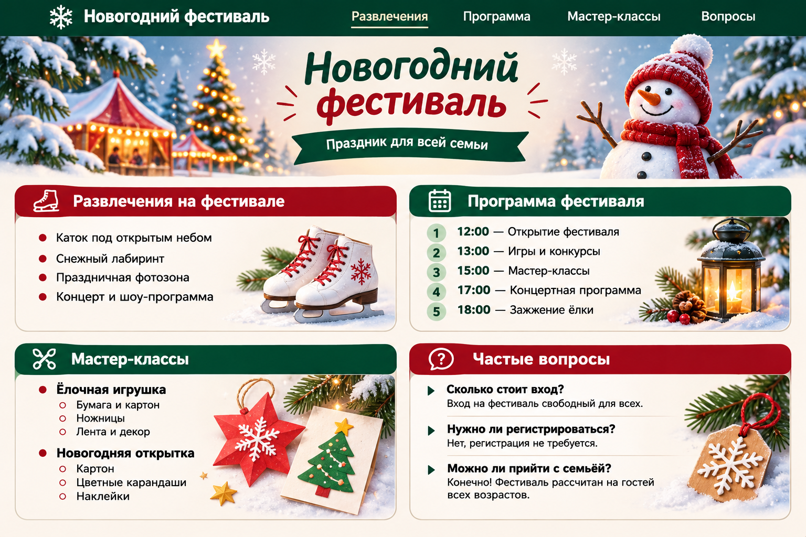

# 📝 Практика · Урок 2 «Списки»

**Темы:** `<ul>`/`<ol>`/`<li>`, `list-style-type` и `list-style: none`, вложенные списки, `<dl>`/`<dt>`/`<dd>`, меню из списка (`display: flex`), Emmet `ul>li*5`. Плюс повторяем ссылки и шрифты.

> 🎯 **Как работать.** Делай в файлах `.html`/`.css`, смотри результат в браузере через Live Server (сохраняй — `Ctrl+S`). Уровни: 🟢 базовые · 🟡 средние · 🔴 со звёздочкой. 💡 подсказка — это наводка, а не готовый код.
>
> 📌 **Правила игры:** список — контейнер (`<ul>`/`<ol>`) + пункты `<li>`; маркеры меняет `list-style-type`, убирает `list-style: none`; вложенный список кладут внутрь `<li>`; меню = список без маркеров + `display: flex`.

---

## 🟢 Уровень 1 — базовый (обязательно)

**1. Список покупок.**
Сделай маркированный список «Покупки к новогоднему столу» из 5 пунктов. Разверни его Emmet-строкой `ul>li*5`, потом впиши товары.
> 💡 Подсказка: `<ul><li>...</li></ul>`. Emmet: `ul>li*5` + Tab.

**2. Шаги рецепта.**
Сделай нумерованный список «Как украсить ёлку» из 4 шагов. Убедись, что браузер сам поставил номера 1–4.
> 💡 Подсказка: `<ol><li>...</li></ol>`. Emmet: `ol>li*4`.

**3. Автонумерация.**
В списке из задания 2 добавь новый шаг в середину. Проверь, что номера пересчитались сами.
> 💡 Подсказка: просто вставь ещё один `<li>` — `<ol>` перенумерует автоматически.

**4. Меняем маркер.**
Возьми маркированный список и попробуй на нём три вида маркеров по очереди: `square`, `circle`, затем убери маркеры совсем.
> 💡 Подсказка: `ul { list-style-type: square; }`; убрать — `ul { list-style: none; }`.

**5. Список с эмодзи.**
Убери стандартные маркеры и начни каждый пункт с эмодзи прямо в тексте (✅, 🔥, ⭐).
> 💡 Подсказка: `ul { list-style: none; }` и `<li>✅ Пункт</li>`.

**6. Буквы вместо цифр.**
Сделай нумерованный список, где вместо цифр — буквы (A, B, C).
> 💡 Подсказка: `<ol type="A">` или `ol { list-style-type: upper-alpha; }`.

**7. Мини-словарик.**
Сделай список описаний `<dl>` из 3 пар «термин → объяснение» на любую тему (игры, спорт).
> 💡 Подсказка: `<dl>`, внутри пары `<dt>термин</dt>` и `<dd>описание</dd>`.

---

## 🟡 Уровень 2 — средний (для уверенности)

**8. Вложенный список.**
Сделай список «Подготовка к празднику» с пунктами «Покупки», «Украшения», «Подарки», а внутри каждого — вложенный список из 2 дел.
> 💡 Подсказка: вложенный `<ul>` ставь **внутрь** `<li>`, перед его `</li>`.

**9. Дерево категорий.**
Собери «дерево» из вложенных списков: «Оливье» (картофель, яйца), «Печенье» (мука, масло) — минимум два уровня вложенности.
> 💡 Подсказка: у пункта верхнего уровня внутри — свой `<ul>` с подпунктами.

**10. Горизонтальное меню.**
Собери меню сайта из `<ul class="menu">` с тремя пунктами-ссылками. Убери маркеры и поставь пункты в ряд.
> 💡 Подсказка: `.menu { list-style: none; padding: 0; display: flex; gap: 20px; }`, внутри `<li>` — `<a>`.

**11. Меню-кнопки.**
Оформи меню из задания 10 так, чтобы пункты выглядели кнопками: фон, `padding`, скругление, отклик на `:hover` (повтор урока 1).
> 💡 Подсказка: `.menu a { display: inline-block; background: #2563eb; color: #fff; padding: 8px 16px; border-radius: 8px; text-decoration: none; }`.

**12. Топ-5 с красивым шрифтом.**
Сделай страницу «Топ-5 новогодних фильмов» нумерованным списком и подключи к ней красивый шрифт с Google Fonts (повтор урока 2).
> 💡 Подсказка: `<ol>` + `<link>` шрифта + `body { font-family: "...", sans-serif; }`.

**13. FAQ из `<dl>`.**
Сделай блок «Частые вопросы»: 3 вопроса (`<dt>`) и ответы к ним (`<dd>`). Вопросы сделай жирными через CSS.
> 💡 Подсказка: `dt { font-weight: 700; }` — вопрос выделен, ответ обычный.

---

## 🔴 Уровень 3 — со звёздочкой (челлендж)

**14. Своя картинка-маркер.**
Поставь спискам **свою картинку** вместо маркера через `list-style-image: url(...)`. Вспомни, что `url()` — это путь к файлу (как у шрифтов).
> 💡 Подсказка: `ul { list-style-image: url("звезда.png"); }` — картинка рядом с CSS.

**15. Цветной маркер через `::marker`.**
Сделай маркеры списка цветными и крупнее через псевдоэлемент `::marker`.
> 💡 Подсказка: `li::marker { color: #e11d48; font-size: 20px; }`.

**16. Двухуровневое меню.**
Собери меню, где у одного пункта при наведении есть подсписок (вложенный `<ul>`). Пока можно просто показать вложенный список под пунктом.
> 💡 Подсказка: вложенный `<ul>` внутри `<li>`; оформи его отступом и другим цветом.

---

## Итоговая работа урока — «Новогодний фестиваль»

Представь, что ты организуешь зимний фестиваль в своём городе. Гостям нужно заранее узнать, какие развлечения их ждут, во сколько начнутся мероприятия и что понадобится на мастер-классах. Создай сайт фестиваля, на котором эту информацию удобно найти.

Картинка — ориентир по расположению блоков и оформлению. Придумай собственное название фестиваля, мероприятия и расписание. Иллюстрации можно подобрать самостоятельно или обойтись без них.

### 1. Подготовь проект

Создай папку `winter-festival`, а внутри — `index.html` и `style.css`. Подключи внешний CSS и шрифт с Google Fonts. В шапке укажи название фестиваля, а в главном блоке добавь `h1` и короткое приглашение для гостей.

### 2. Собери меню сайта

Внутри `nav` создай `ul` с классом `menu`. Добавь четыре пункта: «Развлечения», «Программа», «Мастер-классы», «Вопросы». В каждом `li` размести ссылку `a`, ведущую к соответствующему разделу. Разделам задай уникальные `id`: `activities`, `schedule`, `workshops`, `faq`.

Например, ссылка `href="#schedule"` ведёт к разделу с `id="schedule"`.

> Подсказка: убери маркеры только у `.menu`, задай `display: flex`, `gap` и `flex-wrap: wrap`. Проверь каждую ссылку в браузере.

### 3. Развлечения на фестивале

Создай маркированный список `ul` минимум из пяти развлечений. Например: каток, снежный лабиринт, праздничная фотозона, конкурс снеговиков, концерт. Здесь порядок не важен, поэтому нумерация не нужна. Придумай хотя бы два собственных развлечения. Выбери подходящий вид маркеров через `list-style-type`.

### 4. Программа фестиваля

Создай нумерованный список `ol` минимум из пяти мероприятий в порядке их начала. У каждого пункта укажи время и название события. Например, в 12:00 — открытие, в 13:00 — конкурсы, в 15:00 — мастер-классы, в 17:00 — концерт, в 18:00 — зажжение ёлки.

Выдели время жирным шрифтом через `strong`. Номера пунктов не пиши вручную: браузер поставит их сам. Добавь ещё одно мероприятие между двумя существующими и проверь, что нумерация обновилась.

### 5. Мастер-классы

Создай внешний `ul` с названиями минимум двух мастер-классов. Например, изготовление ёлочной игрушки и создание новогодней открытки. Внутри каждого пункта размести вложенный `ul` минимум из трёх материалов, которые понадобятся участникам.

> Подсказка: вложенный список должен находиться внутри `li` с названием мастер-класса, до закрывающего `</li>`. Сделай названия заметнее, а для внутренних списков выбери другой маркер, например `circle`.

### 6. Частые вопросы посетителей

Создай список описаний `dl` из трёх или более пар вопрос–ответ. Например: сколько стоит вход, нужна ли регистрация, можно ли прийти с семьёй. Каждый вопрос помести в `dt`, ответ — в `dd`. У вопросов сделай жирный шрифт, а между парами оставь небольшие отступы.

### 7. Оформи страницу

Расположи четыре раздела в отдельных карточках. На широком экране можно разместить по две карточки в ряд с помощью Flexbox, а на узком разрешить перенос через `flex-wrap: wrap`. Не убирай маркеры у обычных списков. Добавь праздничные цвета, заголовки и при желании изображения.

| Элемент | Пример оформления |
|---|---|
| Фон страницы | `#fff8ed` |
| Шапка | `#124b38` |
| Акцент | `#b32626` |
| Текст | `#24352e` |
| Промежутки между карточками | `gap: 20px` |
| Скругление карточек | `border-radius: 12px` |

### Проверка результата

- [ ] Есть маркированный список минимум из пяти развлечений.
- [ ] Есть нумерованная программа минимум из пяти мероприятий с временем.
- [ ] Есть два мастер-класса с вложенными списками материалов.
- [ ] Есть список описаний `dl` с тремя парами вопрос–ответ.
- [ ] Меню из списка расположено горизонтально, все четыре ссылки работают.
- [ ] Подключены внешний CSS и шрифт.
- [ ] Страница читается, маркеры обычных списков сохранены.

**Дополнительно:** раскрась маркеры через `::marker`, добавь собственную картинку-маркер или создай вложенный список конкурсов по возрастным группам.

---

> ✅ **🟢 — база есть. 🟡 — уверенно. 🔴 — мастер списков!**
> 🆘 Застрял — открой [самоучитель.md](самоучитель.md): там всё по шагам.
> 📌 Быстро вспомнить — [итого.md](итого.md).
