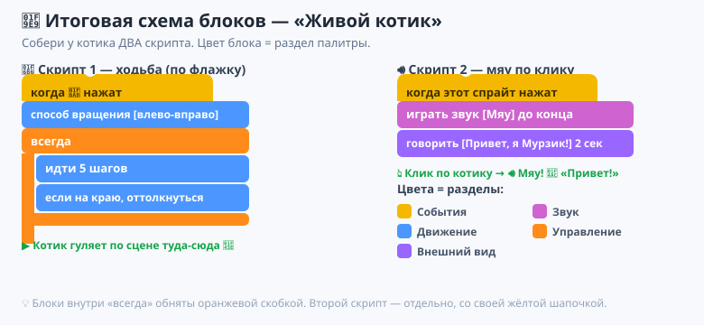
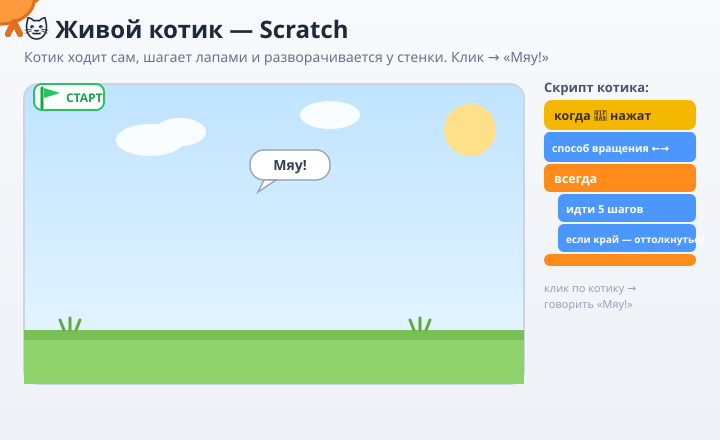

# ✏️ Практика — Урок 11: «Живой котик»

> 🎯 **Твоя миссия:** оживить котика по-настоящему — чтобы он **сам гулял по сцене туда-сюда**, разворачивался у стенки и **мяукал, когда по нему щёлкнешь**. Соберёшь две программы — котик станет как живой! А кто справится быстро — научит его ещё куче трюков.

Работаем в **Scratch**. Напоминание: блоки берём мышкой из **палитры слева** (по цветам), соединяем в **области скриптов по центру** (сверху вниз, прилипают, как пазлы — лови серую тень). Запуск — 🟢 **флажок** над сценой, стоп — 🔴.

> ✅ **Сначала проверь:** в списке спрайтов справа внизу выделен **котик** (синяя рамочка), а не «Сцена».

---

## 🐾 Программа 1 — котик ГУЛЯЕТ

### Шаг 1. Шапочка 🟨
Категория **«События»** → перетащи **«когда ▶ нажат»** в центр.

### Шаг 2. Способ вращения 🟦
Категория **«Движение»** → прицепи снизу **«установить способ вращения `влево-вправо`»**.
*Чтобы котик у стенки зеркалился, а не ходил вверх ногами.*

### Шаг 3. Цикл «всегда» 🟧
Категория **«Управление»** → блок **«всегда»** (скобка-рамка) прицепи снизу.

### Шаг 4. Внутрь «всегда» кладём ходьбу
1. 🟦 «Движение» → **«идти `5` шагов»** — положи **ВНУТРЬ** рамки (рамка подсветится).
2. 🟦 «Движение» → **«если на краю, оттолкнуться»** — тоже **внутрь**, под «идти».

### Шаг 5. ЗАПУСК! 🟢
Нажми флажок — котик **ходит по сцене туда-сюда** и разворачивается у краёв. Ура, гуляет!

---

## 🔊 Программа 2 — котик МЯУКАЕТ по клику

### Шаг 6. Вторая шапочка 🟨
«События» → **«когда этот спрайт нажат»** — перетащи на **пустое место** рядом (это отдельная программа!).

### Шаг 7. Звук и слова
1. 🟥 «Звук» → **«играть звук `Мяу` до конца»** — под шапочку.
2. 🟪 «Внешний вид» → **«говорить `Привет, я Мурзик!` `2` секунды»** — снизу (впиши свою фразу!).

### Шаг 8. Проверь
Нажми 🟢 флажок (котик пошёл), а теперь **кликни по котику мышкой на сцене** — он мяукнет и скажет фразу!

---

## 🎨 Шаг 9. Фон и сохранение
1. Панель **«Сцена»** (справа внизу) → **«Выбрать фон»** 🖼 → выбери, напр. **Blue Sky**.
2. **Файл → Сохранить** → имя **`котик-мурзик`**.

---

## 🖼 Как должно получиться



*А вот как котик оживёт (открой в браузере):*



**Текстом:**

```
ПРОГРАММА 1                         ПРОГРАММА 2
┌──────────────────────────┐        ┌──────────────────────────┐
│ когда ▶ нажат            │ 🟨     │ когда этот спрайт нажат   │ 🟨
├──────────────────────────┤        ├──────────────────────────┤
│ способ вращения [←→]      │ 🟦     │ играть звук [Мяу]         │ 🟥
├──────────────────────────┤        ├──────────────────────────┤
│ всегда                   │ 🟧     │ говорить [Привет!] 2 сек  │ 🟪
│   ├ идти [5] шагов        │ 🟦     └──────────────────────────┘
│   └ если на краю оттолкн. │ 🟦
└──────────────────────────┘
      ⬇ ▶                                 ⬇ клик по котику
 Котик гуляет туда-сюда 🐾           🔊 Мяу! 💬 «Привет!»
```

---

## ✅ Готово, если:
- [ ] в списке спрайтов был выделен котик;
- [ ] по флажку котик **сам ходит по сцене** туда-сюда и не переворачивается;
- [ ] «идти» и «если на краю» стоят **внутри** рамки «всегда»;
- [ ] по клику котик **мяукает и говорит** фразу (отдельный скрипт);
- [ ] выбран фон, проект сохранён (`котик-мурзик.sb3`).

---

## 🎯 А попробуй (кто справился быстро):

1. **Побыстрее / помедленнее.** Поменяй «идти 5 шагов» на 10 (быстрее) или 2 (медленнее) — найди красивую скорость.
2. **Шагает лапами.** 🟪 «Внешний вид» → **«следующий костюм»** положи внутрь «всегда», а под ним 🟧 **«ждать `0.2` секунды»** — котик начнёт перебирать лапами, как в мультике!
3. **Два котика.** Правый клик по котику → **«Дублировать»**. Второму дай другую скорость — устройте гонку.
4. **Думает вслух.** В программе 2 замени «говорить» на 🟪 **«думать `Хочу молока` `2` секунды»** — появится облачко-мысль.
5. **Крутится на месте.** Добавь в «всегда» блок 🟦 **«повернуть ↻ `15` градусов»** — котик закружится (потом убери, если не нравится).
6. **ИИ-фраза.** Попроси учителя узнать у **Алисы** смешную фразу для кота и впиши её в «говорить».

> 💡 Любое число/слово в блоке можно менять — кликни в белое окошко. Не бойся экспериментировать: сломать нельзя, всегда есть **отмена (Ctrl+Z)**!
