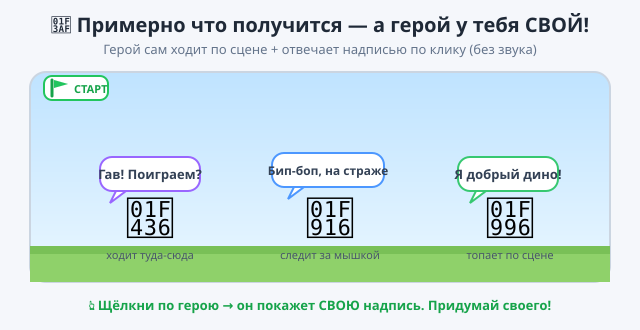

# ✏️ Практика — Урок 11: «Мой собственный живой герой»

> 🎯 **Твоя миссия:** на уроке мы оживляли котика. Теперь придумай и оживи **СВОЕГО героя** — любого! Пусть он сам гуляет по сцене и **отвечает надписью**, когда по нему щёлкнешь. Герой, фон и слова — **на твой вкус**. Без звука (колонок нет) — «голос» показываем облачком.

*Примерно что должно получиться — но герой и слова у каждого СВОИ!*

---

## 🧰 Что ты уже умеешь (бери любые блоки)

- 🟨 запуск **«когда ▶ нажат»** и **«когда этот спрайт нажат»**;
- 🟧 **«всегда»** — повторять без конца;
- 🟦 **«идти … шагов»**, **«если на краю, оттолкнуться»**, **«способ вращения ←→»**;
- 🟦 **«повернуться к указателю мыши»** (герой следит за мышкой);
- 🟪 **«говорить … секунды»** — надпись-облачко;
- 🟦 **«изменить y»** — прыжок.

## 💡 Выбери, КОГО оживить (или придумай сам)

- 🐶 щенок, который бегает и говорит «Гав! Поиграем?»;
- 🤖 робот, который патрулирует и говорит «Бип-боп, я на страже»;
- 🦖 динозаврик, который топает и говорит «Я добрый дино!»;
- 🦸 твой герой — выбери спрайт кнопкой **🐱+** внизу справа.

## 🛠 Собери ПО-СВОЕМУ (это не инструкция по шагам — твори!)

1. **Выбери спрайт** героя (и удали котика, если не нужен).
2. **Оживи движение:** сделай, чтобы герой сам двигался. Реши сам — он **ходит туда-сюда** (всегда + идти + если на краю оттолкнуться) или **следит за мышкой** (всегда + повернуться к указателю + идти). Не забудь **способ вращения ←→**, чтобы не ходил вверх ногами.
3. **Дай голос:** отдельным скриптом `когда этот спрайт нажат` → **говорить** твою фразу (придумай 1–2 свои!).
4. **Добавь свою фишку** (по желанию): прыжок по пробелу, вторую фразу, красивый фон.

> 💡 Подсмотри блоки в разборе на уроке (мячик-попрыгунчик, кот за мышкой) — и примени к своему герою.

---

## ✅ Готово, если ты СМОГ (проверь навыки, а не точные блоки):
- [ ] выбрал **своего** героя (не обязательно котик);
- [ ] герой **сам двигается** по сцене (ходит или следит за мышкой) и не переворачивается;
- [ ] по клику герой **отвечает твоей надписью** (отдельный скрипт);
- [ ] придумал **свои слова** (а не «Привет, я Мурзик»);
- [ ] проект сохранён (`.sb3`, своё имя).

## 🏆 Покажи классу
Запусти героя и дай соседу щёлкнуть по нему — пусть прочитает, что твой герой «скажет». У кого самый живой и смешной герой? 🎉

---

## 🎯 А если хочется ещё (мини-челленджи):

1. **Диалог двух героев** — добавь второй спрайт, пусть оба говорят по очереди (разные фразы).
2. **Герой-охотник** — пусть всегда поворачивается к мышке и крадётся за ней.
3. **Настроение** — по клику меняй фразу: иногда «Привет!», иногда «Я устал…» (две говорилки на разные клавиши).
4. **Сцена-история** — выбери фон под характер героя (космос для робота, джунгли для дино).

> 💡 Главное — сделать **по-своему**. Нет «неправильно»: пробуй, смотри, что получится. Ошибся — **Ctrl+Z**.
