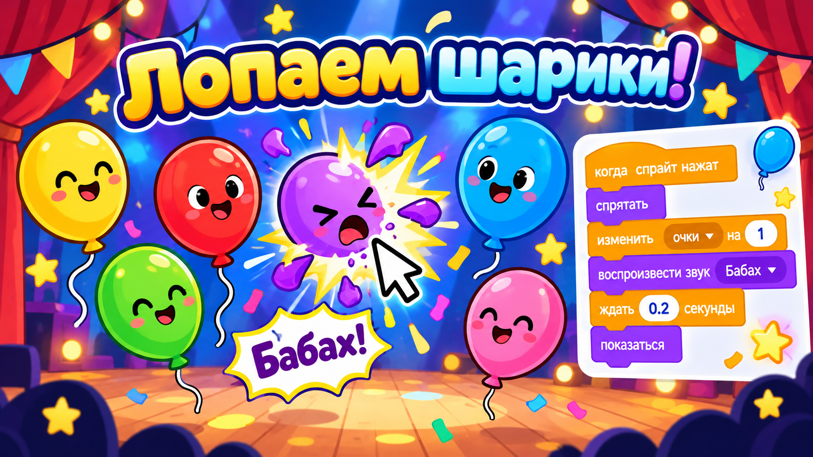

# Догоняем урок 11 (для тех, кто пропустил)

Привет! На этом уроке ребята впервые открыли Scratch и сразу собрали настоящую игру — ловилку «Поймай кота». Ты всё догонишь за одно занятие, примерно за полтора часа. Сначала спокойно прочитай, что было на уроке, а потом сам соберёшь похожую игру — «Лопни шарики». Звук мы не используем (в классе нет колонок), поэтому герои у нас «разговаривают» надписями.

---

## Что было на уроке

Scratch — это как конструктор, только собираешь ты не из деталей, а из разноцветных блоков-команд. Перетаскиваешь блоки мышкой и соединяешь их сверху вниз, будто детали лего. Экран Scratch поделён на четыре части:

- **слева** — палитра: все блоки-команды, разложенные по цветным разделам;
- **в середине** — место, куда ты перетаскиваешь блоки и собираешь из них программу;
- **справа вверху** — сцена: тут живёт герой и идёт игра;
- **справа внизу** — список героев (спрайтов).

Самое важное правило: прежде чем собирать программу, проверь, что в списке внизу **выделен тот герой**, которому ты её пишешь. Иначе блоки «прилипнут» не к тому.

Вот из каких блоков состояла игра про кота:

- **«когда флажок нажат»** — с этого блока игра начинается. Нажал зелёный флажок над сценой — программа побежала.
- **«когда этот спрайт нажат»** — срабатывает, когда игрок кликает по герою. Это и есть «поймал!».
- **«всегда»** — повторяет то, что внутри него, без остановки. Внутрь мы кладём другие блоки.
- **«ждать 1 секунду»** — пауза. Без неё герой носился бы так быстро, что его не поймать.
- **«перейти в случайную позицию»** — герой мгновенно прыгает в неожиданное место сцены. Это и делает кота непоседой.
- **«дать случайное число»** — такой «кубик»: каждый раз выдаёт новое число. С ним можно случайно менять размер или цвет.
- **«говорить»** и спецэффекты — так герой показывает радость без звука: говорит словечко или смешно дёргается.

Кот всё время прыгал по случайным местам с маленькой паузой, а когда по нему кликали — говорил «Поймал!» и менял вид. Вот и вся игра: есть правило и есть реакция на игрока. Этого уже достаточно, чтобы было весело.

---

## Твоя игра: «Лопни шарики»



Сейчас соберёшь свою игру теми же блоками, только вместо кота у тебя будет прыгающий шарик, а вместо «поймал» — «лопнул».

### Шаг 1. Поставь шарик

Внизу справа найди кнопку с котиком и плюсом и открой библиотеку героев. Выбери **Balloon** — это воздушный шарик, у него есть несколько костюмов разного цвета. Котика, который был в начале, убери: нажми на него правой кнопкой и выбери «Удалить».

### Шаг 2. Шарик прыгает и переливается

Собери первую программу (не забудь: шарик должен быть выделен внизу):

1. Возьми из жёлтого раздела «События» блок **«когда флажок нажат»** и положи в середину.
2. Под него из оранжевого раздела «Управление» прицепи блок **«всегда»**.
3. Внутрь «всегда» положи по очереди:
   - **«перейти в случайную позицию»** (синий раздел «Движение») — шарик будет прыгать;
   - **«следующий костюм»** (фиолетовый раздел «Внешний вид») — шарик будет менять цвет;
   - **«ждать 0.8 секунды»** (оранжевый раздел) — чтобы успеть прицелиться.

Нажми зелёный флажок — шарики запрыгали и переливаются цветами.

### Шаг 3. Лопаем по клику

Теперь отдельная маленькая программа — что будет, когда игрок кликнет по шарику:

1. Возьми блок **«когда этот спрайт нажат»** и положи на свободное место (не прицепляй к первой программе — это отдельная стопка).
2. Под него — **«говорить Бабах! 0.3 секунды»**.
3. Добавь **«изменить эффект призрак на 50»** — шарик на миг побледнеет, как будто лопнул. А следом **«убрать графические эффекты»**, чтобы он вернулся.

### Шаг 4. Фон и сохранение

Справа от списка героев нажми на картинку сцены и выбери любой яркий фон. Потом сохрани работу: «Файл» → «Сохранить на компьютер», назови файл `лопни-шарики`.

---

## Как это выглядит в сборе

```
ПРОГРАММА 1 — ШАРИК ПРЫГАЕТ        ПРОГРАММА 2 — ЛОПНУЛ
когда флажок нажат                 когда этот спрайт нажат
всегда                             говорить [Бабах!] 0.3 сек
 ├ перейти в случайную позицию       изменить эффект призрак на 50
 ├ следующий костюм                  убрать графические эффекты
 └ ждать 0.8 сек
```

---

## Теперь ты знаешь то же, что и класс

- [ ] понимаю четыре части экрана Scratch и проверяю, какой герой выделен;
- [ ] умею запускать игру флажком и ловить клик по герою;
- [ ] использую «всегда», «ждать» и «перейти в случайную позицию»;
- [ ] понимаю, что игра — это правило плюс реакция на игрока;
- [ ] радость героя показываю надписью, а работу сохранил в файл.

Хочешь ещё веселее? Пусть шарик при каждом прыжке меняет размер случайно — добавь в «всегда» блок «установить размер» и вставь в него «дать случайное число от 50 до 150». Теперь шарики то крошечные, то огромные, и лопать их интереснее. Если что-то собрал не так — нажми Ctrl+Z, это отменяет последнее действие.
