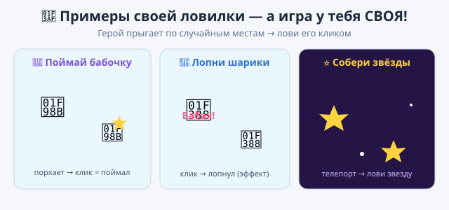

# 🎯 Практика — Урок 11: «Моя игра-ловилка»

> Практика — это **не повтор урока**. На уроке мы ловили кота. Теперь придумай и собери **СВОЮ игру-ловилку** — с другим героем и своими правилами! Подсказки лёгкие (без «возьми этот блок») — думай сам, у тебя получится. 🎮

---

## 🌟 Твой вызов — своя ловилка (не про кота!)

Выбери, КОГО ловить (или придумай своё):
- 🦋 **«Поймай бабочку»** — бабочка порхает по случайным местам, лови кликом;
- 🎈 **«Лопни шарики»** — шарик прыгает по экрану, щёлкнул — «лопнул» (сменил костюм/исчез на миг);
- 🐭 **«Накорми зверя»** — по экрану прыгает сыр/косточка, щёлкни, чтобы «съесть»;
- ⭐ **«Собери звёзды»** — звезда телепортируется, лови её.

**Что должно получиться:** герой **сам прыгает** по сцене, а по **клику** смешно реагирует (надписью, сменой вида, эффектом). Настоящая мини-игра, в которую можно играть!

*Примерно что получится — но игра и герой у тебя СВОИ!*

---

## 🧰 Что ты уже умеешь (вспомни и примени сам)

- запуск по **флажку** и реакцию **«когда этот спрайт нажат»**;
- **«всегда»** и **«ждать»** — чтобы герой прыгал с паузой;
- **«перейти в случайную позицию»** — телепорт;
- **«дать случайное число»** — для случайного размера/поворота/цвета;
- **«говорить»** и **спецэффекты** — реакция без звука.

## 💡 Подсказки (лёгкие — не инструкция):
- Чтобы герой «убегал», ему нужен **цикл**, а внутри — **телепорт** и **пауза** (иначе не поймать).
- Чтобы «ловился», ему нужен **отдельный скрипт на клик** со смешной реакцией.
- Трудно поймать/слишком легко? Поиграй **числом в «ждать»**.
- Нет звука (колонок нет) — радость от поимки показывай **надписью и видом** героя.

---

## ✅ Готово, если ты СМОГ (навыки, а не точные блоки):
- [ ] игра **не про кота** — свой герой и фон;
- [ ] герой **сам прыгает** по случайным местам;
- [ ] по **клику** герой реагирует (надпись / смена вида / эффект);
- [ ] играется — реально можно «ловить»;
- [ ] проект сохранён (`.sb3`, своё имя).

## 🏆 Турнир
Дай соседу поиграть в твою ловилку 20 секунд — сколько поймает? Устройте **чемпионат**: чья игра веселее и у кого рекорд больше? 🏅

---

## 🧩 Полегче (если тема «плывёт»):
- Возьми **любого** героя и сделай только **2 вещи**: он **прыгает** по случайным местам (цикл + телепорт + пауза) и **говорит что-то по клику**. Этого уже достаточно — игра работает! 🎉

## 🎓 Посложнее (кто хочет вызов):
- **Хитрый герой:** при каждом прыжке меняет **размер случайно** (`дать случайное число`) — то крошечный, то огромный.
- **Два беглеца:** добавь второго героя (своя скорость) — лови сразу двоих.
- **Награда:** по клику герой не только говорит, но и делает **случайный трюк** (крутится/цвет), как «кот-шутник».
- **Ускорение:** пусть пауза «ждать» каждый раз чуть меньше — игра разгоняется (пригодится блок, который узнаем на уроке 17 — переменные).

> 📌 Будь готов за 20 секунд рассказать, **что делает каждый твой скрипт**. Главное — сделал **по-своему**. Ошибся — **Ctrl+Z**.
