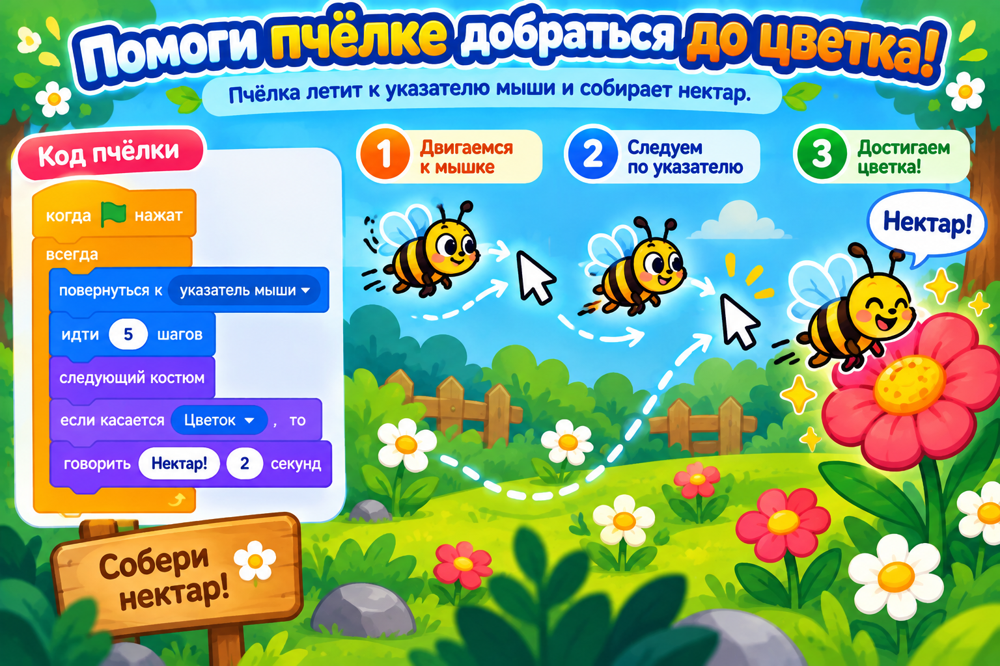

# Догоняем урок 12 (для тех, кто пропустил)

Привет! На этом уроке ребята собрали гоночную игру «Гонка к финишу»: герой ехал за мышкой, рисовал пером трассу и побеждал, когда доезжал до финиша. Ты всё догонишь за одно занятие, примерно за полтора часа. Сначала прочитай, что было на уроке, а потом соберёшь свою гонку — «Пчела летит к цветку». Звук не нужен — победу герой объявит надписью.

---

## Что было на уроке

Главная идея урока: герой может **ехать за целью**, а компьютер — **проверять, доехал он или нет**.

Вот что мы для этого использовали:

- **«повернуться к указателю мыши»** — герой разворачивается носом туда, где мышка. Это как руль.
- **«идти 4 шага»** — герой делает шажок вперёд. Это как газ. Если положить руль и газ в «всегда», герой будет всё время ехать за мышкой.
- **Перо** — это как фломастер, привязанный к герою. Когда перо опущено, за героем тянется цветная линия — трасса. Перо живёт в отдельном разделе, который сначала надо подключить (об этом ниже). Полезные команды пера: «очистить» (стереть всё старое), «опустить перо» (начать рисовать), «поднять перо» (перестать рисовать), «установить цвет пера».
- **«если касается [Финиш]»** — это блок-вопрос. Он всё время проверяет: «Герой уже коснулся финиша?» Как только да — выполняет то, что внутри.
- **«остановить всё»** — полностью заканчивает игру. Мы ставим его после победы.

Ещё на уроке мы сделали соперника — вторую копию героя, которая каталась сама. Но для догонялки хватит и одного гонщика.

---

## Твоя игра: «Пчела летит к цветку»



Соберёшь ту же гонку, только героем будет пчёлка, а финишем — цветок.

### Шаг 1. Поставь двух героев

Открой библиотеку героев (кнопка с котиком и плюсом внизу справа). Выбери **Bee** — это пчела. Потом добавь ещё одного героя — **Flower** (цветок). Цветок переименуй в **Финиш** (его имя написано над списком — сотри и впиши своё) и оттащи мышкой в угол сцены. Котика из начала удали правой кнопкой.

### Шаг 2. Подключи перо

Пера в палитре сразу нет — его надо включить. В самом низу слева есть кнопка «Добавить расширение». Нажми её и выбери **«Перо»**. В палитре появится новый раздел с командами пера.

### Шаг 3. Собери программу пчелы

Проверь, что внизу выделена пчела, и собери одну программу:

1. **«когда флажок нажат»** — старт.
2. Под ним настрой перо: **«очистить»**, затем **«опустить перо»**, затем **«установить цвет пера»** (выбери жёлтый).
3. Прицепи **«всегда»** и положи внутрь:
   - **«повернуться к указателю мыши»** — пчела смотрит на мышку;
   - **«идти 4 шага»** — летит вперёд;
   - блок-вопрос **«если касается Финиш»**, а внутрь него — **«говорить Нектар! 2 секунды»** и **«остановить всё»**.

Нажми флажок и веди пчелу мышкой к цветку. Как только она коснётся цветка — скажет «Нектар!» и игра закончится победой.

### Шаг 4. Фон и сохранение

Выбери сцене фон-полянку или сад. Сохрани работу: «Файл» → «Сохранить на компьютер», имя — `пчела-гонка`.

---

## Как это выглядит в сборе

```
когда флажок нажат
очистить · опустить перо · установить цвет пера (жёлтый)
всегда
 ├ повернуться к указателю мыши
 ├ идти 4 шага
 └ если касается [Финиш]
      ├ говорить [Нектар!] 2 сек
      └ остановить всё
```

---

## Теперь ты знаешь то же, что и класс

- [ ] умею заставить героя ехать за мышкой (повернуться к мышке плюс идти);
- [ ] умею подключить перо и нарисовать им трассу;
- [ ] понимаю блок-вопрос «если касается» и проверяю им финиш;
- [ ] заканчиваю игру блоком «остановить всё»;
- [ ] понимаю, что герой может следовать за целью, и сохранил работу в файл.

Хочешь ещё веселее? Сделай пчеле соперника: нажми на неё правой кнопкой, выбери «Дублировать», и у копии вместо руля-мышки собери «всегда [идти, если на краю оттолкнуться, повернуть на случайное число]». Теперь вторая пчела летает сама, и это уже гонка за нектар наперегонки. Собрал не так — Ctrl+Z всё отменит.
