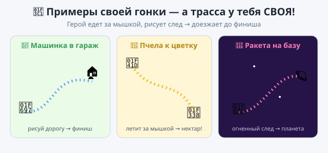

# 🎯 Практика — Урок 12: «Моя гоночная трасса»

> Практика — **не повтор урока**. На уроке жук ехал за мышкой к финишу. Теперь придумай **СВОЮ гонку или трассу** — другой герой, своя трасса, свои правила! Подсказки лёгкие (без «возьми этот блок»). 🏁

*Примерно что получится — но гонка у тебя СВОЯ!*

---

## 🌟 Твой вызов — своя гонка (не про жука!)

Выбери, КТО гонщик и какая трасса (или придумай своё):
- 🚗 **«Машинка едет за мышкой»** — ведёшь к гаражу-финишу, рисуя дорогу;
- 🐝 **«Пчела к цветку»** — летит за мышкой к цветку-финишу;
- 🚀 **«Ракета на базу»** — рисует огненный след, спешит к планете-финишу;
- 🎨 **«Трасса-художник»** — просто катайся и рисуй пером красивую трассу-узор (без финиша).

**Что должно получиться:** герой **едет за мышкой** (или по твоему маршруту), **оставляет след пером** и как-то **побеждает** (доехал до финиша → надпись «Финиш!»).

---

## 🧰 Что ты уже умеешь (вспомни и примени сам)

- **повернуться к указателю мыши** + **идти** — ехать за мышкой;
- **повернуть ↻/↺** и **направление** — развороты;
- **перо**: опустить / поднять / очистить / цвет — рисовать трассу;
- **если касается [Финиш]** — проверить, доехал ли;
- **остановить всё** — закончить гонку победой.

## 💡 Подсказки (лёгкие — не инструкция):
- Чтобы герой ехал за мышкой, ему нужен **цикл**, а внутри — «повернуться к мышке» и «идти».
- Чтобы **увидеть трассу**, не забудь в начале **опустить перо** (и «очистить»).
- Победу проверяй блоком-датчиком **«если касается …»** внутри цикла.
- Имя финиша в блоке «касается» должно **совпадать** с именем спрайта.

---

## ✅ Готово, если ты СМОГ (навыки, а не точные блоки):
- [ ] гонка **не про жука** — свой герой и трасса;
- [ ] герой **едет за мышкой** (или по маршруту);
- [ ] рисует **след-трассу** пером;
- [ ] есть **финиш** или красивая трасса-узор;
- [ ] проект сохранён (`.sb3`, своё имя).

## 🏆 Гран-при класса
Дай соседу проехать твою трассу — за сколько секунд доедет? Устройте **Гран-при**: чья трасса красивее и кто доедет быстрее? 🏁🏅

---

## 🧩 Полегче (если тема «плывёт»):
- Сделай только, чтобы герой **ехал за мышкой и рисовал след** (цикл: повернуться к мышке + идти + перо опущено). Финиш не обязателен — уже весело кататься! 🎉

## 🎓 Посложнее (кто хочет вызов):
- **Соперник-автопилот:** дублируй героя, у копии — «всегда [идти + если на краю оттолкнуться + повернуть случайно]». Гонка вдвоём!
- **Маршрут-головоломка:** НЕ веди мышкой, а **запрограммируй** путь («повторить [идти, повернуть]») так, чтобы герой сам доехал до финиша.
- **Цветная трасса:** меняй цвет пера по ходу — радужный след.
- **Старт по кругу:** нарисуй пером круг/восьмёрку как настоящую гоночную трассу.

> 📌 Будь готов рассказать, **что делает каждый твой скрипт**. Главное — сделал **по-своему**. Ошибся — **очистить** и заново (или **Ctrl+Z**).
