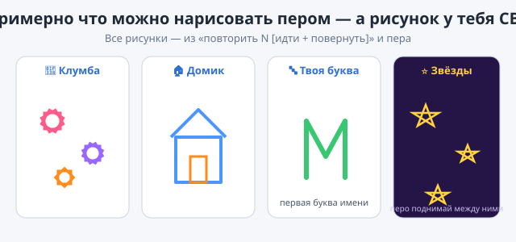

# ✏️ Практика — Урок 12: «Моя картина пером»

> 🎯 **Твоя миссия:** на уроке котик нарисовал квадрат. Теперь **нарисуй СВОЮ картину** пером! Выбери, что рисовать, какими фигурами и цветами. Это твоё творчество — одинаковых работ быть не должно!

*Примерно что можно сделать — но рисунок у каждого СВОЙ!*

---

## 🧰 Что ты уже умеешь (бери любые блоки)

- 🖊 перо: **опустить / поднять / очистить / цвет / размер / штамп**;
- 🔄 **повернуть ↻ … градусов**, **повернуться в направление**;
- 🔁 **повторить N раз** — рисовать фигуру;
- 📐 секрет: **угол = 360 ÷ число сторон**.

## 💡 Выбери, ЧТО нарисовать (или придумай своё)

- 🌸 **клумба** — несколько цветков (цветок = 12 × квадрат) разными цветами;
- 🏠 **домик** — квадрат + треугольная крыша;
- 🔤 **твоя буква** — нарисуй первую букву своего имени из линий и поворотов;
- ⭐ **звёздное небо** — звёзды (5 × 144°) в разных местах (поднимай перо между ними);
- 🌀 **волшебный узор** — спираль или цветок из фигур.

## 🛠 Твори ПО-СВОЕМУ (не копируй урок — пробуй!)

1. В начало поставь **очистить** → **опустить перо** → выбери **цвет** и **размер**.
2. Собери **свою фигуру** блоком «повторить N [идти + повернуть]». Вспомни: угол = 360 ÷ стороны.
3. Хочешь **несколько фигур**? Между ними **поднимай перо**, переходи в новое место, снова опускай. Меняй цвет!
4. Добавь **свою деталь**: штамп героя, другой размер пера, поворот всей картины.

> 💡 Не бойся экспериментировать с числами — именно так находят красивые узоры.

---

## ✅ Готово, если ты СМОГ (навыки, а не точные блоки):
- [ ] использовал **перо** (очистить → опустить → рисуй);
- [ ] нарисовал **хотя бы одну фигуру** через «повторить»;
- [ ] выбрал **свой цвет** (и, может, размер пера);
- [ ] придумал **свою картину** (не просто квадрат из урока);
- [ ] сохранил проект и картинку рисунка.

## 🏆 Мини-выставка
Сохрани рисунок картинкой (правый клик по сцене → «Сохранить картинку») и покажи классу. Устройте **галерею** — у кого какой узор получился? 🖼

---

## 🎯 А если хочется ещё (мини-челленджи):

1. **Радуга** — рисуй одну фигуру в цикле «повторить 6», каждый раз меняя цвет пера и поворачиваясь на 60°.
2. **Имя целиком** — нарисуй несколько букв, поднимая перо между ними.
3. **Рисовалка за мышкой** — сделай «волшебный карандаш» из доп-вау урока (всегда → перейти к указателю мыши, перо опущено).
4. **Симметрия** — нарисуй фигуру, потом «повернуть ↻ 180» и ещё раз — получится зеркальный узор.

> 💡 Главное — **своя** картина. Нет «неправильно»: это творчество! Ошибся — **очистить** и начни заново (или **Ctrl+Z**).
