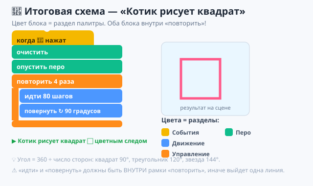
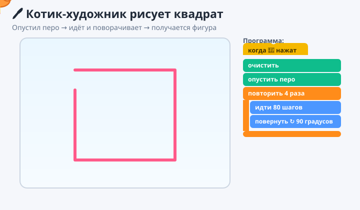

# ✏️ Практика — Урок 12: «Котик-художник»

> 🎯 **Твоя миссия:** включить перо и научить котика **рисовать**! Сначала простой след, потом — целый **квадрат** по программе. А кто справится быстро — нарисует треугольник, звезду и свой узор!

Работаем в **Scratch**. Напоминание: блоки берём из **палитры слева**, собираем в центре. Запуск — 🟢 флажок. Перед рисованием проверь, что выделен **котик**.

---

## Шаг 1. Подключи перо 🖊
Слева **в самом низу** → **«Добавить расширение»** 🧩 → **«Перо»**. Внизу палитры появится зелёная категория **Перо**.

## Шаг 2. Нарисуй простой след
1. 🟨 «События» → **«когда ▶ нажат»**.
2. 🖊 «Перо» → **«очистить»** (чистый лист).
3. 🖊 «Перо» → **«опустить перо»** (прижали карандаш).
4. 🟦 «Движение» → **«идти `100` шагов»**.
5. 🟢 флажок — за котиком **тянется линия!**

## Шаг 3. Сделай след цветным 🌈
🖊 «Перо» → **«установить цвет пера»** → кликни по цветному кружку, выбери любимый цвет. Запусти ещё раз.

## Шаг 4. ВАУ — нарисуй квадрат ⬜
Замени «идти 100» на блок-повтор:
1. 🟧 «Управление» → **«повторить `4`»**.
2. Внутрь рамки: 🟦 **«идти `80` шагов»**.
3. Внутрь, ниже: 🟦 **«повернуть ↻ `90` градусов»**.
4. 🟢 флажок — котик **рисует квадрат сам!**

---

## 🖼 Как должно получиться



*А вот как котик рисует (открой в браузере):*



**Текстом:**
```
когда ▶ нажат
очистить
опустить перо
повторить 4 раза
 ├ идти 80 шагов
 └ повернуть ↻ 90 градусов
```

---

## ✅ Готово, если:
- [ ] подключил расширение **Перо**;
- [ ] котик рисует **цветной след**;
- [ ] «идти» и «повернуть» стоят **внутри** «повторить 4»;
- [ ] получился **квадрат**;
- [ ] проект сохранён (`прогулка-художник.sb3`).

---

## 🎯 А попробуй (кто справился быстро):

1. **Треугольник** 🔺 — поставь «повторить `3`» и «повернуть ↻ `120`».
2. **Звезда** ⭐ — «повторить `5`» и «повернуть ↻ `144`».
3. **Радуга из фигур** — оберни всю программу ещё в «повторить `6`», а перед каждой фигурой меняй **цвет пера** и добавь «повернуть ↻ `60`» — получится цветок из квадратов!
4. **Подпись** — 🟦 «перейти в x:`0` y:`0`» в начале, чтобы рисунок всегда был по центру.
5. **Котик без следа** — вставь 🖊 «поднять перо», погуляй, потом снова «опустить» — будут линии «пунктиром».

> 💡 Если рисунок «уполз» за край — добавь в начало 🟦 «перейти в x:`0` y:`0`» и 🟦 «повернуться в направление `90`». А «очистить» в начале всегда даёт чистый лист. Сломать нельзя — есть **Ctrl+Z**!
