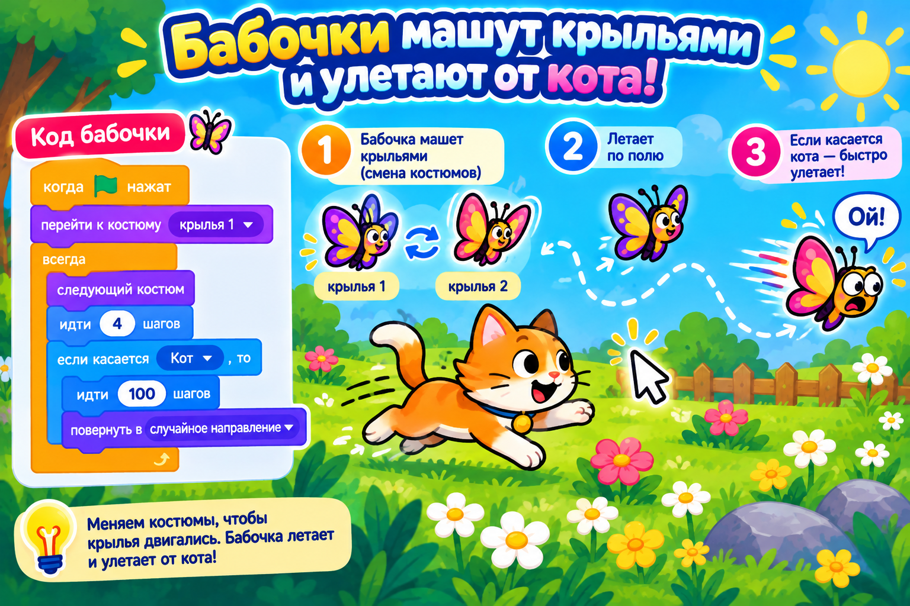

# Догоняем урок 13 (для тех, кто пропустил)

Привет! На этом уроке ребята оживили аквариум: рыбки плавали и махали плавниками, а акула кралась за мышкой. Ты всё догонишь за одно занятие, примерно за полтора часа. Сначала прочитай, что было, а потом оживишь свой мир — весёлую поляну с бабочками. Звук не нужен — реакции показываем надписями.

---

## Что было на уроке

Главное, что мы поняли: **анимация — это быстрая смена картинок**. Если показывать похожие картинки одну за другой, глаз видит движение. В мультиках такие картинки называют кадрами, а в Scratch — **костюмами**.

У каждого героя есть вкладка **«Костюмы»** (вверху слева). Там лежат его позы. Например, у рыбки один костюм — плавник вверх, другой — плавник вниз. Если быстро переключать их, рыбка будто машет.

Вот блоки, которые нам понадобились:

- **«следующий костюм»** — переключает героя на следующую позу;
- **«ждать»** — задаёт скорость смены. Маленькая пауза — быстрые взмахи, без паузы — вообще мельтешение;
- **«идти»** и **«если на краю, оттолкнуться»** — герой плывёт и отскакивает от стенок, а не упирается в них;
- **«способ вращения влево-вправо»** — чтобы при развороте герой не переворачивался вверх ногами;
- **«дублировать»** — быстрый способ сделать много одинаковых героев (целую стайку);
- для акулы — **«повернуться к указателю мыши»** и **«идти»**, чтобы она плыла туда, где мышка;
- ловля — блок-вопрос **«если касается»**: если акула коснулась рыбки, рыбка говорит «Ой!» и убегает в случайное место.

---

## Твой проект: «Весёлая поляна»



Оживишь поляну с бабочками — приёмы те же, что в аквариуме, только место другое.

### Шаг 1. Поставь бабочку и фон

Открой библиотеку героев и выбери **Butterfly** — у неё уже есть два костюма, крылья вверх и крылья вниз. Сцене выбери фон с небом или полянкой (например, Blue Sky). Котика из начала удали.

### Шаг 2. Бабочка летает и машет

Проверь, что выделена бабочка, и собери программу:

1. **«когда флажок нажат»** — старт.
2. **«способ вращения влево-вправо»** — чтобы бабочка не кувыркалась.
3. **«всегда»**, а внутрь:
   - **«идти 3 шага»** и **«если на краю, оттолкнуться»** — летит и отскакивает от краёв;
   - **«следующий костюм»** и **«ждать 0.15 секунды»** — машет крыльями.

Нажми флажок — бабочка летает по поляне и машет.

### Шаг 3. Сделай стайку

Нажми на бабочку правой кнопкой и выбери **«Дублировать»** два-три раза. Копии уже умеют летать — программа внутри них та же. Каждой можно поставить чуть разную паузу «ждать», чтобы махали вразнобой, как настоящие.

### Шаг 4. Добавь ловца (если хочешь)

Поставь кота и собери ему «всегда [повернуться к указателю мыши, идти 5 шагов]» — теперь ты водишь кота мышкой. А в программу бабочки добавь проверку: «если касается Кот → говорить Ой! → перейти в случайную позицию». Поймал бабочку — она упорхнула в другое место.

### Шаг 5. Сохрани

«Файл» → «Сохранить на компьютер», имя — `поляна`.

---

## Как это выглядит в сборе (программа бабочки)

```
когда флажок нажат
способ вращения влево-вправо
всегда
 ├ идти 3 шага
 ├ если на краю, оттолкнуться
 ├ следующий костюм
 └ ждать 0.15 сек
```

---

## Теперь ты знаешь то же, что и класс

- [ ] понимаю, что костюмы — это кадры, а анимация — их смена;
- [ ] собираю анимацию из «следующий костюм» и «ждать» в цикле;
- [ ] делаю стайку героев через «дублировать»;
- [ ] умею вести героя за мышкой и ловить касание;
- [ ] реакции показываю надписью и сохранил работу в файл.

Хочешь ещё красивее? Открой вкладку «Костюмы» и дорисуй бабочке третий костюм — например, крылья посередине. Тогда взмах станет плавнее, в три кадра вместо двух. Собрал не так — Ctrl+Z отменит.
