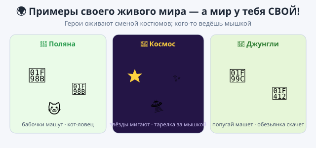

# Практика — урок 13

Вместе мы оживили аквариум костюмами. Теперь оживи что-то своё и попробуй костюмы по-разному. Три задания — делай по порядку или выбирай.

*Так это примерно выглядит — но мир у тебя свой.*

---

## Задание 1. Оживи одного героя

Возьми героя, у которого есть два костюма (например, птицу — крылья вверх и крылья вниз), и заставь его махать на месте.

Что сделать: собери цикл, в котором герой переключает костюм и чуть-чуть ждёт. Будет казаться, что он живой.

*Подсказка:* это два блока в «всегда» — «следующий костюм» и «ждать». Паузой задаёшь скорость: «ждать 0.2» — быстрые взмахи, «ждать 1» — медленные. Подбери, как нравится.

## Задание 2. Нарисуй второй кадр

Помнишь, в 3D-мастерской (BlockBench) твоя модель оживала по кадрам? Здесь то же самое, только кадры — это костюмы. Возьми героя с одним костюмом и сделай из него анимацию из двух кадров.

Что сделать: открой вкладку «Костюмы», скопируй костюм и на копии чуть измени героя — открой ему рот, подними лапу или моргни. Теперь переключай эти два костюма в цикле — герой «задвигается».

*Подсказка:* костюм копируют так — правой кнопкой по костюму → «Дублировать», потом рисуешь поверх.

## Задание 3. Свой живой мир

Оживи любое место: лес 🦋, космос 🚀, джунгли 🦜. Сделай одного героя, который сам двигается и машет, размножь его в стайку, а одного пусть можно вести мышкой — как акулу на уроке.

Что сделать: собери одного героя полностью, потом размножь его и добавь героя-«мышку».

*Подсказка:* чтобы быстро получить стайку, сделай одного идеально и нажми правой кнопкой → «Дублировать» — у копий программа уже будет внутри. Героя, которого ведёшь мышкой, собирай из «повернуться к указателю мыши» и «идти» в цикле.

---

**Если получилось быстро:**
- сделай охоту: герой-хищник плывёт за мышкой, а добыча при касании убегает в случайное место;
- дорисуй третий костюм — движение станет плавнее;
- пусть по нажатию клавиши наступает «ночь» — фон темнеет или герои меняют костюм.

**Если трудно:** хватит одного героя, который плывёт и машет крыльями. Это уже живой мир.

**Готово, когда:**
- [ ] в мире есть герой, который машет или шагает костюмами;
- [ ] хотя бы один герой двигается сам;
- [ ] одного героя можно вести мышкой;
- [ ] проект сохранён (`.sb3`, своё имя).

Покажи свой живой мир классу — пусть поводят героя мышкой.
