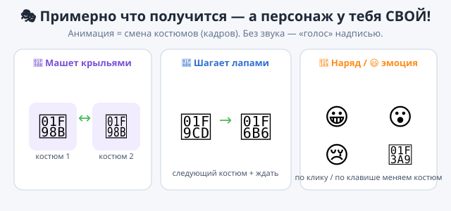

# ✏️ Практика — Урок 13: «Мой анимированный персонаж»

> 🎯 **Твоя миссия:** на уроке мы оживляли котика костюмами. Теперь придумай **СВОЕГО персонажа** и оживи его: пусть **двигается со сменой костюмов** и умеет что-то менять (наряд или настроение) — на твой выбор. Всё без звука: «голос» — надписью. У каждого персонаж СВОЙ!

*Примерно что получится — но персонаж и его трюки у тебя СВОИ!*

---

## 🧰 Что ты уже умеешь (бери любые блоки)

- 👗 вкладка **«Костюмы»**, **дублировать** и **рисовать** костюм;
- 🟪 **«следующий костюм»** — смена кадра (анимация);
- 🟧 **«ждать …»** — скорость анимации;
- 🟨 запуск по **флажку / клавише / клику**;
- 🟦 **«идти»**, **«если на краю, оттолкнуться»**;
- 🟪 **«говорить …»** — надпись-облачко (без звука).

## 💡 Выбери СВОЕГО персонажа и трюк (или придумай)

- 🦋 **бабочка/птичка** — машет крыльями (2 костюма) и летает;
- 🚦 **светофор** — меняет костюм-цвет (красный→жёлтый→зелёный) по клику;
- 🤖 **робот-танцор** — перебирает «ногами» и пританцовывает;
- 🎭 **лицо-настроение** — по клику меняет эмоцию (😀😮😢);
- 👗 **модник** — по пробелу меняет наряды.

## 🛠 Собери ПО-СВОЕМУ (не копируй урок — твори!)

1. **Выбери спрайт** (или нарисуй/дублируй костюмы сам).
2. **Оживи анимацию:** «всегда [ … + следующий костюм + ждать 0.2 ]» — сам реши, **машет, шагает или танцует**.
3. **Добавь свою «суперспособность»** на выбор: смену наряда по клавише ИЛИ смену эмоции по клику ИЛИ «говорить» фразу.
4. **Укрась:** фон, скорость «ждать», ещё один костюм для плавности.

> 💡 Чем больше костюмов — тем плавнее анимация. Дублируй и чуть меняй позу.

---

## ✅ Готово, если ты СМОГ (навыки, а не точные блоки):
- [ ] выбрал/сделал **своего** персонажа с **несколькими костюмами**;
- [ ] персонаж **анимирован** (следующий костюм + ждать) — двигается/машет/танцует;
- [ ] добавил **свой трюк** (наряд по клавише, эмоция по клику или фраза-надпись);
- [ ] придумал **своё**, а не повторил котика с урока;
- [ ] сохранил проект (`.sb3`, своё имя).

## 🏆 Показ мод / мультик
Запусти персонажа и покажи соседу: пусть нажмёт клавишу/щёлкнет — увидит твой трюк. Устройте **парад персонажей**! 🎉

---

## 🎯 А если хочется ещё (мини-челленджи):

1. **Три кадра** — дорисуй третий костюм, анимация станет плавнее.
2. **Прыжок** — по стрелке ↑ персонаж подпрыгивает (изменить y вверх, ждать, вниз).
3. **Хамелеон** — костюмы разных цветов, меняются по пробелу.
4. **Диалог** — два персонажа «говорят» по очереди надписями.

> 💡 Главное — **свой** персонаж и **свои** идеи. Нет «неправильно»: это твой мультик! Ошибся — **Ctrl+Z**.
