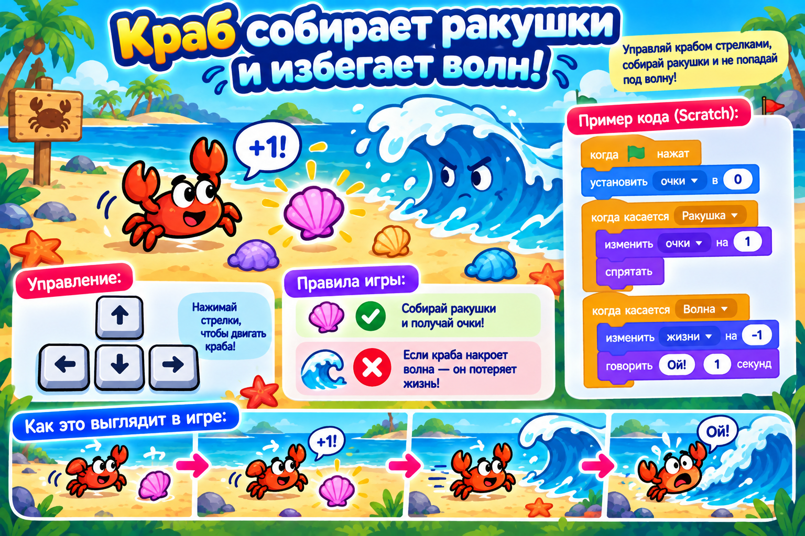

# Догоняем урок 14 (для тех, кто пропустил)

Привет! На этом уроке ребята собрали игру «Собери звёзды»: ракета слушалась стрелок на клавиатуре, игрок собирал звёзды и уворачивался от шипа. Ты всё догонишь за одно занятие, примерно за полтора часа. Сначала прочитай, что было, а потом соберёшь свою игру — «Краб и ракушки». Звук не нужен — очки и промахи показываем надписями.

---

## Что было на уроке

Новое и главное: теперь героем **управляет сам игрок** — с клавиатуры, стрелками.

Чтобы герой ехал в нужную сторону, сцена в Scratch размечена как лист в клеточку. Положение героя задают два числа:

- **x** — насколько он правее или левее центра (вправо — плюс, влево — минус);
- **y** — насколько выше или ниже центра (вверх — плюс, вниз — минус).

А вот блоки, которые мы использовали:

- **«когда клавиша [стрелка] нажата»** — срабатывает, когда игрок жмёт эту стрелку. Таких программ четыре — по одной на каждую сторону.
- **«изменить x на 10»** и **«изменить y на 10»** — сдвигают героя. Число со знаком минус двигает в обратную сторону.
- **«перейти в случайную позицию»** и **«ждать»** — делают добычу непоседой: звезда то и дело прыгает на новое место.
- блок-вопрос **«если касается [герой]»** — проверяет, собрал ли игрок добычу или налетел ли на опасность;
- **«говорить»** — показывает «+1!» или «Ой!» без звука;
- **«перейти в x: 0 y: 0»** — возвращает героя точно в центр сцены.

Правило игры простое: хорошее собираем, плохого избегаем.

---

## Твоя игра: «Краб и ракушки»



Соберёшь игру с управлением, только героем будет краб, а добычей — ракушки.

### Шаг 1. Поставь героя и фон

Открой библиотеку героев и выбери **Crab** — это краб. Сцене выбери фон с пляжем или морским дном. Котика из начала удали.

### Шаг 2. Научи краба ездить (четыре программы)

Проверь, что выделен краб, и собери четыре коротких программы — по одной на стрелку:

- **«когда стрелка вверх нажата»** → **«изменить y на 10»**;
- **«когда стрелка вниз нажата»** → **«изменить y на −10»**;
- **«когда стрелка вправо нажата»** → **«изменить x на 10»**;
- **«когда стрелка влево нажата»** → **«изменить x на −10»**.

Нажимай стрелки — краб ездит во все стороны. Если едет не туда, проверь знак числа: минус — это назад.

### Шаг 3. Ракушка-добыча

Поставь героя **Shell** (ракушка). Собери ей две программы. Первая — она прыгает: «когда флажок нажат → всегда [перейти в случайную позицию, ждать 2 секунды]». Вторая — её ловят: «всегда [если касается Crab → говорить +1! 0.3 секунды → перейти в случайную позицию]». Поймал — ракушка тут же появляется в новом месте.

### Шаг 4. Опасность-волна (если хочешь)

Поставь героя-волну. Пусть она гуляет: «всегда [перейти в случайную позицию, ждать 3 секунды]». А крабу добавь проверку: «всегда [если касается волна → говорить Ой! → перейти в x: 0 y: 0]». Налетел на волну — краба отбросило в центр.

### Шаг 5. Сохрани

«Файл» → «Сохранить на компьютер», имя — `краб-ракушки`.

---

## Как это выглядит в сборе (управление)

```
когда стрелка вверх нажата   → изменить y на 10
когда стрелка вниз нажата    → изменить y на −10
когда стрелка вправо нажата  → изменить x на 10
когда стрелка влево нажата   → изменить x на −10
```

---

## Теперь ты знаешь то же, что и класс

- [ ] умею делать управление стрелками (четыре программы);
- [ ] понимаю, что x — это влево-вправо, а y — вверх-вниз;
- [ ] делаю добычу-непоседу и ловлю её блоком «если касается»;
- [ ] умею добавить опасность и возврат в центр;
- [ ] реакции показываю надписью и сохранил работу в файл.

Хочешь ещё красивее? Сделай так, чтобы ракушка при поимке меняла костюм на другой цвет — добавь ей «следующий костюм» рядом с «+1!». Собрал не так — Ctrl+Z отменит.
