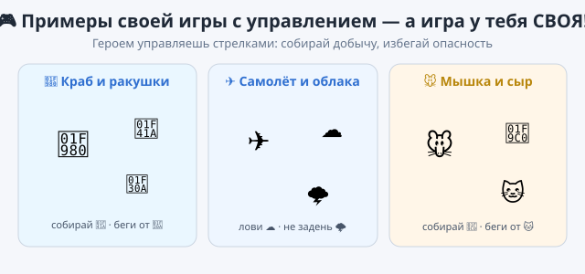

# Практика — урок 14

На уроке ракета летала по стрелкам и собирала звёзды. Теперь собери управление по-своему и вспомни пару приёмов с прошлых уроков. Три задания — делай по порядку или выбирай.

*Так это примерно выглядит — но игра у тебя своя.*

---

## Задание 1. Герой ходит во все стороны

Возьми любого героя (не ракету) и научи его ездить стрелками — вверх, вниз, влево и вправо.

Что сделать: собери четыре маленьких скрипта — по одному на каждую стрелку. Запусти и проверь: герой слушается всех четырёх кнопок.

*Подсказка:* вверх и вниз — это блок «изменить y», влево и вправо — «изменить x». Чтобы ехать назад, ставь число со знаком минус (например, −10).

## Задание 2. Добыча-непоседа

Вспомни урок 11 — там кот сам прыгал по случайным местам. Сделай так же добычу: монетку или звезду, которая прыгает по экрану. Поймал её героем — она говорит «+1!» и прыгает дальше.

Что сделать: добыче дай скрипт, где она всё время телепортируется с паузой, и проверку — если её коснулся герой, она прыгает на новое место.

*Подсказка:* телепорт — это «перейти в случайную позицию» и «ждать» в цикле. Поимку лови блоком «если касается [твой герой]».

## Задание 3. Своя игра с опасностью

Собери игру, где герой собирает добычу стрелками, но от одной вещи надо убегать — шип 🔺, враг или волна 🌊. Коснулся опасного — герой возвращается в центр и говорит «Ой!».

Что сделать: добавь спрайт-опасность и проверку касания у героя.

*Подсказка:* опасность проверяется таким же блоком «если касается», только вместо очка герой делает «перейти в x:0 y:0» — это и есть центр сцены.

---

**Если получилось быстро:**
- сделай плавное управление: один скрипт «всегда [если клавиша нажата — изменить x/y]», тогда герой едет, пока держишь кнопку;
- добавь вторую опасность в другом углу;
- сделай бонус: редкая золотая добыча даёт не одно очко, а сразу делает героя больше на секунду.

**Если трудно:** оставь только управление (4 стрелки) и одну добычу, которая прыгает и ловится. Этого хватает, чтобы играть.

**Готово, когда:**
- [ ] героем можно управлять стрелками во все стороны;
- [ ] есть добыча, которая появляется и ловится;
- [ ] в игре есть то, чего не было на уроке (своя добыча, своя опасность или бонус);
- [ ] проект сохранён (`.sb3`, своё имя).

Дай соседу поиграть 20 секунд — сколько соберёт?
