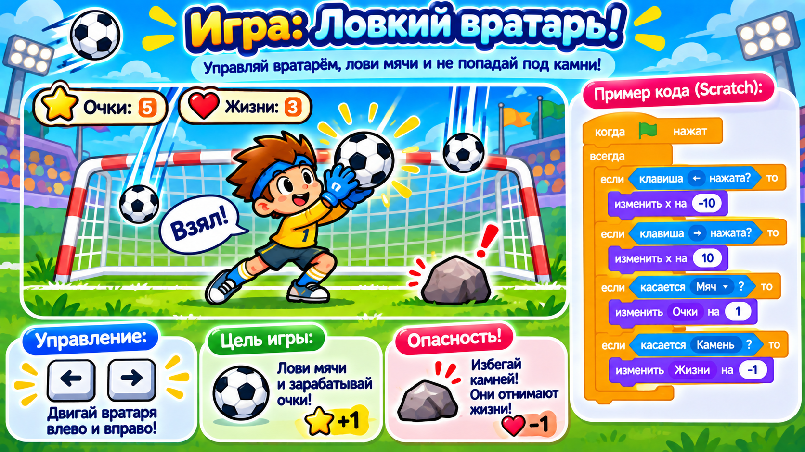

# Догоняем урок 15 (для тех, кто пропустил)

Привет! На этом уроке ребята собрали классическую аркаду «Лови яблоки»: с неба сыплются яблоки, игрок ловит их корзиной, а за промах теряет жизнь. И собрали её по-взрослому — через **клоны**. Ты всё догонишь за одно занятие, примерно за полтора часа. Сначала прочитай, что было, а потом соберёшь свою игру — «Вратарь». Звук не нужен — что поймал, что пропустил, герой скажет надписью.

---

## Что было на уроке

Самое важное новое слово урока — **клон**. Клон это живая копия спрайта. Представь штамп: прикладываешь один раз — получаешь оттиск, ещё раз — ещё оттиск. Так и спрайт: командой **«создать клон себя»** он делает свою копию, и копий можно наделать сколько угодно. Поэтому на сцене падают десятки яблок, хотя спрайт-яблоко всего один.

С клонами работают три блока (все в разделе «Управление»):

- **«создать клон себя»** — делает новую копию;
- **«когда я начинаю как клон»** — это особая шапочка: она говорит копии, что ей делать, как только она появилась на свет;
- **«удалить этот клон»** — убирает копию, когда она больше не нужна. Это важно: если клоны не удалять, их станет сотни и игра начнёт тормозить.

А ещё на уроке были два знакомых помощника. **«если … иначе»** — развилка с двумя дорожками: если условие верно, идём по одной, если нет — по другой. И **переменная «жизни»** — коробочка с числом: положили туда 3, при промахе уменьшаем на единицу, стало 0 — игра закончилась.

Вот как всё собиралось. У яблока было ДВЕ программы:

- **яблоко-завод:** «когда флажок → задать жизни 3 → скрыться → всегда [создать клон, подождать секунду]». Сам спрайт прячется, а в небе появляются его клоны.
- **жизнь клона:** «когда я начинаю как клон → показаться → встать наверху в случайном месте → всегда [падать вниз; если поймали корзиной — Ням! и удалить этот клон, иначе если упал совсем низко — минус жизнь и удалить этот клон; если жизни 0 — остановить всё]».

---

## Твоя игра: «Вратарь»



Соберёшь ту же игру, только вместо корзины у тебя будет вратарь, а вместо яблок — мячи. И мячей будет много — это клоны одного мяча.

### Шаг 1. Поставь вратаря и мяч

Открой библиотеку героев. Выбери **Goalie** (вратарь) или любого человечка — поставь его внизу сцены. Потом добавь героя **Soccer Ball** (мяч). Сцене выбери фон с футбольным полем. Котика из начала удали.

### Шаг 2. Научи вратаря ездить вбок

Выдели вратаря и собери две коротких программы:

- «когда стрелка вправо нажата» → «изменить x на 20»;
- «когда стрелка влево нажата» → «изменить x на −20».

Теперь вратарь двигается по воротам влево-вправо.

### Шаг 3. Заведи жизни

Слева внизу в разделе «Переменные» нажми «Создать переменную» и назови её **жизни**. Поставь рядом галочку — тогда счётчик будет виден на сцене.

### Шаг 4. Мяч-завод (делает клоны)

Выдели мяч и собери ему первую программу — она будет штамповать мячи:

1. «когда флажок нажат».
2. «задать жизни = 3».
3. «скрыться» — сам мяч прячется, видны будут только клоны.
4. «всегда», а внутрь: «создать клон себя» и «ждать 1 секунду».

### Шаг 5. Что делает каждый мяч-клон

Собери вторую программу — на шапочке «когда я начинаю как клон»:

1. «показаться».
2. «перейти наверх» — вверху, в случайном месте по ширине (x — случайное число, y — высоко, около 170).
3. «всегда», а внутрь:
   - «изменить y на −6» — мяч летит вниз;
   - «если касается Goalie, иначе» — развилка:
     - поймал: «говорить Взял! 0.2 секунды» и «удалить этот клон»;
     - иначе: если мяч улетел за нижний край (y меньше −160) — «говорить Гол! 0.2 секунды», «изменить жизни на −1» и «удалить этот клон»;
   - «если жизни = 0 — остановить всё».

Нажми флажок — мячи сыплются сверху по одному, а ты ловишь их вратарём.

### Шаг 6. Сохрани

«Файл» → «Сохранить на компьютер», имя — `вратарь`.

---

## Как это выглядит в сборе

```
МЯЧ-ЗАВОД                         ЖИЗНЬ КЛОНА
когда флажок нажат                когда я начинаю как клон
задать жизни = 3                  показаться · перейти наверх
скрыться                          всегда
всегда                             ├ изменить y на −6
 ├ создать клон себя               ├ если касается [Goalie]
 └ ждать 1 сек                     │    └ Взял! · удалить этот клон
                                   │  иначе
                                   │    └ если y<−160 → Гол! · жизни −1 · удалить клон
                                   └ если жизни = 0 → остановить всё
```

---

## Теперь ты знаешь то же, что и класс

- [ ] понимаю, что клон — это живая копия спрайта;
- [ ] умею делать поток объектов через «создать клон себя» и «ждать»;
- [ ] не забываю «удалить этот клон», чтобы клоны не копились;
- [ ] понимаю развилку «если … иначе» и веду счётчик жизней;
- [ ] реакции показываю надписью и сохранил работу в файл.

Хочешь ещё интереснее? Добавь второй спрайт — камень, у которого тоже есть завод клонов. Камни ловить нельзя: поймал камень — минус жизнь. Теперь надо не ловить всё подряд, а выбирать. Собрал не так — Ctrl+Z отменит.
