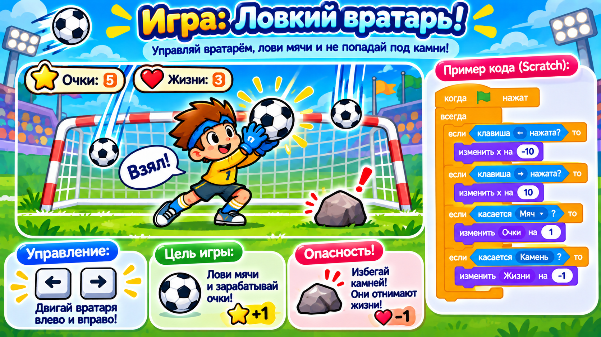

# Догоняем урок 15 (для тех, кто пропустил)

Привет! На этом уроке ребята собрали классическую аркаду «Лови яблоки»: с неба падают яблоки, игрок ловит их корзиной, а за промах теряет жизнь. Ты всё догонишь за одно занятие, примерно за полтора часа. Сначала прочитай, что было, а потом соберёшь свою игру — «Вратарь». Звук не нужен — что поймал, что пропустил, герой скажет надписью.

---

## Что было на уроке

Самое важное новое на уроке — программа научилась **сама принимать решение**. Для этого есть блок **«если … иначе»**. У него две дорожки: если условие выполнилось — идём по верхней, если нет — по нижней. Это как развилка на тропинке.

Ещё мы впервые завели **переменную**. Переменная — это коробочка с именем, в которой лежит число. Мы сделали коробочку «жизни» и положили в неё 3. Когда игрок промахивался, число в коробочке уменьшалось на единицу. Когда стало 0 — игра закончилась. (Подробно переменные будут на уроке 17, тут просто попробуем.)

Вот как это собиралось:

- **«изменить y на −5»** в цикле «всегда» — яблоко падает вниз;
- после поимки или падения — **«перейти наверх»** в случайное место, чтобы падало снова;
- **«если касается корзины»** на верхней дорожке — поймал: сказать «Ням!» и запустить новое яблоко;
- **иначе** — проверить, не улетело ли яблоко совсем вниз (ниже края): если да — сказать «Эх!» и убавить жизнь на 1;
- **«если жизни = 0, то остановить всё»** — конец игры.

Правило игры: лови хорошее, пропускай плохое. Гнилые яблоки ловить нельзя.

---

## Твоя игра: «Вратарь»



Соберёшь ту же игру, только вместо корзины у тебя будет вратарь, а вместо яблок — мячи.

### Шаг 1. Поставь вратаря и мяч

Открой библиотеку героев. Выбери **Goalie** (вратарь) или любого человечка — поставь его внизу сцены. Потом добавь героя **Soccer Ball** (мяч). Сцене выбери фон с футбольным полем. Котика из начала удали.

### Шаг 2. Научи вратаря ездить вбок

Выдели вратаря и собери две коротких программы:

- **«когда стрелка вправо нажата»** → **«изменить x на 20»**;
- **«когда стрелка влево нажата»** → **«изменить x на −20»**.

Теперь вратарь двигается по воротам влево-вправо.

### Шаг 3. Заведи жизни

Слева внизу в разделе «Переменные» нажми «Создать переменную» и назови её **жизни**. Поставь рядом галочку — тогда счётчик будет виден на сцене.

### Шаг 4. Мяч летит и ловится

Выдели мяч и собери ему программу:

1. **«когда флажок нажат»**.
2. **«задать жизни = 3»** — кладём в коробочку тройку.
3. **«перейти наверх»** — поставь мяч вверху, в случайном месте по ширине (x — случайное число, y — высоко, около 170).
4. **«всегда»**, а внутрь:
   - **«изменить y на −6»** — мяч летит вниз;
   - **«если касается Goalie, иначе»** — развилка:
     - поймал (верхняя дорожка): **«говорить Взял! 0.2 секунды»** и снова наверх;
     - иначе (нижняя дорожка): проверь, не улетел ли мяч за нижний край (y меньше −160). Если да — **«говорить Гол! 0.2 секунды»**, **«изменить жизни на −1»** и наверх;
   - **«если жизни = 0, то говорить Матч окончен! 2 секунды и остановить всё»**.

### Шаг 5. Сохрани

«Файл» → «Сохранить на компьютер», имя — `вратарь`.

---

## Как это выглядит в сборе (сердце программы мяча)

```
всегда
 ├ изменить y на −6
 ├ если касается [Goalie]
 │    └ говорить [Взял!] · перейти наверх
 │  иначе
 │    └ если (y меньше −160) → Гол! · изменить жизни на −1 · наверх
 └ если (жизни = 0) → остановить всё
```

---

## Теперь ты знаешь то же, что и класс

- [ ] умею делать падение (изменить y на минус в цикле);
- [ ] понимаю развилку «если … иначе» (поймал или пропустил);
- [ ] проверяю поимку блоком «если касается»;
- [ ] веду счётчик жизней в переменной и заканчиваю игру при нуле;
- [ ] реакции показываю надписью и сохранил работу в файл.

Хочешь ещё интереснее? Добавь камень, который ловить нельзя: пусть иногда вместо мяча летит камень, и если вратарь его поймал — тоже минус жизнь. Теперь надо не просто ловить всё подряд, а выбирать. Собрал не так — Ctrl+Z отменит.
