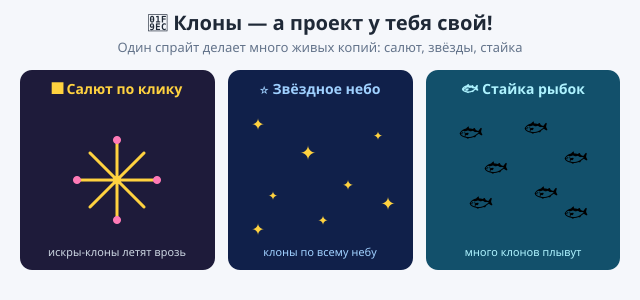

# Практика — урок 15

На уроке яблоко делало клоны, и они падали вниз. Но клоны умеют куда больше, чем падать! В практике ты применишь клоны **по-другому** — не для ловилки. Три задания: делай по порядку или выбирай.

*Так это примерно выглядит — но проект у тебя свой.*

---

## Задание 1. Салют по клику

Сделай так, чтобы при клике по спрайту из него в разные стороны разлетались искры — как настоящий салют. Искры — это клоны.

Что сделать: по клику создай сразу много клонов, а каждый клон пусть повернётся в случайную сторону, немного пролетит вперёд и исчезнет.

*Подсказка:* «когда этот спрайт нажат → повторить 12 [создать клон себя]». А на шапочке «когда я начинаю как клон» поставь «повернуться в случайном направлении», потом «повторить 15 [идти 10 шагов]» и в конце «удалить этот клон».

## Задание 2. Своё звёздное небо

Сделай фон, который сам наполняется звёздами (или снежинками). Звёзды — клоны одного спрайта, разбросанные по всему экрану.

Что сделать: пусть спрайт-звезда появляется клонами в случайных местах, пока небо не заполнится. Можешь нарисовать звезду сам или взять пиксельную из Piskel и загрузить её спрайтом.

*Подсказка:* «повторить 25 [создать клон себя, ждать 0.1]», а клон делает «перейти в случайную позицию» и «показаться». Хочешь живее — добавь клону «установить размер (случайное 30..100)», чтобы звёзды были разного размера.

## Задание 3. Свой проект на клонах

Придумай, где ещё пригодятся клоны: стайка рыбок 🐟, пузырьки, которые поднимаются вверх, дождь ☔, рой бабочек. Собери свою маленькую сцену, где из одного спрайта получается много живых копий.

Что сделать: выбери героя, настрой завод клонов и реши, что каждый клон делает — плывёт, всплывает или кружит.

*Подсказка:* всё строится из трёх блоков — «создать клон себя» (завод), «когда я начинаю как клон» (что делает копия) и «удалить этот клон» (когда она больше не нужна).

---

**Если получилось быстро:**
- добавь клонам немного случайности — разный размер, цвет или скорость, тогда они не будут как близнецы;
- сделай, чтобы клоны появлялись не сразу, а по одному — зрелище красивее;
- соедини с прошлым уроком: пусть героя, который уворачивается от клонов-камней, ты ведёшь стрелками.

**Если трудно:** сделай только одно — спрайт по флажку создаёт 10 клонов, и каждый уходит в случайное место. Этого хватает, чтобы увидеть, как работает клон.

**Готово, когда:**
- [ ] из одного спрайта получается много клонов;
- [ ] каждый клон что-то делает сам (летит, всплывает, кружит);
- [ ] клоны исчезают, когда больше не нужны (не копятся без конца);
- [ ] проект сохранён (`.sb3`, своё имя).

Покажи соседу: нажми кнопку и пусть увидит, как из одного героя рождается целый рой.
