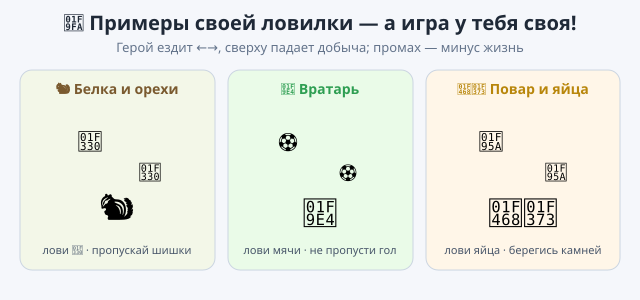

# Практика — урок 15

На уроке корзина ловила падающие яблоки, а за промах мы теряли жизнь. Теперь сделай свою ловилку и попробуй то, чему научился сегодня и раньше. Три задания — делай по порядку или выбирай.

*Так это примерно выглядит — но игра у тебя своя.*

---

## Задание 1. Своя корзина, свой урожай

Придумай, кто ловит и что падает: белка и орехи 🌰, повар и яйца 🥚, зонтик и капли ☔. Герой ездит ←→, добыча падает сверху, поймал — радость и добыча улетает наверх заново.

Что сделать: собери скрипт падения у добычи и управление ←→ у ловца. Поймал — верни добычу наверх в случайное место, чтобы падала снова.

*Подсказка:* падение — это «изменить y на −5» в цикле «всегда». Поимку лови блоком «если касается [ловец]».

## Задание 2. Герой, которого ты нарисовал сам

Помнишь пиксельного героя, которого ты рисовал в Piskel и сохранял в файл `.png`? Загрузи его прямо в игру и сделай ловцом — это круче, чем брать героя из библиотеки.

Что сделать: в меню спрайтов наведись на кнопку добавления и выбери «Загрузить спрайт», потом найди свой файл. Если файла под рукой нет — нарисуй нового героя в редакторе костюмов.

*Подсказка:* чтобы герой не был слишком большим, добавь ему в начало блок «установить размер 60%».

## Задание 3. Хорошее и плохое

Пусть сверху падает и хорошее, и плохое: спелое яблоко — радость, а гнилое или промах — минус жизнь. Жизни кончились — на экране «Игра окончена!».

Что сделать: добавь выбор «поймал хорошее или нет» и счётчик жизней. Когда жизней не осталось — останови игру.

*Подсказка:* выбор делает блок «если … иначе» — у него две части, как две дорожки. Жизни — это переменная: создай её, задай в начале 3, при промахе делай «изменить жизни на −1», а когда станет 0 — «остановить всё».

---

**Если получилось быстро:**
- заведи вторую переменную «очки» и прибавляй по одному за каждую поимку — покажи счёт на сцене;
- сделай два вида добычи: обычная даёт одно очко, золотая — сразу три;
- пусть добыча с каждым разом падает чуть быстрее — игра будет разгоняться.

**Если трудно:** сделай только корзину, которая ездит ←→ и ловит падающую добычу («если касается — наверх»). Жизни и «плохое» добавишь потом.

**Готово, когда:**
- [ ] ловец ездит стрелками, добыча падает и ловится;
- [ ] в игре есть то, чего не было на уроке (свой герой из Piskel, или выбор «хорошее-плохое», или счёт);
- [ ] проект сохранён (`.sb3`, своё имя).

Дай соседу поиграть — сколько поймает, пока не кончатся жизни?
