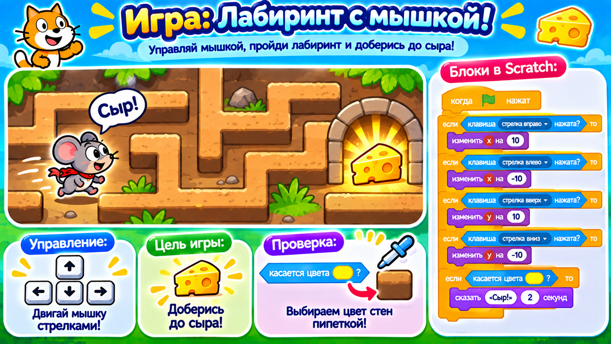

# Догоняем урок 16 (для тех, кто пропустил)

Привет! На этом уроке ребята построили игру-лабиринт: сами нарисовали фон со стенами, провели героя стрелками к выходу, а если он задевал стену — его отбрасывало в начало. Ты всё догонишь за одно занятие, примерно за полтора часа. Сначала прочитай, что было, а потом соберёшь свой лабиринт — «Мышка к сыру». Звук не нужен — реакции показываем надписями.

---

## Что было на уроке

Два новых умения на этом уроке.

Первое — **рисовать свой фон**. Раньше мы брали готовые фоны, а тут стены лабиринта нарисовали сами. Фон сцены редактируется так же, как костюм героя: кистью, нужным цветом. Главное — рисовать стены одним цветом и оставлять между ними дорожку, чтобы герой прошёл.

Второе — блок-вопрос **«касается цвета?»**. Раньше мы проверяли касание героя с другим героем. А теперь проверяем, коснулся ли герой **определённого цвета** на сцене. Это удобно: стена — это просто цвет, и нам не нужен отдельный спрайт-стена. Цвет в этом блоке надо выбрать **пипеткой** — навести её прямо на стену, чтобы Scratch взял точно тот же оттенок.

Вот из чего собиралась игра:

- герой ездит стрелками (четыре программы с «изменить x» и «изменить y»);
- **«если касается цвета стены, то перейти в x:(старт) y:(старт)»** — задел стену, вернулся в начало;
- **«если касается цвета выхода, то Победа! и остановить всё»** — дошёл до выхода;
- **«следующий фон»** — так делается новый уровень: лабиринт потруднее это просто другой фон.

Главная мысль: игра узнаёт стены и выход по цвету, а уровни — это разные фоны.

---

## Твоя игра: «Мышка к сыру»



Соберёшь свой лабиринт, только героем будет мышка, а выходом — сыр.

### Шаг 1. Нарисуй норы

Нажми на картинку сцены справа и открой вкладку «Фоны». Кистью нарисуй **коричневые стены** — норы лабиринта, оставляя между ними дорожку. В конце пути нарисуй **жёлтое пятно** — это будет сыр, то есть выход.

### Шаг 2. Поставь мышку

Открой библиотеку героев и выбери **Mouse1** (мышка). Сделай её поменьше, чтобы пролезала в коридоры (ей пригодится блок «установить размер 40%»), и поставь в начало лабиринта. Котика из начала удали.

### Шаг 3. Научи мышку ездить

Собери четыре коротких программы — по одной на стрелку:

- вверх → «изменить y на 8»; вниз → «изменить y на −8»;
- вправо → «изменить x на 8»; влево → «изменить x на −8».

### Шаг 4. Стены и сыр

Выдели мышку и собери ей главную программу:

1. **«когда флажок нажат»** → **«перейти в x:(старт) y:(старт)»** (поставь мышку в начало и возьми эти числа).
2. **«всегда»**, а внутрь:
   - **«если касается цвета коричневый, то говорить Ой! и перейти в x:(старт) y:(старт)»** — задела стену, вернулась в начало. Цвет возьми пипеткой прямо со стены.
   - **«если касается цвета жёлтый, то говорить Сыр! 2 секунды и остановить всё»** — добралась до сыра, победа. Цвет возьми пипеткой с сыра.

### Шаг 5. Сохрани

«Файл» → «Сохранить на компьютер», имя — `мышка-лабиринт`.

---

## Как это выглядит в сборе (сердце программы мышки)

```
когда флажок нажат → перейти в x:(старт) y:(старт)
всегда
 ├ если касается цвета (коричневый) → Ой! · в начало
 └ если касается цвета (жёлтый)    → Сыр! · остановить всё
```

---

## Теперь ты знаешь то же, что и класс

- [ ] умею рисовать свой фон и стены цветом;
- [ ] понимаю блок «касается цвета?» и беру цвет пипеткой;
- [ ] возвращаю героя на старт блоком «перейти в x: y:»;
- [ ] делаю выход и победу;
- [ ] понимаю, что уровни — это разные фоны, и сохранил работу в файл.

Хочешь ещё интереснее? Спрячь в лабиринте маленький кусочек сыра-бонус: как только мышка его коснётся, он говорит «Ням!» и прячется (блок «скрыться»). Можно насобирать по дороге несколько бонусов. Собрал не так — Ctrl+Z отменит.
