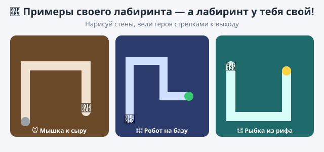

# 🎯 Практика — Урок 16: «Мой лабиринт»

> На уроке мы прошли лабиринт вместе. Теперь нарисуй и собери **свой** — со своими стенами, своим героем и своей темой. Пошаговой инструкции не будет: вспоминай, что умеешь, и твори. 🧩

*Примерно что получится — но лабиринт у тебя свой!*

---

## 🌟 Твой вызов — свой лабиринт

Придумай тему (или возьми свою):
- 🐭 **«Мышка к сыру»** — проведи мышку через норы к сыру 🧀;
- 🤖 **«Робот на базу»** — доберись до зелёной базы, не задев провода;
- 🐠 **«Рыбка из рифа»** — выплыви из кораллового лабиринта к выходу;
- 👻 **«Побег из замка»** — проведи героя к двери, минуя стены.

**Что должно получиться:** свой **нарисованный лабиринт** (стены цветом), герой ездит **стрелками**, задел стену — назад в начало, дошёл до выхода — «Победа!». А если успеешь — **два уровня**.

---

## 🧰 Что ты уже умеешь (вспомни и примени сам)

- рисовать **фон** в редакторе сцены (стены — кистью, одним цветом);
- управлять героем **стрелками** (изменить x/y);
- **«касается цвета …?»** — узнать стену/выход по цвету;
- **«перейти в x: y:»** — вернуть героя на старт;
- **«следующий фон»** — новый уровень; **«остановить всё»** — конец.

## 💡 Если застрял — вот куда посмотреть:
- Стены рисуй **потолще** и **одним цветом**, оставь дорожку.
- В «касается цвета» бери цвет **пипеткой прямо со стены**.
- Запомни старт: числа в «перейти в x y» подставятся сами, если герой стоит на старте.
- Второй уровень — это **второй фон** + блок «следующий фон» при выходе.

---

## ✅ Получилось, если:
- [ ] лабиринт **нарисован тобой** (свои стены и тема);
- [ ] герой ездит **стрелками**;
- [ ] задел стену — **возвращается в начало**;
- [ ] у выхода — **«Победа!»**;
- [ ] (по желанию) есть **второй уровень**;
- [ ] проект сохранён (`.sb3`, своё имя).

## 🏆 Кубок лабиринтов
Дай соседу пройти твой лабиринт на время — за сколько доберётся? Устройте **заезд**: чей лабиринт хитрее и красивее? 🏅

---

## 🧩 Полегче (если тема «плывёт»):
- Нарисуй **простой широкий** лабиринт и сделай только: управление стрелками + «если касается стены → в начало». Выход и уровни можно добавить потом — уже играется! 🎉

## 🎓 Посложнее (кто хочет вызов):
- **Ключ и дверь:** спрячь в лабиринте ключ 🗝 (касание → «есть ключ»), а выход открывается только с ключом.
- **Таймер:** заведи переменную «время» и считай, за сколько пройдёшь (познакомимся с переменными ближе на ур.17).
- **Три уровня:** три фона — от лёгкого к сложному.
- **Ловушки:** нарисуй красные зоны (лава) — коснулся, тоже в начало.

> 📌 Будь готов рассказать, что делает каждый твой скрипт. Главное — сделай по-своему. Ошибся — **Ctrl+Z**.
