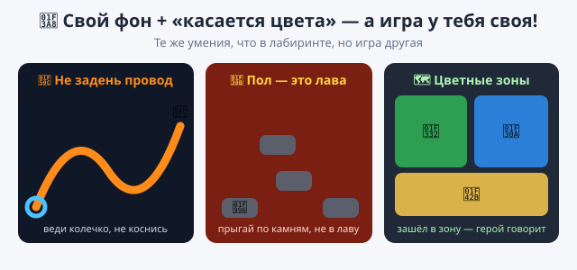

# Практика — урок 16

На уроке мы рисовали лабиринт и ловили касание цвета. Эти же умения — свой фон и блок «касается цвета» — годятся не только для лабиринта. В практике сделай из них **другую игру**. Три задания: делай по порядку или выбирай.

*Так это примерно выглядит — но игра у тебя своя.*

---

## Задание 1. Не задень провод

Нарисуй на фоне изогнутый цветной провод от старта до финиша. Игрок ведёт колечко-героя вдоль провода мышкой и старается не коснуться его. Коснулся — «Зззз!» и обратно на старт.

Что сделать: нарисуй толстую волнистую линию одного цвета, а герою сделай так, чтобы он всё время шёл за мышкой и проверял касание этого цвета.

*Подсказка:* «всегда [идти к указателю мыши]» ведёт героя за мышкой; а «если касается цвета [цвет провода] → перейти в x:(старт) y:(старт)» возвращает на старт. Цвет бери пипеткой прямо с провода.

## Задание 2. Пол — это лава

Нарисуй островки одного цвета (безопасные) над лавой другого цвета. Герой прыгает по островкам стрелками. Наступил на лаву — сгорел и вернулся в начало.

Что сделать: закрась фон цветом лавы, а поверх нарисуй несколько островков-камней другим цветом. Герою собери управление стрелками и проверку касания цвета лавы.

*Подсказка:* это «если касается цвета [лава] → перейти в x:(старт) y:(старт)». Управление стрелками ты уже умеешь с урока 14 — четыре скрипта с «изменить x/y».

## Задание 3. Цветные зоны

Нарисуй фон из нескольких цветных областей — например, карту: лес зелёный, море синее, пустыня жёлтая. Когда герой заходит в область, он говорит, где он («Я в лесу!»), или меняет костюм.

Что сделать: раскрась фон на 2–3 цветные зоны и собери герою по одной проверке на каждый цвет.

*Подсказка:* на каждую зону — свой «если касается цвета […] → говорить …». Героя можно двигать мышкой или стрелками, как тебе удобнее.

---

**Если получилось быстро:**
- добавь в «Не задень провод» счётчик касаний — сколько раз дёрнулся, пока дошёл;
- в «Пол — это лава» спрячь на островке звезду: коснулся — «+1» и она исчезает;
- сделай зоны секретными: в одной спрятан клад, и только там герой говорит «Нашёл!».

**Если трудно:** возьми любое одно задание и сделай только главное — один цвет и одну проверку «касается цвета». Этого достаточно, чтобы игра работала.

**Готово, когда:**
- [ ] ты сам нарисовал фон с цветами;
- [ ] герой реагирует на касание цвета (возврат, фраза или смена костюма);
- [ ] это не лабиринт с урока, а своя игра;
- [ ] проект сохранён (`.sb3`, своё имя).

Дай соседу пройти твою игру — получится ли у него не обжечься (или не задеть провод)?
