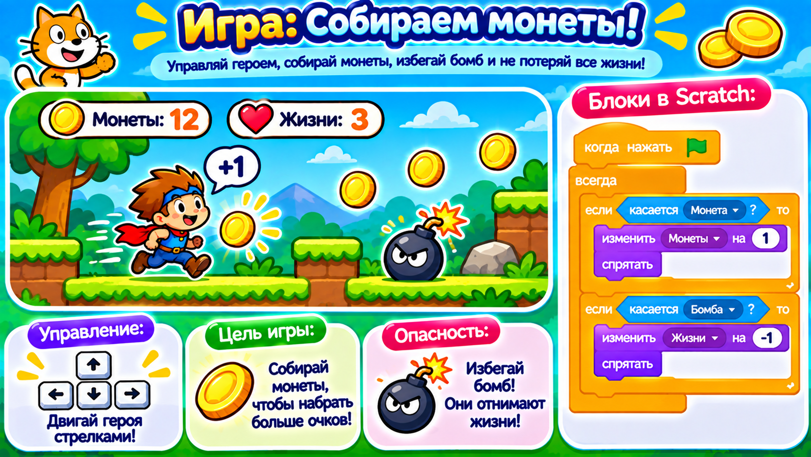

# Догоняем урок 17 (для тех, кто пропустил)

Привет! На этом уроке ребята собрали «Пинг-понг со счётом» и научились главному в играх — **переменным**, то есть коробочкам для чисел: очки, жизни, рекорд. Ты всё догонишь за одно занятие, примерно за полтора часа. Сначала прочитай, что было, а потом соберёшь свою игру со счётом — «Собери монеты». Звук не нужен — всё показываем надписями и числами.

---

## Что было на уроке

Главное слово урока — **переменная**. Это коробочка с именем, в которой лежит одно число. Представь копилку, на которой написано «очки»: внутри число, и его можно менять.

С переменной делают три вещи:

- **задать** — положить в коробочку число. Например, «задать очки = 0» в начале игры.
- **изменить на** — прибавить или убавить. «изменить очки на 1» добавит единицу к тому, что уже есть; «изменить жизни на −1» отнимет одну жизнь.
- **показать** — если поставить галочку рядом с переменной, её число будет видно на сцене, как счёт в настоящей игре.

Ещё переменную можно **проверить** в блоке «если». Например, «если жизни = 0 → остановить всё»: как только в коробочке «жизни» окажется ноль, игра закончится.

В пинг-понге было так: мяч скакал по экрану, ракетка ездила за мышкой. Отбил мяч ракеткой — «изменить очки на 1». Пропустил мяч вниз — «изменить жизни на −1». Жизни кончились — конец. Две коробочки, очки и жизни, управляли всей игрой.

---

## Твоя игра: «Собери монеты»



Соберёшь игру со счётом, только вместо пинг-понга — сбор монеток. Переменные те же: очки и жизни.

### Шаг 1. Поставь героя и фон

Открой библиотеку героев и выбери любого — кота, робота, зверька. Сцене выбери любой фон. Это будет сборщик монет.

### Шаг 2. Научи героя ездить стрелками

Собери четыре коротких программы (ты это уже умел на уроке 14):

- вверх → «изменить y на 10»; вниз → «изменить y на −10»;
- вправо → «изменить x на 10»; влево → «изменить x на −10».

### Шаг 3. Заведи переменные

В разделе «Переменные» создай **очки** и **жизни**. Поставь обе галочки — числа появятся на сцене.

### Шаг 4. Монета-непоседа

Поставь спрайт **Coin** (монета) или нарисуй кружок. Дай ему две программы:

- она прыгает: «когда флажок → всегда [ перейти в случайную позицию · ждать 1 секунду ]»;
- её ловят: «всегда [ если касается героя → изменить очки на 1 · перейти в случайную позицию ]».

Поймал монету — очко прибавилось, монета ускакала на новое место.

### Шаг 5. Бомба отнимает жизнь

Поставь спрайт-бомбу. В начале проекта «задать жизни = 3». Бомбе дай: «всегда [ перейти в случайную позицию · ждать 2 секунды ]», а герою добавь проверку: «всегда [ если касается бомбы → изменить жизни на −1 · говорить Ой! 0.3 ]». И в конце: «если жизни = 0 → говорить Игра окончена! 2 → остановить всё».

### Шаг 6. Сохрани

«Файл» → «Сохранить на компьютер», имя — `собери-монеты`.

---

## Как это выглядит в сборе

```
В НАЧАЛЕ ПРОЕКТА               МОНЕТА
задать очки = 0               всегда
задать жизни = 3               ├ если касается героя
                               │    └ изменить очки на 1 · перейти в случайную позицию

ГЕРОЙ                          БОМБА
4 стрелки (x/y)               всегда [ перейти в случайную позицию · ждать 2 ]
всегда
 ├ если касается бомбы → изменить жизни на −1 · Ой!
 └ если жизни = 0 → остановить всё
```

---

## Теперь ты знаешь то же, что и класс

- [ ] понимаю, что переменная — это коробочка для числа;
- [ ] умею «задать» число и «изменить на» (прибавить/убавить);
- [ ] показываю переменную на сцене галочкой;
- [ ] проверяю переменную в «если» (жизни = 0 → конец);
- [ ] реакции показываю надписью и сохранил работу в файл.

Хочешь ещё интереснее? Заведи переменную «рекорд»: если очки стали больше рекорда — «задать рекорд = очки» и «говорить Новый рекорд!». Рекорд не сбрасывается, и можно соревноваться, кто наберёт больше. Собрал не так — Ctrl+Z отменит.
