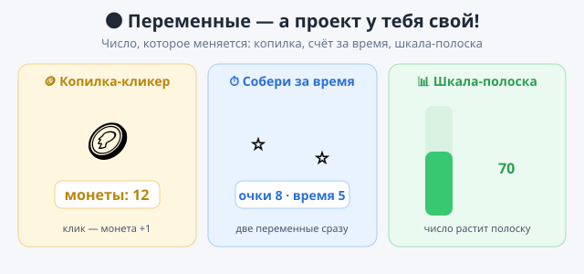

# Практика — урок 17

На уроке мы считали очки в пинг-понге. Но переменная — это коробочка для любого числа, не только для счёта мяча. В практике примени переменные в **других** проектах. Три задания: делай по порядку или выбирай.

*Так это примерно выглядит — но проект у тебя свой.*

---

## Задание 1. Копилка-кликер

Сделай игру, где за каждый клик по герою ты получаешь монетку, а счёт виден на экране. Набрал 10 монет — герой говорит «Богач!».

Что сделать: заведи переменную «монеты», показывай её на сцене и прибавляй по клику. Когда монет хватит — поздравь игрока.

*Подсказка:* клик ловит «когда этот спрайт нажат», внутри — «изменить монеты на 1». А поздравление включай проверкой «если монеты = 10».

## Задание 2. Собери за время

Возьми любую свою игру-сборщик (например, героя со стрелками, который ловит звёзды) и добавь сразу **две** переменные: очки и время. Время идёт вниз от 20 до 0, а за собранное растут очки. Время кончилось — «Стоп, твой счёт: …».

Что сделать: заведи «очки» и «время», очки прибавляй за сбор, а время уменьшай раз в секунду.

*Подсказка:* отсчёт времени — это «всегда [ждать 1 секунду, изменить время на −1]», а конец — «если время = 0 → остановить всё».

## Задание 3. Своя шкала

Придумай, что может расти и падать: здоровье героя, заряд батарейки, градусник, уровень воды. Сделай переменную и покажи её не числом, а **полоской**: чем больше число — тем длиннее (или выше) полоска.

Что сделать: заведи переменную и свяжи её с размером спрайта-полоски, чтобы при изменении числа менялась и картинка.

*Подсказка:* возьми спрайт-полоску и в цикле ставь ему «установить размер (переменная)» — число управляет тем, какой он большой.

---

**Если получилось быстро:**
- добавь вторую переменную-рекорд, которая запоминает лучший результат;
- сделай «магазин»: накопил монеты — можно «купить» смену костюма героя (монеты −5);
- покажи переменную красиво — рядом с героем, своим цветом (в меню переменной есть вид «крупный показ»).

**Если трудно:** сделай только копилку — клик по герою прибавляет 1, и число видно на сцене. Этого достаточно, чтобы понять переменную.

**Готово, когда:**
- [ ] в проекте есть переменная, и её число видно на сцене;
- [ ] число меняется по ходу игры (растёт или падает);
- [ ] это не пинг-понг с урока, а своя идея;
- [ ] проект сохранён (`.sb3`, своё имя).

Покажи соседу: пусть поиграет и увидит, как меняется твоё число.
