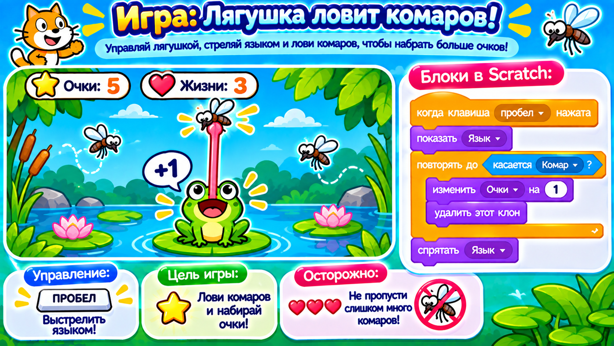

# Догоняем урок 18 (для тех, кто пропустил)

Привет! Это был последний урок модуля «Мои первые игры». Ребята собрали «Космошутер» и научились **стрельбе клонами**: пуля — это клон, который вылетает из героя и летит вперёд. Ты всё догонишь за одно занятие, примерно за полтора часа. Сначала прочитай, что было, а потом соберёшь свою стрелялку — «Лягушка ловит комаров». Звук не нужен — всё показываем надписями и числами. В конце получишь значок «Юный геймдев».

---

## Что было на уроке

Этот урок — финальный, и в нём встретилось всё, что вы учили в модуле:

- **клоны** — живые копии спрайта (вы их делали в «Лови яблоки»);
- **переменные** — коробочки для чисел, очки и жизни (из «Пинг-понга»);
- **управление с клавиатуры** — стрелки двигают героя (из «Собери звёзды»);
- **«если касается»** — ловит столкновение.

Новое на уроке — **стрельба клонами**. Выстрел это не отдельный заранее нарисованный предмет, а клон, который рождается в момент, когда ты нажал кнопку. Спрайт-пуля по нажатию делает «создать клон себя», а программа «когда я начинаю как клон» отправляет копию лететь от героя вперёд. Один выстрел — одна пуля-клон. Долетела или попала — удаляется.

В космошутере было два «завода» клонов: корабль штамповал пули (летят вверх), а астероид штамповал врагов (летят вниз). Когда пуля встречала астероид — оба исчезали, и прибавлялось очко. Когда астероид врезался в корабль — минус жизнь.

---

## Твоя игра: «Лягушка ловит комаров»



Соберёшь свою стрелялку, только вместо корабля — лягушка, а вместо пуль — «язык», которым она сбивает комаров.

### Шаг 1. Поставь героев и фон

Открой библиотеку. Выбери **Frog** (лягушка) — поставь внизу. Добавь **Ladybug1** или нарисуй комара — это враг. Нарисуй тонкую зелёную палочку — это «язык» (пуля). Сцене выбери фон с прудом.

### Шаг 2. Переменные

Создай **очки** и **жизни** (галочки поставь). В начале у лягушки «задать очки = 0», «задать жизни = 3».

### Шаг 3. Лягушка двигается и стреляет

У лягушки: «когда → нажата → изменить x на 15»; «когда ← нажата → изменить x на −15». А выстрел повесим на язык (следующий шаг).

### Шаг 4. Язык — стрельба клонами

У спрайта-языка собери:

- «когда флажок → скрыться»;
- «когда клавиша пробел нажата → создать клон себя»;
- «когда я начинаю как клон → показаться → перейти к [Frog] → повторить 20 [ изменить y на 15 · если касается комара → удалить этот клон ] → удалить этот клон».

Нажми пробел — язык выстреливает вверх.

### Шаг 5. Комар-завод

У комара две программы:

- завод: «когда флажок → скрыться → всегда [ создать клон себя · ждать 1.5 сек ]»;
- клон: «когда я начинаю как клон → показаться → перейти наверх в случайное место → всегда [ изменить y на −3 · если касается языка → изменить очки на 1 · удалить этот клон · если касается Frog → изменить жизни на −1 · удалить этот клон · если y < −180 → удалить этот клон ]».

### Шаг 6. Конец игры и сохранение

У лягушки: «всегда [ если жизни = 0 → говорить Ква, всё! 2 → остановить всё ]». Потом «Файл» → «Сохранить на компьютер», имя — `лягушка-комары`.

---

## Как это выглядит в сборе

```
ЯЗЫК (пуля)                      КОМАР-клон
когда пробел нажат               когда я начинаю как клон
 └ создать клон себя             показаться · перейти наверх
когда я начинаю как клон         всегда
показаться · перейти к Frog       ├ изменить y на −3
повторить 20                      ├ если касается языка → очки +1 · удалить клон
 ├ изменить y на 15               ├ если касается Frog → жизни −1 · удалить клон
 └ если касается комара → удалить └ если y < −180 → удалить клон
удалить этот клон
```

---

## Теперь ты знаешь то же, что и класс

- [ ] понимаю, что выстрел — это клон, который летит вперёд;
- [ ] умею делать стрельбу: пробел → «создать клон себя» → клон летит;
- [ ] не забываю удалять клоны (и пули, и врагов);
- [ ] считаю попадания очками, а столкновения — минусом жизни;
- [ ] собрал законченную игру и получил значок «Юный геймдев».

Хочешь ещё интереснее? Добавь большого комара-босса с переменной «здоровье»: его надо попасть несколько раз, зато он даёт сразу много очков. Собрал не так — Ctrl+Z отменит.
