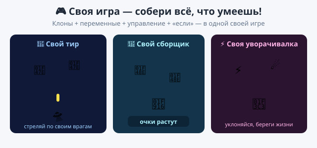

# Практика — урок 18 (финал модуля)

Это последний урок модуля, и практика особенная: собери **свою собственную игру**. У тебя уже есть все инструменты — клоны, переменные, управление, «если касается». Выбери одну идею (или придумай свою) и доведи до конца. Космошутер повторять не нужно — сделай что-то своё.

*Так это примерно выглядит — но игра у тебя своя.*

---

## Идея 1. Свой тир

Придумай, кто и по кому стреляет: лягушка ловит языком комаров, рыцарь бьёт по драконам, садовник — по сорнякам. Герой двигается, стреляет клонами, попал — очко.

Что сделать: сделай героя с управлением, стрельбу клонами (пробел) и врагов-клонов, которые появляются. Попадание считай очками.

*Подсказка:* выстрел — это «создать клон себя» по пробелу, а клон летит и проверяет «если касается врага → удалить этот клон». Врагу добавь «если касается пули → изменить очки на 1».

## Идея 2. Свой сборщик

Сделай игру, где герой собирает что-то хорошее и копит очки: робот — болтики, пчела — цветы, кот — рыбок. Можно добавить и то, чего надо избегать.

Что сделать: герой ходит стрелками, добыча появляется клонами или телепортом, собрал — очки растут. Жизни потеряешь, если тронешь плохое.

*Подсказка:* очки и жизни — переменные (задать в начале, изменить по ходу). Добычу лови блоком «если касается героя».

## Идея 3. Своя уворачивалка

Сделай игру, где главное — не попасться: герой уклоняется от падающих астероидов, молний или капель, а очки растут просто за то, что ты ещё жив.

Что сделать: опасности сыпь клонами сверху, герою дай управление и проверку «если касается опасного → минус жизнь». Очки прибавляй по времени.

*Подсказка:* чтобы очки росли сами, сделай «всегда [ждать 1 секунду, изменить очки на 1]». Жизни кончились — «остановить всё».

---

**Доведи игру до конца:**
- придумай название и нарисуй или выбери героя (можно загрузить своего из Piskel);
- добавь счёт и жизни, которые видно на сцене;
- проверь, что в игру правда можно играть от начала до конца;
- сохрани проект (`.sb3`) — это работа для твоего портфолио.

**Если получилось быстро:**
- добавь рекорд, босса или ускорение (чем дольше играешь — тем труднее);
- сделай экран «Игра окончена» со своим счётом;
- покажи игру классу и дай друзьям поиграть.

**Готово, когда:** у тебя есть своя законченная игра со счётом, в которую можно играть, — и ты получил значок «Юный геймдев». Поздравляю, ты геймдизайнер!
