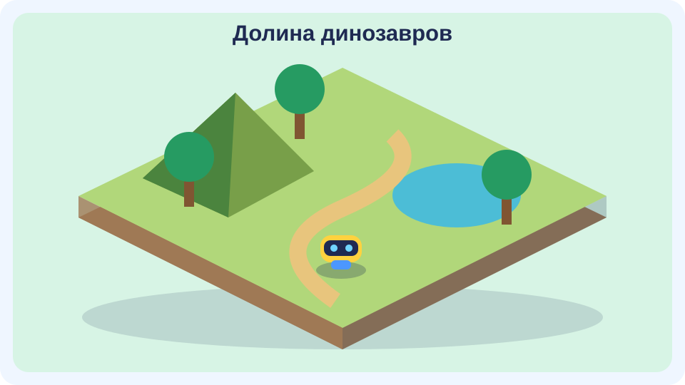
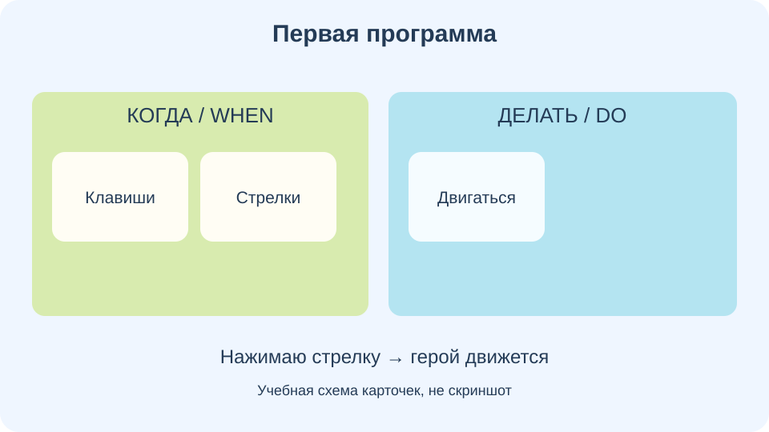
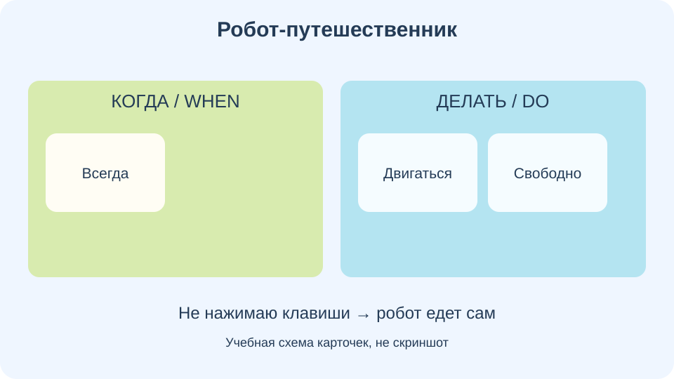

# Догоняющий урок — Долина динозавров

**Для тех, кто пропустил урок 19 · 1,5 ак. ч. (≈67 мин)**

Сегодня ты научишься тому же, что класс: построишь объёмный мир, научишься управлять камерой, изменишь землю, создашь воду, поставишь объекты и научишь героя двигаться. Твой проект — долина древних животных. Настоящего динозавра в Kodu искать не обязательно: используй доступного робота как исследователя.

## 1. Что такое Kodu (5 мин)
В Scratch мы рисовали сцену и двигали героев. В Kodu земля настоящая объёмная: можно посмотреть сверху, сбоку, создать холм и яму. Открой Kodu Game Lab, New World, выбери пустую площадку. Центр — мир, низ — инструменты, слева сверху — подсказки. Домик открывает меню, треугольник запускает игру.

## 2. Камера (8 мин)
Выбери Руку. ЛКМ + движение перемещает взгляд, ПКМ + движение поворачивает его, колёсико приближает и отдаляет. Покажи взрослому весь мир, затем вид сбоку, затем снова весь мир. Если потерял площадку, отдали камеру и верни её в центр. [Схема](изображения/камера.svg).

## 3. Создаём долину (12 мин)
1. Ground Brush: выбери зелёный материал, круглую или квадратную кисть. Стрелками вправо/влево измени размер по подсказке.
2. ЛКМ по краю расширь землю до широкой площадки. Попробуй ПКМ на маленьком краю, восстанови участок ЛКМ.
3. Другим цветом нарисуй извилистую дорожку на существующей земле.
4. Up/Down: удерживай ЛКМ коротко на дальней части, чтобы поднять два холма; если земля слишком тонкая, сначала подними её широкой кистью, затем ПКМ в центре сбоку сделай низину. Оставь широкое место для героя.
5. Рукой осмотри рельеф сбоку. Если холмы слишком острые, используй сглаживание по подсказкам инструмента.

## 4. Водоём и лес (9 мин)
Выбери Water Tool. Наведи на низину, коротко нажимай ЛКМ до появления воды. ПКМ снижает её уровень. Если вода выходит на тропу, опусти её. Выбери Object Tool, кликни по пустой земле, найди дерево в меню. Поставь три дерева на расстоянии друг от друга и два камня (или доступные декорации). Добавь Kodu на ровную площадку. Наведи на героя и стрелками выбери цвет. ПКМ → Изменить размер, попробуй увеличить его. Перетащи на ровную землю.

## 5. Перерыв (3 мин)
Встань, потянись, посмотри вдаль, поморгай. Вернись к работе.

## 6. Учим исследователя ходить (13 мин)
Выбери Объект, ПКМ по Kodu → Программа. На странице 1 нажми плюс у КОГДА, выбери Клавиши, затем следующий плюс → Стрелки. Это условие: компьютер проверяет, нажал ли ты клавишу. Нажми плюс у ДЕЛАТЬ → Двигаться. Теперь у героя есть приказ.

Esc → Play. Нажми стрелки: попробуй проехать к дереву и обратно. Отпусти клавишу. Если герой не едет, проверь, что запущена игра и программа написана для него. Если путь закрыт холмом, исправь землю.

Теперь добавь второго Kodu другого цвета на широкой площадке. ПКМ → Программа. Плюс у КОГДА → Всегда. Плюс у ДЕЛАТЬ → Двигаться → плюс → Свободно. Так он будет двигаться без клавиатуры.

Запусти мир. Кто управляет каждым героем? Первый — ты, второй — программа. Вернись в редактор через Esc.

## 7. Экскурсия и сохранение (5 мин)
Рукой покажи лес, озеро и холмы. Найди свободный маршрут между ними. Исправь опасный обрыв кистью земли. Home → Save My World, название «Долина — имя». Проверь My Worlds. Если названия кнопок отличаются, пользуйся подсказками программы или попроси взрослого помочь.

## 8. Закрепление (12 мин)
Пройди [Карту Бипа](игра.html) (4 мин), один режим [тренажёра](тренажёр.html) (4 мин) и [викторину](викторина.html) (4 мин). Покажи взрослому сохранённый мир.

## Теперь ты знаешь то же, что класс
- [ ] Могу создать новый мир и найти инструменты.
- [ ] Перемещаю, вращаю и приближаю камеру.
- [ ] Добавляю, удаляю и крашу землю.
- [ ] Делаю холм и низину, добавляю воду.
- [ ] Размещаю объекты, меняю их цвет и размер, сохраняю мир.
- [ ] Собираю правило движения по стрелкам и самостоятельного движения.
