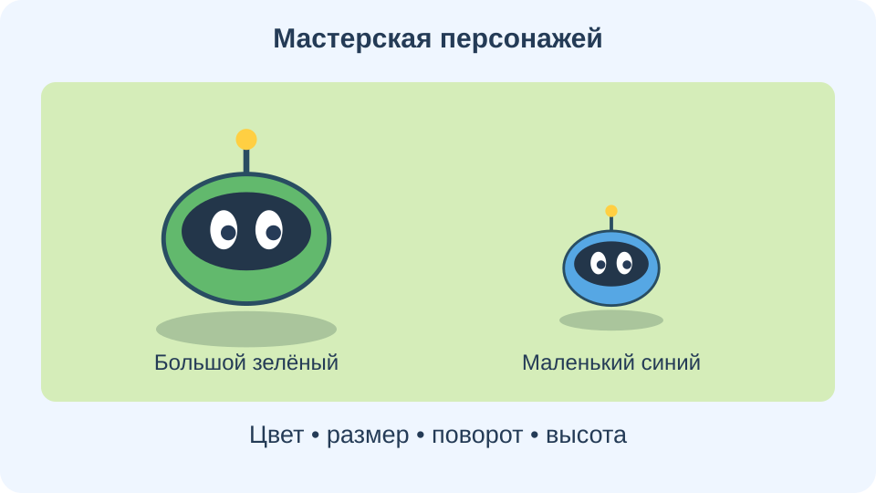
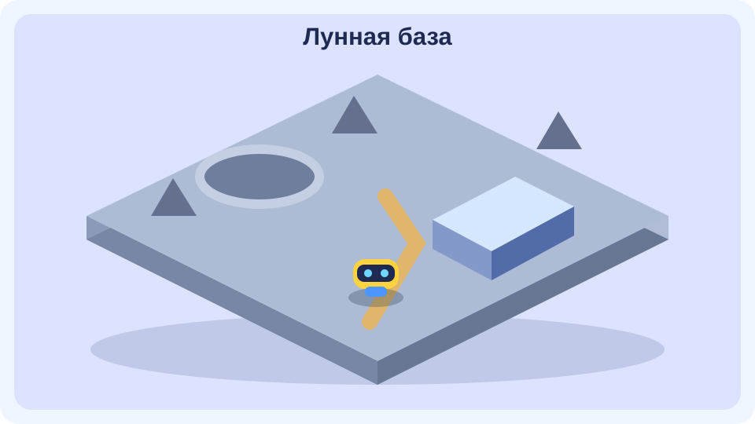
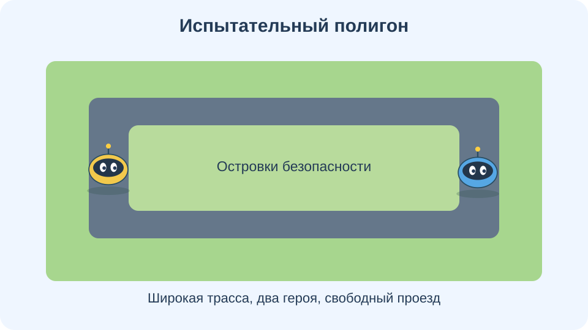

# Самостоятельная работа — Мастерская игровых миров

Сегодня ты уже построил остров и научил героя двигаться. Теперь попробуй себя в роли дизайнера персонажей, строителя и испытателя игры. Работы сохраняй отдельно, чтобы не потерять остров.

## Задание 1. Два брата-робота (8–10 мин)

Создай новый мир с ровной площадкой. Добавь Kodu, сделай его зелёным, поставь размер 2,5, высоту 1,75 и поворот 250, если такие значения доступны. Скопируй его. Второго сделай меньше, другого цвета и поверни лицом к первому. Подбери высоту так, чтобы оба были видны сбоку. Покажи работу с двух ракурсов.

**Подсказка:** наведи курсор на героя для выбора цвета; остальные настройки находятся в меню ПКМ. Не путай поворот модели с поворотом камеры. Сохрани «Два робота — имя».

## Задание 2. Лунная база (15–20 мин)

*Пример композиции. Используй доступные материалы и объекты Kodu.*

Представь, что исследователи прилетели на Луну. Им нужно место для посадки и безопасная дорога к кратеру. Создай собственный мир:
- Серый каменистый ландшафт, широкая площадка другого цвета, кратер и два холма.
- Не добавляй воду. Оставь ровный широкий маршрут вокруг кратера.
- Размести исследователя Kodu, два камня или другие доступные ориентиры. Выбери цвет героя, который хорошо заметен на серой земле.
- Сделай героя управляемым с клавиатуры. Запусти мир и проедь от места посадки к ориентиру и обратно. Если не получается проехать, исправь рельеф, а не программу.

**Подсказка:** вспомни, где в редакторе находится программа объекта. Для кратера сначала понадобится достаточно толстая земля. Сохрани «Лунная база — имя».

## Задание 3. Испытательный полигон (10–15 мин)

Построй площадку для двух испытателей. Нарисуй широкую замкнутую дорожку контрастным материалом. Поставь на ней управляемого героя, а в свободной центральной зоне — второго, который гуляет сам. Сделай их разного цвета. Запусти игру: первый должен слушаться стрелок, второй — двигаться без тебя. Испытай, как меняется движение, если отпустить клавиши.

**Подсказка:** у каждого объекта своя программа. Для самостоятельного движения вспомни карточки «Всегда» и «Свободно». Нарисованная дорожка — просто материал земли, она сама не заставляет героя ехать по ней. Сохрани «Полигон — имя».

## Задание 4. Страна чудес (творческое, по желанию)

Придумай мир необычной формы: звезда, цветок, огромный ключ или несколько островков, соединённых широкими мостиками. Используй цвета земли, чтобы нарисовать стрелки-подсказки или символы. Вспомни Tux Paint: как сочетать большую кисть для фона и маленькую для деталей? Размести героя, придумай экскурсию и покажи её другу. Можно использовать мир из задания 2 и превратить его в необычную планету.

## Проверка
- [ ] Умею менять цвет, размер, высоту и поворот объекта.
- [ ] Могу сделать копию и отличить её от оригинала.
- [ ] Создал мир с рельефом, материалами и свободным маршрутом.
- [ ] Мой герой управляется стрелками, а второй может двигаться сам.
- [ ] Проверил игру и сохранил работу под своим названием.

Покажи преподавателю одну законченную работу и объясни, как действует программа героя. Если забыл шаг, открой [самоучитель](самоучитель.md).

*Для преподавателя: идеи заданий 1 и 4 адаптированы из книги К. И. Астаховой, §1.6, с. 26–27; движение — §2.1, с. 28–31. Остальные проекты — собственная адаптация курса.*
