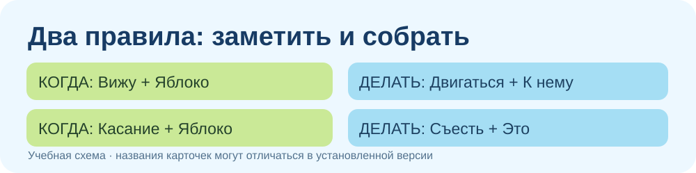

# Догоняющее занятие — «Почтальон на планете роботов»

**Для тех, кто пропустил урок 20 · около 67 минут.** Это один законченный проект. Не требуется открывать «Яблочный патруль»; все необходимые навыки разбираются здесь заново.

## Что делали на занятии (10 минут)

На прошлом уроке мы научили героя двигаться. Сегодня другие дети изучали два новых условия: **Вижу** — герой заметил предмет, и **Касание** — подошёл достаточно близко, чтобы дотронуться. Они разобрали, что слева в строке правил находится условие «Когда», справа — действие «Делать». Пример был с яблоками: первое правило заставляет ехать к предмету, второе — убрать его после касания. Эти строки принадлежат тому персонажу, чья программа открыта.

## Проект: «Почтальон на планете роботов»

### Шаг 1. Почтовая площадка (10 минут)

Создай новый мир. Сделай ровную широкую платформу, нарисуй на ней дорожку другого цвета и небольшой почтовый дворик. По краям добавь две-три декорации, не загромождая проезд. Сохрани черновик «Почтальон — имя».

### Шаг 2. Герой и посылки (10 минут)

Добавь Байкера — это почтальон. Размести на площадке **три яблока**: в этой учебной истории они заменят посылки, потому что именно для них мы знаем рабочие карточки взаимодействия. Поставь первую посылку близко, остальные немного дальше.

### Шаг 3. Находим первую посылку (12 минут)

Инструмент **Объект** → правая кнопка по Байкеру → **Программа**. В первой строке через плюсы последовательно выбери **Когда → Вижу → Яблоко** и **Делать → Двигаться → К нему**. Выйди из программы и запусти игру. Герой должен ехать к посылке. Если не едет, приблизь предмет и проверь карточки.

### Шаг 4. Забираем посылку (10 минут)

Вернись к программе Байкера. Во второй строке выбери **Когда → Касание → Яблоко** и **Делать → Съесть → Это**. В этой игре «съесть» означает «забрать посылку»: программное действие всё равно остаётся именно Eat. Запусти и проверь, исчезают ли предметы по одному.

### Шаг 5. Испытание (10 минут)

Перемести третью посылку на другую сторону дороги и ещё раз запусти. Умышленно удали вторую строку и предскажи, что произойдёт. Верни её, повтори испытание. Объясни разницу между условиями «видит» и «касается».

### Шаг 6. Сохранение и итог (5 минут)

Сохрани мир «Почтальон — имя». Найди его в списке сохранённых миров и покажи обе строки. Если осталось время, открой [викторину](викторина.html) и [тренажёр печати](тренажёр.html), уровень 20.

## Теперь ты знаешь то же, что и класс

- [ ] Могу построить небольшую площадку в Kodu.
- [ ] Могу добавить персонажа и три яблока.
- [ ] Умею собрать правило «вижу → двигаюсь».
- [ ] Умею добавить «касаюсь → съесть».
- [ ] Могу объяснить, зачем нужны две строки и где сохранить игру.

*Подход к условиям взят из §2.1 учебника К. И. Астаховой; почтовый сюжет и объяснения созданы специально для догоняющего занятия.*
