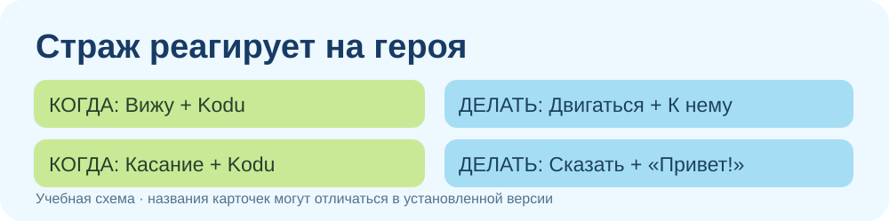

# Практическая работа — «Мир, который отвечает»

**Что понадобится:** Kodu, мышь, клавиатура. Сначала выполни обязательные задания 1–2. Задания 3–4 — для тех, кто справился раньше. Не открывай проект «Яблочный патруль» для копирования: сегодня строишь **новые** истории сам.

## Задание 1. «Фруктовый курьер» — проверяем условия (8–12 минут)

Создай маленькую ровную площадку, поставь Байкера и **три яблока**. Одно яблоко положи близко, два — дальше. Научи Байкера находить яблоки и съедать их. Затем проведи эксперимент: временно убери действие из **второй строки**, запусти игру и посмотри, что изменилось. Верни действие обратно. Сохрани результат как «Курьер — имя».

**Подсказки без полного решения:** сначала нужна реакция на то, что персонаж **видит** предмет, затем — на то, чего он **коснулся**. Карточки действия для двух случаев разные. Если робот не двигается, начинай отладку с одного близкого яблока.

## Задание 2. «Парк приветствий» — другой персонаж, другая реакция (12–15 минут)



Построй небольшую дорожку в парке. Помести у входа Kodu (посетителя), в центре — Стража (второй персонаж другого цвета). Напиши для стража правило: если он увидел посетителя, он приближается к нему. Если доступны карточки сообщения, добавь приветствие при касании. Проверь, реагирует ли он на того, кого должен заметить. Сохрани «Парк приветствий — имя».

**Важная проверка:** посетитель не должен внезапно начать выполнять программу стража. Перед редактированием называй вслух, кого ты выбрал мышью. Если вывод текста недоступен в версии Kodu, достаточно первого правила.

## Задание 3. «Цветочный помощник» (дополнительно, 10 минут)

Создай новую поляну с двумя дорожками. Вместо яблок выбери другой **доступный в твоей сборке** предмет. Если действие «Съесть» для него не подходит, не заставляй персонажа делать невозможное: придумай реакцию, которую позволяет меню (например подойти и остановиться). Составь минимум одно правило с **Вижу** и проверь его. Объясни преподавателю, почему одни действия подходят яблоку, а другие — нет.

## Задание 4. «Найди ошибку» (творческое, 8 минут)

Попроси соседа по парте (или преподавателя) незаметно испортить **одну** карточку в копии твоей программы: поменять «яблоко» на другой объект либо убрать уточнение «к нему». Запусти игру, посмотри на поведение и найди ошибку. Верни правильный вариант и объясни, какое изменение помогло.

## Готово, если
- [ ] На игровом поле есть герой и предметы, к которым он должен реагировать.
- [ ] Первое условие отличается от второго: **видит** и **касается**.
- [ ] Реакция происходит только после подходящего условия.
- [ ] Я могу открыть программу **нужного** персонажа.
- [ ] Мир сохранён под понятным названием.

**Кто закончил раньше:** добавь ещё два яблока, поставь одно за преградой и проверь, меняется ли поиск цели. Не добавляй непроходимые горы в середину дороги.

### Образец расположения (не точная карта Kodu)

```text
  [дерево]       яблоко
        яблоко      [дерево]
  БАЙКЕР → — — — — яблоко
        широкий ровный участок
```

*Адаптация для курса по мотивам примера с Байкером и яблоками из учебника К. И. Астаховой, §2.1, с. 33–35. Парк и поиск ошибки — новые самостоятельные задания.*


## Новая расширенная самостоятельная практика

### 1. «Фруктовый светофор» (обязательное, 15–20 минут)

Построй поляну с двумя деревьями. У первого размести красные яблоки, у второго — зелёные. Главным героем управляет игрок стрелками. При касании красного яблока герой становится красным, зелёного — зелёным; яблоко исчезает. **Важно:** в каждой строке условия укажи *цвет яблока*, иначе реакции смешаются. Не копируй полностью готовую сцену «Три дерева»: поменяй расположение дорожек и станций.

Проверь по очереди: взять зелёное → герой зелёный; затем взять красное → герой красный. Объясни, в каком месте программы выбирается цвет предмета, а в каком — цвет персонажа.

### 2. «Плохой гриб» (обязательное, 10–15 минут)

Сделай отдельный мини-мир с безопасными красными яблоками и тёмными яблоками, обозначающими ядовитый гриб. При касании безопасных предметов персонаж их убирает. При касании тёмных персонаж меняет цвет на чёрный и произносит предупреждение, если в твоей версии есть Say. Проверяй эффекты по одному. **Подсказка:** не ставь безусловное Eat для любого яблока, иначе предупредить о тёмном предмете может быть сложно.

### 3. «Встречающий робот» (на самостоятельность, 10–15 минут)

Создай охранника у ворот. Игрок управляет гостем, а охранник должен заметить его и подъехать. Дополнительно при касании охранник говорит короткое приветствие или воспроизводит доступный звук. В конце поменяй условие «вижу» на «касаюсь» и объясни, почему изменилось поведение.

### 4. «Чужая ошибка» (короткий разбор, 5–7 минут)

В программе есть строка `КОГДА Касание → Яблоко / ДЕЛАТЬ Изменить цвет → Красный`, а разработчик ждёт, что герой будет становиться зелёным после зелёного яблока. Найди ошибку и перепиши условие так, чтобы зелёный предмет вызывал только зелёную реакцию. Проверь её в игре.

**Критерии:** два цвета различаются; исчезновение предмета происходит при касании; игра пройдена хотя бы дважды; ребёнок может показать одну строку на экране и объяснить её вслух.
