# 🌫 Доп-задание — «Эффект запотевшего стекла»

**Модуль 2 · Фотомагия в Photoshop · Дополнительное задание**
⏱ ~90 минут · 🎯 Уровень: 🎓 9–11 (много шагов, но все настройки даны) · 🖼 Нужен фон-фото

> 📌 Самостоятельное доп-задание (пропустил урок / хочешь ещё практики). Перекликается с уроком 9 (стили слоя) и уроком 13 (Облака, Размытие в движении).
> 🖼 Скриншоты — из старого материала; настройки продублированы **текстом**, так что скрины — просто для ориентира. *(Заказчик заменит на свежие.)*
> ⚠️ Всё вручную, без ИИ.

---

## 🎬 Что сделаем и чему научимся

Превратим обычное фото в вид **через запотевшее окно**: матовое стекло, стекающие **капли воды** и надпись, «написанная пальцем» по стеклу (сквозь неё видно чётко).

**Освоишь:**
- свою **кисть-капли** (настройки кисти: рассеивание/динамика);
- режимы наложения **«Осветление основы»**, «Перекрытие», «Экран», «Умножение»;
- **много стилей слоя сразу** на каплях (Внутр. тень, Тиснение, Внутр. свечение, Наложение цвета, Тень) — объём и блеск;
- **маски** для стекающих капель и «чистого» текста;
- фильтр **«Облака»** на маске (неравномерный туман).

**Результат:** атмосферное фото «за мокрым стеклом» с каплями и надписью.

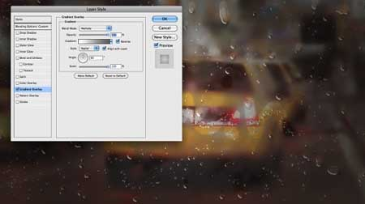

---

## 📸 Какое фото нужно (фон за стеклом)

Любая **яркая сцена с огнями** — она красиво расплывётся за матовым стеклом.

**📥 Скачать картинку-фон:**
- 📦 **Готовый фон из комплекта** — [материалы/фон-за-стеклом.jpg](материалы/фон-за-стеклом.jpg) (ночная улица с огнями). *(На GitHub: открой файл → кнопка «Download».)*
- 🌆 Или **ночной город** из урока 13 — [ночной-город.png](../../урок-13-погодная-магия/изображения/ночной-город.png).
- 🔗 **Бесплатные стоки** (без регистрации): [Pexels — night city bokeh](https://www.pexels.com/search/night%20city%20bokeh/) · [Unsplash — city lights](https://unsplash.com/s/photos/city-lights-night).
- 🎨 **Промпт для генерации своего фона:** `blurry night city street with bright car lights and neon, bokeh, rainy mood, no readable text, no people, photographic --ar 16:9`.

---

## Часть 1 — Делаем капли воды (20 минут)

### Шаг 1. Тёмный холст

`Файл → Создать` (например 2560×1440). Залей **тёмно-серым**.

### Шаг 2. Настраиваем кисть-капли

Возьми **мягкую круглую** кисть (`B`), открой **`F5`** (Настройки кисти) и настрой по скриншоту: добавь **«Рассеивание»** и **«Динамику формы»** — чтобы кисть ставила **разные по размеру капли вразброс**, а не сплошную линию.

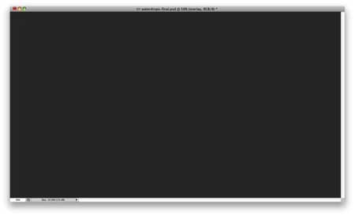

### Шаг 3. Рисуем «заготовки» капель

Создай новый слой, помести его в **группу** (`Ctrl+G`). Режим наложения **группы** — **«Осветление основы» (Color Dodge)**. Цвет — **белый**. Хаотично натыкай капель по холсту.
👀 Края капель **размытые** — так и нужно, дальше сделаем их чёткими.

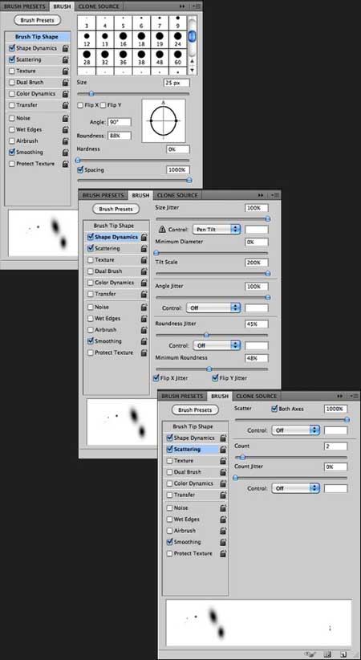

### Шаг 4. Делаем края чёткими — Уровни

Объедини группу капель с тёмным фоном. Примени **Уровни** (`Ctrl+L`): чёрный вход ≈ **124**, белый ≈ **161** (подбери на глаз). Цель — **убрать размытые края**, оставить чёткие капли.

### Шаг 5. Убираем чёрный фон

**Волшебной палочкой** (`W`) кликни по чёрному фону → `Выделение → Смежные пиксели` (чтобы захватить все чёрные участки) → **`Delete`**. Остались только капли на прозрачном слое.

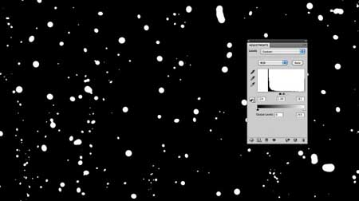

---

## Часть 2 — Матовое стекло из фото (12 минут)

### Шаг 6–8. Размытие + серый налёт

1. Открой фон-фото, сделай его **дубликат** (`Ctrl+J`). Дубликат пока **скрой** (глазик) — он понадобится позже для «чистых» участков.
2. На **нижнем** (исходном) слое: `Фильтр → Размытие → Размытие по Гауссу` **20 px** — стекло «запотело».
3. Добавь стиль слоя **«Наложение цвета»** → тёмно-серый, **Непрозрачность 60 %** — матовый налёт.

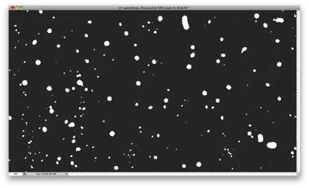
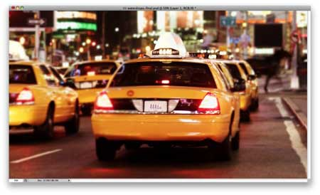

---

## Часть 3 — Оживляем капли стилями слоя (20 минут)

Перемести слой с каплями **выше** фото. Убедись, что он активен. Двойной клик → **«Параметры наложения»**, **Заливка (Fill) = 0** (сами капли прозрачные, виден только «рельеф» от стилей). Теперь добавь стили (все значения ниже):

**Шаг 10. Внутренняя тень:** цвет **белый**, режим **«Линейный затемнитель»**, Непрозр. **50 %**, Угол **90°**, Смещение **3 px**, Размер **5 px**, Контур — **Конус**.

**Шаг 11. Тиснение:** Глубина **350 %**, Направление **Вниз**, Размер **7 px**, Смягчение **5 px**, Угол **54°**, Высота **42°**, Контур глянца — **Глубокая выемка**; Подсветка — белый, **«Осветление основы»**, 80 %; Тень — чёрный, **«Умножение»**, 50 %.

**Шаг 12. Внутреннее свечение:** режим **«Замена тёмным»**, Непрозр. **40 %**, чёрный, Источник **«На краях»**, Размер **25 px**.

**Шаг 13. Наложение цвета:** цвет **`#907f72`**, Непрозр. **45 %**, режим **«Осветление основы»**.

**Шаг 14. Тень:** режим **«Умножение»**, чёрный, Непрозр. **20 %**, Угол **90°**, Смещение **9 px**, Размах **5 %**, Размер **10 px**.

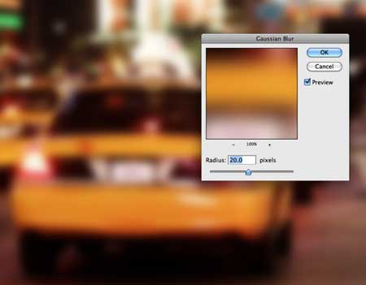
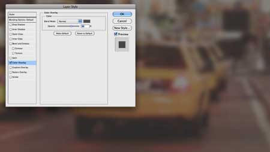
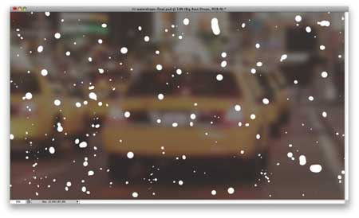
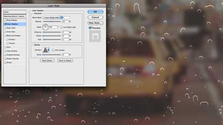
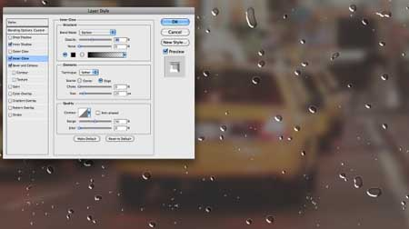

> 💡 Это тот же приём «стили слоя», что в уроке 9 — только здесь он делает **стеклянные капли**.

---

## Часть 4 — Капли стекают вниз (12 минут)

### Шаг 15–17. «Хвосты» от капель

1. Покажи **дубликат** фото (из Шага 6), размой его **Гауссом 5 px** (чуть чётче, чем фон).
2. ПКМ по миниатюре слоя капель → **«Выбрать пиксели»** (выделятся все капли).
3. На слое размытого дубликата: `Слой → Слой-маска → Показать выделенную область`.
4. Выдели маску → `Фильтр → Размытие → Размытие в движении` угол **−90°**, Смещение **80 px** — под каплями потянулись **стекающие хвосты**.
5. `Изображение → Коррекция → Уровни` на маске — подстрой, чтобы хвосты смотрелись естественно.

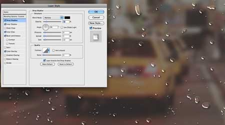
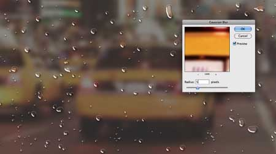

---

## Часть 5 — Пишем пальцем по стеклу (10 минут)

### Шаг 18. Чёткая надпись сквозь запотевание

1. Снова дублируй размытое (5 px) фото, удали с него маску.
2. **«Горизонтальный текст»** (`T`) → напиши **любое слово** (или нарисуй кистью «от руки»).
3. Выдели пиксели текста (ПКМ по миниатюре → «Выбрать пиксели») и примени маску так, чтобы **сквозь буквы было видно чёткое фото** — будто протёр стекло пальцем.

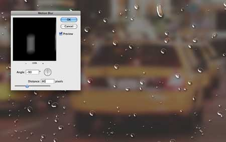

> 💡 Напиши своё имя, смайлик или «HELLO» — то, что рисуют на запотевшем окне в жизни.

---

## Часть 6 — Больше реализма (14 минут)

- **Шаг 19. Мелкие капли:** новый слой, той же кистью-каплями добавь **мелких капель** (особенно по надписи). Скопируй стили слоя с больших капель и вклей на этот слой (`ПКМ → Скопировать/Вклеить стиль слоя`).
- **Шаг 20. Неравномерный туман:** дублируй фото, удали маску → `Слой → Слой-маска → Скрыть всё` → на маске `Фильтр → Рендеринг → Облака` (цвета чёрный/белый, `D`). Запотевание станет **неровным**, как настоящее.
- **Шаг 21–23. Общий блеск:** выдели все слои, дублируй, слей дубли в один. `Гаусс 20 px`. Один раз режим **«Перекрытие» 40 %**, второй дубль — **«Экран» 40 %**.
- **Шаг 24. Виньетка:** верхний новый слой → **радиальный градиент** от тёмно-серого к светло-серому, режим **«Умножение»**.

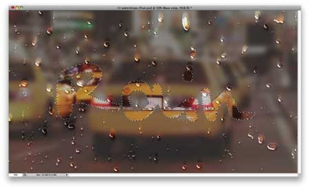

---

## 🎯 А попробуй (по желанию)

- ❄️ **Морозный узор** вместо капель (голубые тона, кристаллики).
- 💧 **Одна крупная капля** с чётким отражением внутри.
- 💬 **Своё сообщение** на стекле + сердечко.

---

## 📋 Что сдать

- `запотевшее-стекло.psd` (слои) + `.png`.
- Своё слово/рисунок «пальцем» по стеклу обязательно.

> 🎤 **Проверь себя:** зачем каплям «Заливка 0»? как сделали стекающие хвосты? как получилась чёткая надпись «сквозь» запотевание? чем сделали неровный туман?
