# 🎮 Доп-задание — «Пиксель-арт: герой для игры»

**Модуль 2 · Фотомагия в Photoshop · Дополнительное задание**
⏱ ~60–90 минут · 🎯 Уровень: 🧩 5–7 и 🎓 9–11 · 🖌 Рисуем с нуля (фото не нужно)

> 📌 Это **самостоятельное доп-задание**: можно делать, если пропустил урок или просто хочешь ещё попрактиковаться. К основному уроку не привязано.
> 🖼 Скриншоты — из старого материала (интерфейс мог измениться); кнопки те же. *(Заказчик позже заменит на свежие.)*
> ⚠️ Всё вручную, без ИИ.

---

## 🎬 Что сделаем и чему научимся

Нарисуем **8-битного персонажа** (спрайт) для игры — пиксель за пикселем, как в ретро-играх. Такой герой пригодится и в твоих проектах на Scratch/геймдеве.

**Освоишь:**
- 🆕 инструмент **«Карандаш»** (рисует чёткие пиксели, без размытия) и настройку **сетки** по 1 пикселю;
- рисование **по слоям** (тело / одежда / волосы / лицо — каждый на своём слое);
- **тени** обтравочной маской в режиме «Мягкий свет» и **блики** в режиме «Перекрытие»;
- правильный **экспорт** пиксель-арта без «замыливания» (интерполяция «По соседним пикселям»).

**Результат:** аккуратный пиксельный герой в `.png`, который не размывается при увеличении.

---

## Часть 1 — Настраиваем Photoshop под пиксели (15 минут)

Пиксель-арт — это рисование **по клеткам**. Сначала настроим программу, чтобы каждый пиксель был виден и чёток.

### Шаг 1. Новый маленький холст

**`Файл → Создать`**:
- Ширина: **50 пикс**, Высота: **50 пикс** (маленький — так и задумано);
- Разрешение: **72**;
- Цветовой режим: **RGB, 8 бит**;
- Содержимое фона: **Прозрачный**.

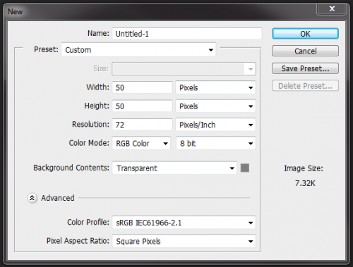
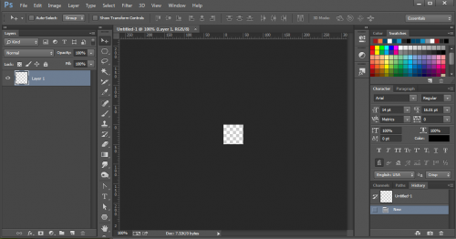

### Шаг 2. Карандаш и Ластик — по 1 пикселю

Возьми инструмент **«Карандаш»** (он в выпадающем меню под «Кистью» — нажми и подержи кнопку кисти). Карандаш рисует **чёткие пиксели без мягких краёв** — именно то, что нужно.
Размер — **1 пиксель**. Ластику тоже задай размер **1 пиксель** и **Режим: Карандаш**.

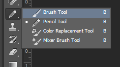
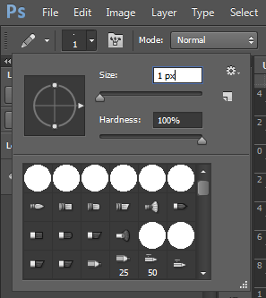
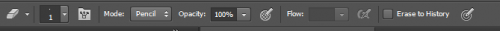

### Шаг 3. Включаем сетку по 1 пикселю

**`Редактирование → Установки → Направляющие, сетка и фрагменты`** → задай **«Линия через каждые: 1 пиксель»**. ОК.
Включи показ сетки: **`Просмотр → Показать → Сетка`** (`Ctrl+'`).

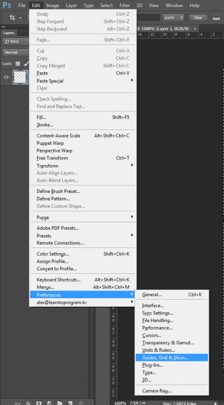
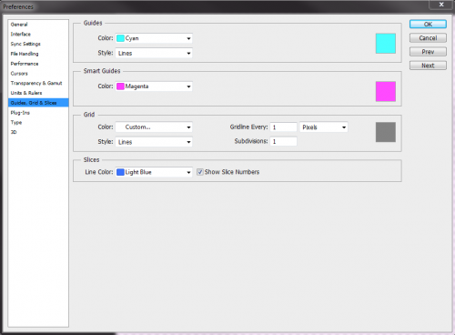
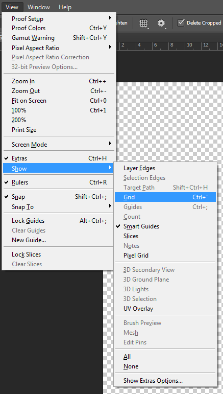

### Шаг 4. Чёткое масштабирование

**`Редактирование → Установки → Основные`** → **«Интерполяция изображения: По соседним пикселям (сохраняет чёткие края)»**.
👀 Теперь при увеличении пиксели останутся **квадратными и чёткими**, а не размытыми.

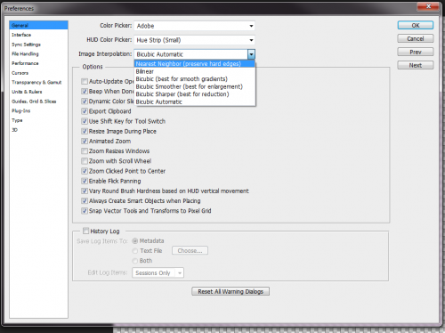

---

## Часть 2 — Рисуем тело (15 минут)

### Шаг 1. Фон и слой тела

Внизу палитры слоёв нажми **◐** (кружок) → **«Цвет»** → выбери нейтральный серый фон (чтобы видеть сетку). Над ним добавь **новый прозрачный слой** (`Слой → Новый → Слой`).

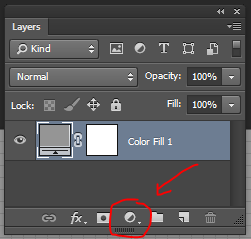

### Шаг 2. Цвет кожи и форма тела

Выбери основной цвет кожи, например **`#F2CB9F`**.

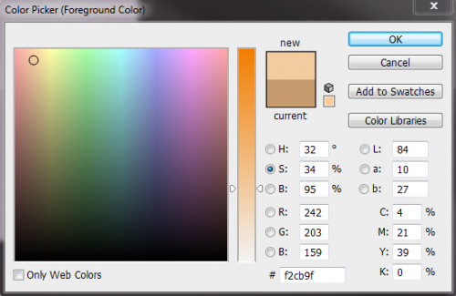

Карандашом нарисуй **простую форму тела** (детали добавим потом). Делай так:
1. Карандашом **15 px** один раз кликни — получится **голова**.
2. Карандашом **3 px** нарисуй **шею** и **грудь** (треугольник вниз).
3. Ниже — **туловище** (треугольник вверх), от него — **ноги**.
4. Поставь точки, где кончаются **руки**: одна поднята, другая опущена. Зажми **`Shift`** и кликни — Photoshop проведёт **прямую линию** между точками (рука).
5. Добавь **кисти и ступни**. Подправь форму (убери/добавь пиксели).

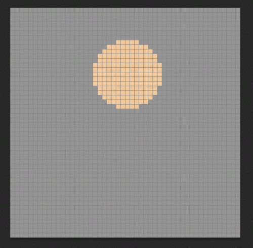

> 💡 **Подсказка:** прямая линия = клик, потом `Shift`+клик в конце. Каждую новую деталь — на **новый слой**, чтобы можно было поправить.

---

## Часть 3 — Одежда, волосы, лицо (15 минут)

Используй форму тела как **шаблон**. Добавь **6 новых слоёв**: рубашка, брюки, обувь, волосы, лицо, мелкие детали. Рисуй каждый элемент на своём слое — так проще исправлять.

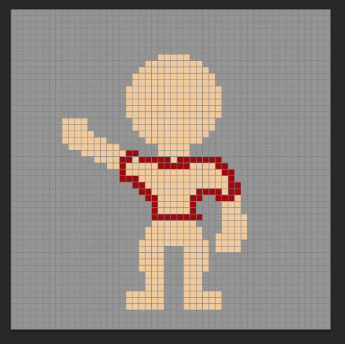
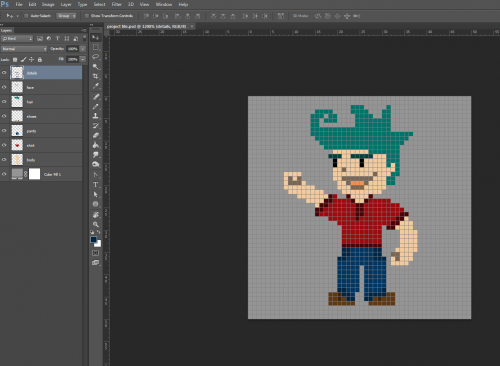

> 💡 Держи слои в порядке и давай им имена («рубашка», «волосы»…). Сгруппируй в папку `Ctrl+G`, чтобы не запутаться.

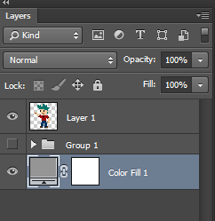

---

## Часть 4 — Тени: объём за минуту (10 минут)

1. Сделай **сведённую копию** всех слоёв: скрой фон-заливку (глазик), нажми **`Ctrl+Alt+Shift+E`** — появится копия персонажа одним слоем.
2. Новый слой сверху, назови **«Тени»**, режим наложения **«Мягкий свет»**.
3. Зажав **`Alt`**, кликни между слоем «Тени» и персонажем — создашь **обтравочную маску** (тени будут только по фигуре, не вылезут за край).
4. **Чёрным** карандашом закрась те места, что в тени (низ рук, под волосами). Чёрное в «Мягком свете» **затемняет** цвет под собой: красная рубашка станет тёмно-красной и т.д.

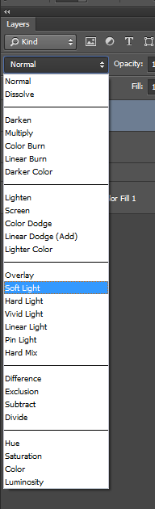
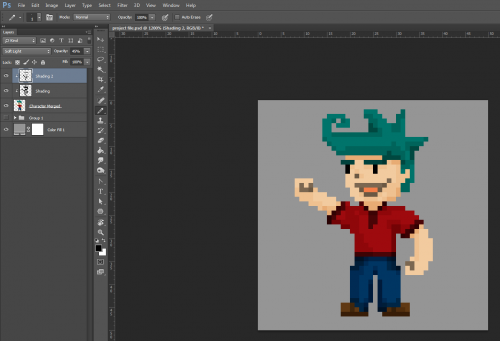

> 💡 Слишком резко? Убавь **непрозрачность** слоя теней. Хочешь глубже — сделай **два** слоя теней с разной непрозрачностью (например 25% и 45%).

---

## Часть 5 — Блики (5 минут)

Так же, как тени, добавь слой **«Блики»**, но режим **«Перекрытие»** и рисуй **белым** карандашом по освещённым местам (макушка, плечи). Белое в «Перекрытии» **высветляет** — появляется объём и «блеск».

---

## Часть 6 — Обрезаем и сохраняем (10 минут)

1. Выключи фон-заливку. **`Изображение → Тримминг`** → «На основе: **Прозрачные пиксели**» → ОК. Холст обрежется плотно по персонажу.

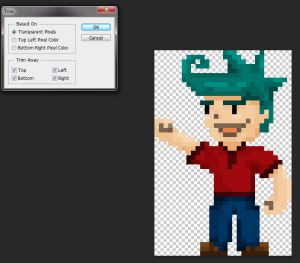

2. **`Файл → Сохранить как…`** → формат **PNG**. Готов крохотный спрайт (~30×45 px).

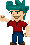

3. Хочешь крупнее без размытия? **`Изображение → Размер изображения`** → «Ресамплинг: **По соседним пикселям (чёткие края)**» → увеличь в 4–8 раз.

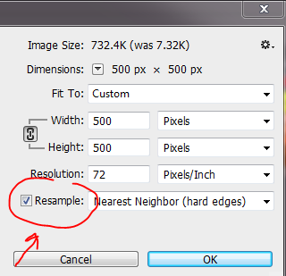

---

## 🎯 А попробуй (по желанию)

- 🐱 **Пиксель-питомец:** нарисуй маленького зверька (кот, дракончик) 32×32.
- 🍎 **Набор предметов:** сердечко, монетка, меч, зелье — иконки для игры, все 16×16.
- 🎞 **Анимация-шаг:** сделай 2 кадра (нога вперёд / нога назад) и переключай — персонаж «идёт».
- 🌈 **Своя палитра:** ограничь себя 4–5 цветами — настоящий ретро-стиль.

---

## 📋 Что сдать

- `пиксель-герой.png` (маленький) + увеличенная версия;
- по желанию — набор иконок или 2 кадра анимации.

> 🎤 **Проверь себя:** почему для пиксель-арта берут «Карандаш», а не «Кисть»? зачем интерполяция «По соседним пикселям»? каким режимом делали тени, а каким — блики?
