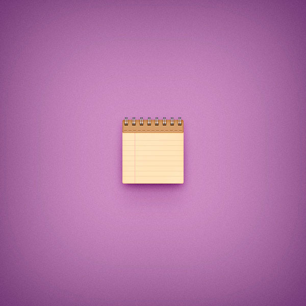

# 📒 Доп-задание — «Рисуем иконку блокнота»

**Модуль 2 · Фотомагия в Photoshop · Дополнительное задание**
⏱ ~90–120 минут · 🎯 Уровень: 🎓 9–11 (много стилей слоя) · 🖌 Рисуем из фигур (фото не нужно)

> 📌 Самостоятельное доп-задание на закрепление **фигур + стилей слоя** (уроки 6 и 9). Хорошо после «Рисуем карандаш».
> 🖼 Скриншоты каждого шага (54 шт.) — в папке [`шаги/`](шаги). В тексте даны числа (размеры, цвета, проценты); точные значения стилей — на скриншотах. *(Заказчик заменит на свежие.)*
> ⚠️ Всё вручную, без ИИ.

---

## 🎬 Что сделаем и чему научимся

Нарисуем **блокнот на пружине** — страница в линейку с полями и металлической спиралью сверху. Иконка в стиле скевоморфизм.

**Освоишь:**
- точные **фигуры** по сетке + **Радиус угла** (скругление);
- **копирование и объединение фигур** (линейки, кольца спирали);
- **стили слоя** (Тиснение, Внутр. тень, Наложение градиента, Тень) для бумаги и металла;
- **маски по форме слоя** (`Ctrl`+клик по миниатюре → маска);
- **текстуру бумаги** (заливка + Шум + смарт-объект) и мягкие **тени**.

**Результат:** аккуратная иконка блокнота в линейку с пружиной.

---

## Фаза 1 — Страница в линейку (30 минут)

### Шаг 1. Документ и сетка

`Ctrl+N` — новый документ. Включи **сетку** (`Просмотр → Показать → Сетка`) и **привязку** (`Просмотр → Привязать к → Сетка`). Настрой: **«Линия через каждые 5 px»**, деление **1**, цвет `#a7a7a7`. Открой панель **«Инфо»** (`Окно → Инфо`) — будет видно размеры.

### Шаги 2–4. Фигура страницы + стили

Нарисуй прямоугольник страницы. Двойным кликом открой **«Стиль слоя»** и включи:
- **Тиснение**, **Внутренняя тень**, **Наложение градиента** (кремовые тона бумаги — настройки на скриншотах).
Переименуй слой в **«Страница»**.

> 💡 В «Наложении градиента» на скринах: **белые** цифры = Положение, **жёлтые** = Непрозрачность точек градиента.

### Шаги 5–6. Горизонтальные линии (линейка)

Нарисуй **горизонтальную линию**, поставь её **Непрозрачность 10 %**. Сделай **7 копий** (`Ctrl+J`) и расставь ровно одну под другой (сетка поможет).

### Шаг 7. Поля (вертикальная розовая линия)

Нарисуй **вертикальную линию**: без заливки, **Штрих `#f5989d`**, ширина **1 pt**, **Непрозрачность 50 %** — это «поля» тетради.

### Шаг 8. Скругляем верх страницы

🆕 Выдели **4 верхние точки** страницы белой **«Стрелкой»** (`A`), открой **«Свойства»** (`Окно → Свойства`), проверь, что **«цепочка» связи радиусов включена**, и задай **радиус 3 px** сверху / **2 px** снизу.
Переименуй в **«Верх»**.

> 🆕 **Скругление углов — через «Свойства».** В старом Photoshop CS6 был отдельный «Прямоугольник со скруглёнными углами» (радиус 3 px); сейчас радиус задаётся у обычной фигуры в панели «Свойства».

---

## Фаза 2 — Спираль-пружина (30 минут)

### Шаги 9–10. Отверстия под пружину

Переключи сетку на **1 px**. Нарисуй **крошечный скруглённый прямоугольник 7 × 5 px** (отверстие). Дублируй (`Ctrl+J`), сдвигай копии **на 15 px вправо**, между ними не меньше **8 px**. Выдели все → ПКМ → **«Объединить фигуры»**. Открой «Стиль слоя»: **Тиснение + Внутр. тень + Тень** (по скриншотам) — отверстия «продавлены».

### Шаги 13–18. Кольца пружины

Нарисуй **красные прямоугольники** (кольца металла), дублируй через **10 px**, объедини. Добавь стили (Наложение градиента = металл, Тень). Дубли с **Заливкой 0 %** и стилями **Обводка / Тень** дают блики и объём колец. Маской по форме «Страница» (`Ctrl`+клик по миниатюре «Страница» → кнопка маски) прячь кольца там, где они «за» страницей.

> 💡 **Маска по форме слоя:** `Ctrl`+клик по миниатюре слоя = выделение его формы → кнопка «Добавить маску». Частый приём для иконок.

### Шаг 19. Стили страницы

Открой «Стиль слоя» слоя **«Страница»**: **Внутренняя тень + Тень** — страница приподнялась над фоном.

---

## Фаза 3 — Объём и текстура бумаги (20 минут)

### Шаги 20–23. Мягкая тень-подсветка

Дубль «Страница» → «Очистить стиль слоя» → **Заливка 0 %** → стили **Внутр. тень + Тень**. Поставь слою **Режим «Мягкий свет», Непрозр. 60 %** — добавит мягкий объём. Ещё фигуры со стилем **Тиснение** — рёбра страницы.

### Шаги 24–25. Текстура бумаги

Новый слой **в самый низ иконки** → **Заливка `#c7b29a`** → стиль **Внутреннее свечение**. Преврати в **смарт-объект** (ПКМ → «Преобразовать в смарт-объект») → `Фильтр → Шум → Добавить шум` — зернистая бумага. (Смарт-объект = шум можно потом переправить.)

---

## Фаза 4 — Тени и фон (15 минут)

### Шаги 26–28. Тени под блокнотом

- Фигура **120 × 125 px** под всеми слоями, **Заливка 0 %**, стиль **Тень** — общая тень.
- Копия с другой **Тенью** — мягче/шире.
- Фигура **110 × 100 px**, смарт-объект, **Непрозр. 50 %**, **Мягкий свет**, `Гаусс 10 px`; ещё одна — `Размытие в движении` угол **−90°**, смещение **100 px** + `Гаусс 15 px` = «растёртая» тень вниз.

Сделай **фон** (заливка + лёгкая виньетка/градиент) по вкусу — на примере фиолетовый.

---

## 🎯 А попробуй (по желанию)

- 📓 **Своя обложка:** сделай блокнот в клетку (вертикальные + горизонтальные линии) или с рисунком на обложке.
- 🎨 **Другой цвет бумаги/фона** — крафт, голубой, чёрный «молескин».
- ✏️ **Положи карандаш** рядом (из доп-задания «Рисуем карандаш») — получится набор канцелярии.

---

## 📋 Что сдать

- `блокнот-иконка.psd` (слои) + `.png`.
- По желанию — набор с карандашом в одном стиле.

> 🎤 **Проверь себя:** как сделать линейку из одной линии? как задать скругление углов сейчас? что такое «маска по форме слоя» (`Ctrl`+клик)? зачем текстуру бумаги делать смарт-объектом?
