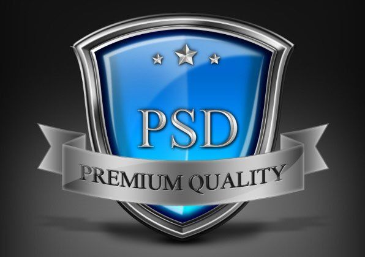
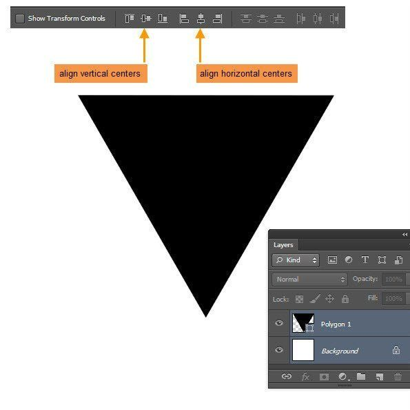
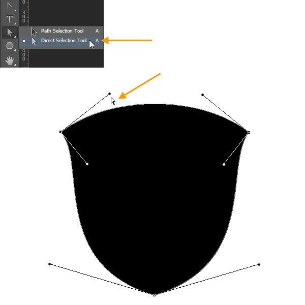
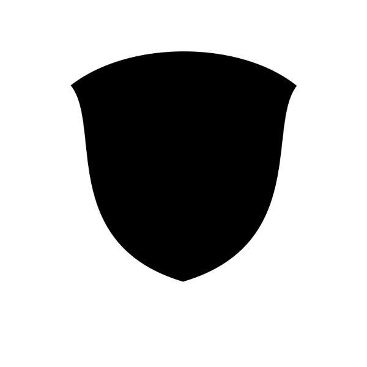
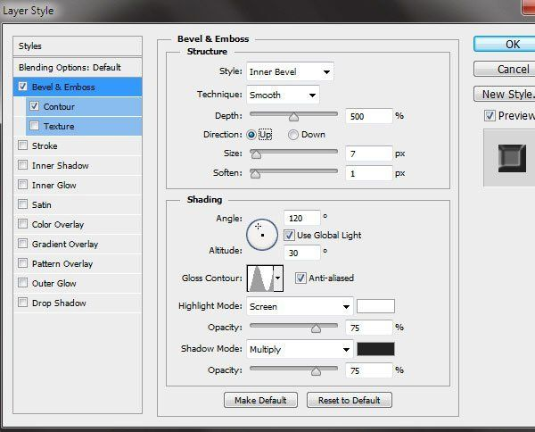
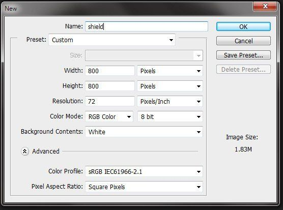

# 🛡 Доп-задание — «Рисуем иконку щита» (премиум-бейдж)

**Модуль 2 · Фотомагия в Photoshop · Дополнительное задание**
⏱ ~2–3 часа (большой проект, можно за 2 занятия) · 🎯 Уровень: 🎓🎓 9–11 (сложное) · 🖌 Рисуем из фигур (фото не нужно)

> 📌 Самостоятельное доп-задание — большой проект на закрепление **фигур + стилей слоя** (уроки 6 и 9). Делится на фазы, можно растянуть.
> 🖼 В этом задании **очень много скриншотов** со стилями слоя — все 128 лежат в папке [`шаги/`](шаги). В тексте даны конкретные числа (размеры, фильтры, шрифты); точные значения стилей — на скриншотах. *(Заказчик заменит скрины на свежие.)*
> ⚠️ Всё вручную, без ИИ.

---

## 🎬 Что сделаем и чему научимся

Соберём металлический **бейдж-щит** с синей сердцевиной, серебряной лентой и надписью — как значок «качества» на сайтах и в играх.

**Освоишь:**
- превращать **фигуру в фигуру** опорными точками (треугольник → щит инструментом **«Угол»**);
- десятки **стилей слоя** (Тиснение, Внутр./Внеш. свечение, Наложение градиента, Тень) — металл, стекло, объём;
- **блики** масками и размытием;
- **ленту** из прямоугольника Деформацией «Арка» + складки;
- **текст** со стилями, **звёзды** произвольной формой, **тени** и **фон**.

**Результат:** объёмный бейдж-щит. Текст можно сделать **свой** (имя, «TOP», «GAME») вместо «PSD».

---

## Фаза 1 — Форма щита из треугольника (25 минут)

1. **Шаг 1.** Новый документ, сохрани как `Shield.psd`. По ходу работы сохраняйся (`Ctrl+S`).
2. **Шаг 2.** Инструмент **«Многоугольник»** (`U`), на верхней панели **3 стороны** → нарисуй **чёрный треугольник**. Масштабируй (`Редактирование → Трансформирование контура → Масштаб`) и **выровняй по центру** холста (кнопки выравнивания на верхней панели).

3. **Шаги 3–5.** Возьми инструмент **«Угол»** (Convert Point Tool). Чтобы он работал, сначала выдели опорную точку белой **«Стрелкой»** (`A`). Затем на каждом из **трёх углов**: кликни по точке и **потяни** — появятся «усы»-рычажки, угол станет **скруглённым/изогнутым**. С зажатым **`Alt`** подправь каждый рычажок. Так острые углы треугольника превращаются в **плавные обводы щита**.

4. **Шаг 6.** Должна получиться форма щита. Назови слой **«shield outer»**, ПКМ → **«Растрировать слой»**.

> 💡 **Главный приём фазы:** «Угол» (Convert Point) делает из прямого угла — скруглённый, управляя «усами». Это основа рисования пером (урок 6).

---

## Фаза 2 — Металлический щит (20 минут)

**Шаги 7–8.** Двойной клик по «shield outer» → добавь стили (точные значения — на скриншотах `шаги/image16–19`):
- **Тиснение:** Стиль — Внутренний скос, Метод — Плавное, Подсветка — «Осветление», Тень — «Умножение»; Контур — **Кольцо**, Контур глянца — **Полукруг**.
- **Внутреннее свечение:** Режим — «Замена тёмным», Метод — Мягкий, Контур — Кольцо.

Дальше (по скриншотам) добавляются **внутренние кольца** щита («shield inner», «shield base mid») со своими стилями — слои металла один в другом. Следуй скриншотам `шаги/`.

> 💡 Металл в Photoshop = **Тиснение + контуры глянца** (Кольцо, Полукруг). Меняя контур, получаешь то матовый, то блестящий металл.

---

## Фаза 3 — Синяя сердцевина и блики (25 минут)

**Шаги ~19–30.** Внутри щита — **синяя сердцевина** («shield core») со стилями (градиент синего, свечение). Поверх — **блики** (refl-слои):
- залей белым, размой **Гауссом**, добавь **маску** и мягкой кистью сделай плавный переход (блик сверху, по бокам);
- непрозрачность бликов **24–50 %**;
- форму бликов меняй **Искажением** (`Трансформировать выделенную область → Искажение`).

> 💡 Блик на стекле/металле = белая заливка + **маска** + размытие. Чем мягче край, тем «стекляннее».

---

## Фаза 4 — Серебряная лента (30 минут)

**Шаги 31–45.** Лента «ribbon front»:
1. Прямоугольная область (`M`) → полоска, залей **50 % серым**.
2. `Редактирование → Трансформирование → Деформация` → тип **«Арка»**, потяни — лента **выгнулась**.
3. Стили: **Обводка** (внутри), **Внутр. свечение** (Осветление), **Наложение градиента** (серебро, линейный).
4. Копия ленты ниже и сдвинута вверх = **задняя часть**; концы вырезаются (`Слой → Вырезать на новый слой`), складки соединяются **Искажением**, стили **копируются** (ПКМ → Скопировать/Вклеить стиль слоя).
5. Треугольные вырезы на концах — **Многоугольным лассо** (`L`) + `Delete`.

> 💡 Лента = прямоугольник + **Деформация «Арка»** + серебряный градиент. Складки — копии с разным углом градиента.

---

## Фаза 5 — Текст, звёзды (20 минут)

- **Шаги 46–49.** **«Горизонтальный текст»** (`T`) → **«PREMIUM QUALITY»**, шрифт Times New Roman **48 pt**, Деформация **«Арка»**. Стили: Тиснение (контурное), Наложение цвета, Внешнее свечение.
- **Шаг 51.** Слово **«PSD»** (или **своё**: имя, «TOP», «WIN»), Times New Roman **122 pt**, чёрный + стили (серебро).
- **Шаги 52–56.** Инструмент **«Произвольная форма»** (`U`) → **звезда**. Нарисуй над текстом, скопируй стили, сделай **3 звезды** (большую по центру, две поменьше по бокам).

> 💡 Поставь **своё** слово — так бейдж станет твоим логотипом.

---

## Фаза 6 — Тени и фон (25 минут)

- **Шаги 57–65.** Тени под щитом и лентой: новый слой под фигурой → чёрная заливка по форме → **уменьши высоту** (`Ctrl+T`) → **Гаусс 4–10 px** → непрозрачность **30–70 %** → **маской** ослабь края (чтобы не было «грязи» от наложения теней).
- **Шаги 66–70.** Внутренние тени на кольцах щита (сжатое выделение −3 px, чёрным, разрезать лассо на 3 части, маски, 70 %) — добавляют глубину.
- **Шаги 71–73.** Фон: слой «bg grd» со стилями **Внутр. тень + Внутр. свечение + Наложение градиента (радиальный)** — тёмная «студийная» подложка.

---

## 🎯 А попробуй (по желанию)

- 🎮 **Игровой бейдж:** вместо «PSD» — «LEVEL 1», звёзды = количество очков.
- 🥇 **Медаль/герб класса:** своё слово и цвет сердцевины (золото, изумруд).
- ✂️ **Упрощённая версия** (для 🧩): щит + сердцевина + одно слово, без ленты и теней.

---

## 📋 Что сдать

- `щит-бейдж.psd` (со слоями) + `.png`.
- Текст — **свой** (не обязательно «PSD»).

> 🎤 **Проверь себя:** как из треугольника сделали щит? чем инструмент «Угол» отличается от «Стрелки»? как сделан металлический блеск? чем выгибали ленту? из чего состоит реалистичная тень?
