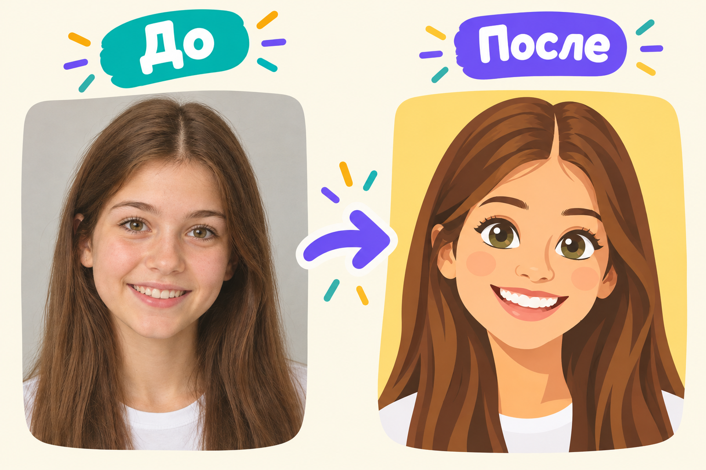
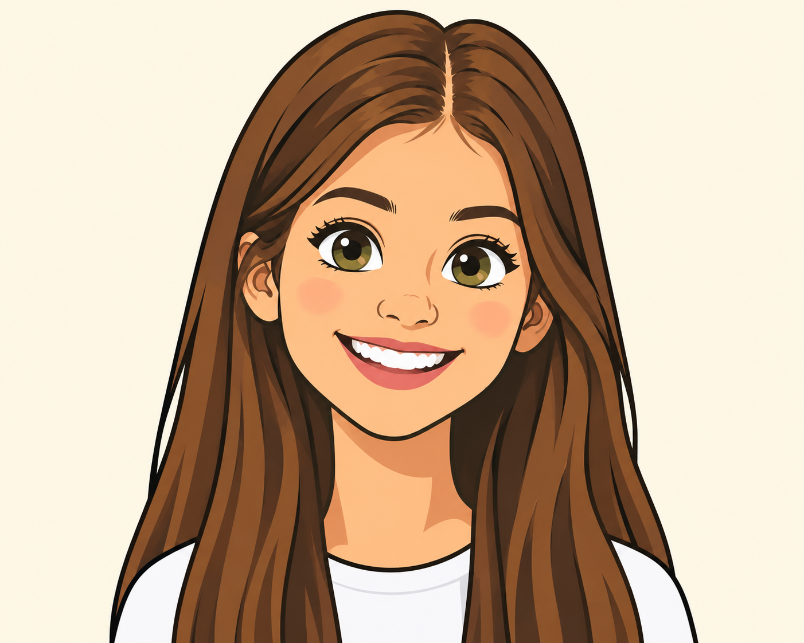
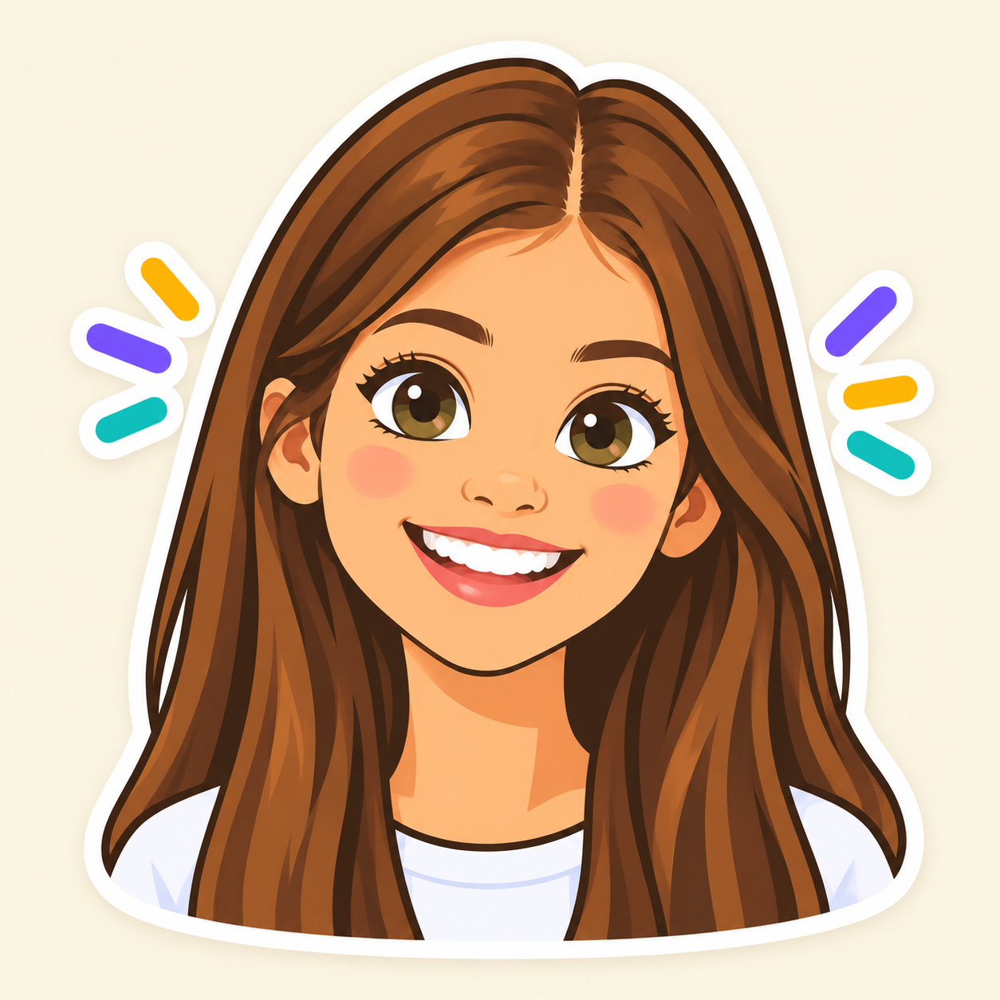

# 🤖 Вау доп-проект «Мультяшный аватар» (к уроку 8)

**Фотомагия в Photoshop · доп-проект к Уроку 8 · 🎓 продвинутый, ~40–50 минут**

> 🧭 Отдельный пошаговый проект (чтобы не раздувать урок). Берём **селфи** и превращаем его в **мультяшный аватар** — как персонаж из мультика или стикер: большие глаза, плоские «постерные» цвета и чёрная обводка-контур. Соединяем **шарж из урока 8** с новыми фильтрами.
> ⚠️ Всё вручную, по шагам. Делаем на **своём** фото или с разрешения.

---

## 🎬 Что сделаем и что получим

Из обычного селфи получим **аватар в мультяшном стиле**: лицо чуть «шаржировано» (большие глаза), кожа и одежда — **плоскими цветными пятнами**, по контуру — **рисованная обводка**, сверху — яркий фон и «стикерная» белая рамка. Готовую картинку можно поставить на аватарку.

**🆕 Новые приёмы этого проекта:**
- 🆕 фильтр **«Аппликация»** (Cutout) — превращает фото в плоские цветные пятна (мультяшность);
- 🆕 фильтр **«Выделение краёв»** (Find Edges) + «Умножение» — рисует **контурную обводку**;
- 🆕 **«Выделить предмет»** + стиль слоя **«Обводка»** — «стикерная» белая рамка;
- Face-Aware «Пластика» из урока 8 — мультяшные глаза;
- **блики в глазах** (catchlights) — оживляем взгляд.

---

## 🧭 Как читать

Шаги короткие, идём по порядку. Сохраняй почаще (`Ctrl+S`), не бойся откатывать (`Ctrl+Z`). Все числа — примерные: подбирай «на глаз» под своё фото.

---

## Шаг 1. Подготовка и мультяшные глаза

1. Открой селфи. Продублируй слой (`Ctrl+J`), назови **`аватар`**.
2. `Фильтр → Пластика…` → инструмент **«Лицо»** (`A`) → раздел **«Пластика с учётом лица»**: чуть увеличь **«Размер глаз»** (замочек 🔗 включён — симметрия), можно добавить **«Улыбку»**. `ОК`.

> 👀 Лицо стало чуть мультяшным — глаза крупнее. Не переусердствуй: аватар должен остаться похожим на тебя.

---

## Шаг 2. 🆕 Плоские «мультяшные» цвета — фильтр «Аппликация»

1. Продублируй слой `аватар` (`Ctrl+J`), назови **`цвет`**.
2. **`Фильтр → Галерея фильтров… → Имитация → Аппликация»** (Cutout). Настрой ползунки:
   - **Количество уровней: 6–8** (сколько цветовых пятен; больше — детальнее);
   - **Простота краёв: 2–3**;
   - **Чёткость краёв: 2–3** → `ОК`.

> 👀 **Результат:** фото стало похоже на рисунок из цветной бумаги — плоские пятна вместо плавных переходов. Это «тело» мультяшного стиля.
> 💡 Хочешь мягче, «масляно»? Вместо «Аппликации» попробуй **`Фильтр → Стилизация → Масляная краска`**.

---

## Шаг 3. 🆕 Контурная обводка — фильтр «Выделение краёв»

Мультфильм узнают по **чёрному контуру**. Сделаем его из того же фото.

1. Снова продублируй исходный слой `аватар` (`Ctrl+J`), перетащи копию **наверх**, назови **`контур`**.
2. **`Фильтр → Стилизация → Выделение краёв`** — на белом фоне проступят цветные линии по краям.
3. Обесцветь: **`Изображение → Коррекция → Обесцветить`** (`Shift+Ctrl+U`) — линии станут серо-чёрными.
4. Сделай линии чёткими: **`Изображение → Коррекция → Уровни`** (`Ctrl+L`) — **чёрный ползунок вправо, белый влево**, пока фон не станет чистo-белым, а контур — чёрным. `ОК`.
5. Поставь слою `контур` режим наложения **«Умножение»** (Multiply) — белое исчезнет, останется **только чёрная обводка** поверх цветных пятен.

> 👀 **Результат:** поверх плоских цветов лёг **рисованный контур** — уже настоящий мультяшный аватар! ⚠️ Контур слишком «грязный»? Добавь слою `контур` маску и сотри лишние линии на фоне чёрной кистью.

---

## Шаг 4. Оживляем глаза — блики

Мультяшный взгляд — это **белые блики** в глазах.

1. Новый слой наверху (`Ctrl+Shift+N`).
2. Возьми **Кисть** (`B`), жёсткость 100%, цвет **белый**, маленький размер.
3. Поставь по **одной белой точке** на радужке каждого глаза (в одном и том же месте — например, вверху слева). Можно добавить точку поменьше рядом.

> 👀 Глаза «засветились» и стали живыми — как в мультфильмах.

---

## Шаг 5. Яркий фон и «стикерная» рамка

1. **Объедини видимое в новый слой:** `Alt+Shift+Ctrl+E` (получится один слой-аватар наверху), назови **`стикер`**.
2. **Выдели себя:** `Выделение → Предмет` (программа сама обведёт фигуру). При необходимости поправь маской.
3. Скопируй выделенное на новый слой (`Ctrl+J`) — теперь ты «вырезан».
4. **Под** собой создай слой и залей **ярким фоном** (`G` — Заливка; сочный цвет или градиент).
5. **Белая рамка-стикер:** дважды кликни по слою с вырезанной фигурой → **Стиль слоя → Обводка** → цвет **белый**, положение **«Снаружи»**, размер **10–20 px**. Можно добавить **«Тень»**.

> 👀 **Результат:** аватар как наклейка — яркий фон, белая обводка по контуру, лёгкая тень.

---

## Шаг 6. Сохраняем

- **PSD** (со слоями): `Файл → Сохранить как…` → Photoshop.
- **PNG** (аватарка): `Файл → Экспортировать → Быстрый экспорт в PNG`.

**🎉 Готово!** Поставь на аватарку в мессенджере или распечатай как стикер.

---

## ✅ Что освоили

- 🆕 **«Аппликация»** — плоские мультяшные цвета;
- 🆕 **«Выделение краёв» + «Умножение»** — рисованный контур;
- Face-Aware «Пластика» — мультяшные глаза;
- блики в глазах (catchlights);
- 🆕 **«Выделить предмет» + «Обводка»** — стикерная рамка.

> 🎓 Уровень 9–11 и всех, кто хочет «как настоящий мультперсонаж». Самый эффектный момент — когда ложится чёрный контур и фото «оживает» мультфильмом.

➡️ Вернуться к [основному уроку 8](../theory.md).
