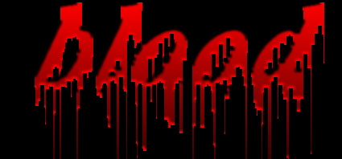

# 🩸 Доп-проект «Кровавая надпись» (к уроку 9)

**Фотомагия в Photoshop · доп-проект к Уроку 9 · 🎓🎓 очень продвинутый, ~35–45 минут**

> 🧭 Надпись как из фильма ужасов: буквы со **стекающими каплями крови**. Самый сложный из текстовых эффектов — тут работаем с **каналами**. Приём из старого курса, команды модернизированы 🆕.
> ⚠️ Делаем на Хэллоуин/постер — по-доброму, это «киношная кровь» (краска). Строго по шагам.
> 🖼 Старые скриншоты шагов — в [`шаги/`](шаги/) (замени своими).

---

## 🎬 Что сделаем
Белый текст на чёрном → потёки «Ветром» → чёрно-белая «штамповка» (Эскиз) → заливка **красным через канал** → объём (Рельеф).

**🆕 Новое:** фильтр галереи **«Линогравюра»**, **работа с каналами** (копия выделения в канал → загрузка канала как выделения), **«Рельеф»**.

---

## Шаг 1. Текст и потёки
1. **`Файл → Создать`**: **1500 × 700 px**, 72, **RGB**, фон **Чёрный**.
2. **«Текст»** (`T`): слово **`КРОВЬ`** / `blood`, жирный, **~150 px**, цвет **белый**. Подвинь **ближе к верху** (внизу место для капель).
3. Сведи (`Ctrl+E`).
4. 🆕 Поверни: `Изображение → Вращение изображения → **90° против часовой**`.
5. **`Фильтр → Стилизация → Ветер`** (Метод «Ветер», **Слева**) — **примени 5 раз** (`Ctrl+F` ×4). Потёки станут длинными.
6. Верни: `Изображение → Вращение изображения → **90° по часовой**` — капли свисают вниз.

## Шаг 2. «Штамповка» (Эскиз)
1. **`Фильтр → Галерея фильтров…`** → раздел **«Эскиз»** → 🆕 **«Линогравюра»**: **Тоновый баланс 5–6**, **Смягчение 1**. `ОК`. Получилась чёрно-белая форма с потёками.
2. **Инверсия:** `Изображение → Коррекция → Инверсия` (`Ctrl+I`).

## Шаг 3. 🩸 Красный через канал (главный трюк)
1. **Выделить всё:** `Ctrl+A`. **Копировать:** `Ctrl+C`. Нажми **`Delete`** (холст очистился).
2. Открой вкладку **«Каналы»** (рядом со «Слоями») → кнопка **«Создать новый канал»** → **Вставить** (`Ctrl+V`) — белая форма букв легла в новый канал.
3. Вернись в канал **RGB** (верхний) и во вкладку **«Слои»**.
4. **Загрузи канал как выделение:** `Ctrl+Alt+4` (или Выделение → Загрузить выделение → твой канал). Побегут «муравьи» по буквам. *(Если выделился фон — `Shift+Ctrl+I`, инверсия.)*
5. **Залей выделение красным** (`Shift+F5` → цвет тёмно-красный `#8a0000`). `Ctrl+D` — снять выделение.

## Шаг 4. Объём и финал
1. **`Фильтр → Галерея фильтров…`** → **«Эскиз»** → **«Рельеф»** — придаст буквам фактуру/объём.
2. *(по желанию)* стилем слоя добавь **Тень** и лёгкое тёмно-красное **Внешнее свечение**.
3. Сохрани **PSD + PNG**.

**🎉 Готово!** Жутко-киношная надпись.

---

## ✅ Что освоили
🆕 Галерея фильтров (Линогравюра, Рельеф) и **каналы** (копия в канал → загрузка канала как выделения `Ctrl+Alt+4`) — профи-приём для точных выделений.

➡️ Вернуться к [уроку 9](../theory.md) · другие эффекты: [🔥 огонь](../огненная-надпись/огненная-надпись.md) · [❄️ лёд](../ледяная-надпись/ледяная-надпись.md) · [🧊 объём](../объёмный-текст/объёмный-текст.md).
