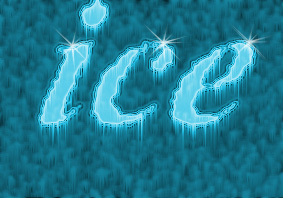

# ❄️ Доп-проект «Ледяная надпись» (к уроку 9)

**Фотомагия в Photoshop · доп-проект к Уроку 9 · 🎓 продвинутый, ~30–40 минут**

> 🧭 Делаем надпись, будто **вырезанную изо льда**: с инеем, шероховатой коркой и сосульками снизу. Приём из старого курса — команды здесь названы **по-современному** (🆕).
> ⚠️ Всё вручную, строго по шагам. 🖼 Картинки шагов в [`шаги/`](шаги/) — это старые скриншоты (для ориентира; результат у тебя будет свой).

---

## 🎬 Что сделаем

Чёрный текст на белом фоне превратится в **ледяную надпись**: ледяная крошка (Кристаллизация + Шум), голубой цвет и **сосульки** (Ветер).

**🆕 Новые фильтры:** Кристаллизация · Добавить шум · Размытие по Гауссу · Инверсия · Ветер · Цветовой тон/Насыщенность (Тонирование).

---

## Шаг 1. Документ и текст
1. **`Файл → Создать`**: **1000 × 700 px**, 72, 🆕 **Градации серого**, фон **Белый**.
2. **«Текст»** (`T`): напиши слово (напр. **`ЛЁД`** / `ice`), жирный, **~180 px**, цвет **чёрный**.
3. **«Перемещение»** (`V`): подвинь надпись **ближе к верху** — внизу оставь место для сосулек.
4. Сведи: **`Слой → Выполнить сведение`** (или `Ctrl+E`).

## Шаг 2. Ледяная корка
1. 🆕 **`Фильтр → Оформление → Кристаллизация`**: **Размер ячейки 6–8**. `ОК` — буквы «раскрошились» на ячейки льда.
2. 🆕 **`Фильтр → Шум → Добавить шум`**: **Эффект 70 %**, **Гауссовский**, галочка **«Монохромный»** — шероховатость.
3. **`Фильтр → Размытие → Размытие по Гауссу`**: **радиус 1,5–2 px** — смягчить.
4. *(по желанию)* **Кривые** (`Ctrl+M`) — чуть добавь контраста.

## Шаг 3. Сосульки
1. **Инверсия:** `Изображение → Коррекция → Инверсия` (`Ctrl+I`) — лёд стал светлым на тёмном.
2. 🆕 Поверни холст: `Изображение → Вращение изображения → **90° против часовой**`.
3. **`Фильтр → Стилизация → Ветер`**: Метод «Ветер», **Направление «Справа»**. Повтори 1–2 раза (`Ctrl+F`).
4. Верни холст: `Изображение → Вращение изображения → **90° по часовой**` — сосульки свисают вниз.

## Шаг 4. Голубой лёд
1. `Изображение → Режим → **RGB**`.
2. `Изображение → Коррекция → **Цветовой тон/Насыщенность**`: включи **«Тонирование»**, выставь **Тон 191**, **Насыщенность 77**, **Яркость +3** — лёд стал голубым.
3. *(по желанию)* возьми **Кисть** с «брызгами»/искрами (белый цвет) и поставь пару **блёсток** на льду.

## Шаг 5. Сохрани
**PSD** + **PNG** (`Файл → Экспортировать → Быстрый экспорт в PNG`).

**🎉 Готово!** Морозная надпись с сосульками.

---

## ✅ Что освоили
🆕 Кристаллизация, Шум, Инверсия, Ветер (сосульки), Тонирование. Сверху можно добавить **Внешнее свечение** (голубое, режим «Экран») стилем слоя — как на уроке.

➡️ Вернуться к [основному уроку 9](../theory.md) · другие эффекты: [🔥 огонь](../огненная-надпись/огненная-надпись.md) · [🩸 кровь](../кровавая-надпись/кровавая-надпись.md) · [🧊 объём](../объёмный-текст/объёмный-текст.md).
