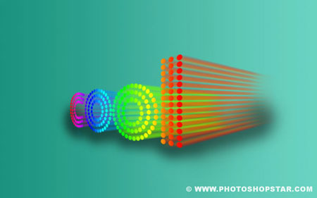

# 🧊 Доп-проект «Объёмный 3D-текст» (к уроку 9)

**Фотомагия в Photoshop · доп-проект к Уроку 9 · 🎓🎓🎓 эксперт, ~50–60 минут**

> 🧭 Самый «взрослый» проект: буквы из цветных **объёмных трубок**, уходящих в перспективу (как 3D-логотип). Тут пригодится **Перо из урока 6** и перспектива. Терпение — результат того стоит!
> 🔤 **Шрифт:** `шрифты/BorisBlackBloxx.ttf` — установи в систему (двойной клик → «Установить») до начала.
> 🖼 Старые скриншоты шагов — в [`шаги/`](шаги/) (замени своими).

---

## 🎬 Что сделаем
Плоское слово → обведём буквы **трубками Пером** → зальём **радужным градиентом** → наклоним в **перспективу** → вытянем **объём** (Размытие в движении) → добавим **тень**.

**🆕 Новое:** обводка контура кистью (Перо), **градиент «Спектр»**, **Перспектива**, объём через **Размытие в движении**, загрузка выделения из слоя.

---

## Шаг 1. Фон и текст
1. **`Файл → Создать`**: **1600 × 1000 px**, RGB.
2. Фон — **градиент**: цвет переднего плана **`#8a5a01`**, фоновый **`#ba9145`** → **Градиент** (`G`), тип **Линейный**, протяни слева направо.
3. **«Текст»** (`T`), шрифт **BorisBlackBloxx**, размер **~400 px** — напиши короткое слово (2–4 буквы, так проще!).

## Шаг 2. Обводим буквы трубками (Перо) 🖊️
> 🔗 Перо подробно — в [уроке 6](../../урок-06-рисуем-иконки/theory.md).
1. **Перо** (`P`), режим вверху — **«Контур»**. Проведи **линию-скелет по центру** первой буквы (клик = угол, клик-потяни = кривая). Поправь белой **«Стрелкой»** (`A`).
2. **Новый слой** (`Ctrl+Shift+N`). Правый клик по контуру → 🆕 **«Выполнить обводку контура»** → инструмент **«Кисть»**, **без** галочки «Имитировать нажим». `Enter` — убрать контур. Получилась «трубка».
3. Повтори обводку по **внутреннему** и **внешнему** краю буквы — каждая на **своём слое**. Итого **3 слоя-трубки** на букву.
4. Так же обведи **все буквы** (для круглых удобно **Эллипс** `U` в режиме «Контур»). Каждый контур — отдельный слой.

## Шаг 3. Радужная заливка
1. Скрой **исходный текстовый** слой (глазик 👁).
2. Выдели все слои-трубки (`Ctrl`+клик) → **`Слой → Объединить слои`** (`Ctrl+E`) → назови **«Объединённый»**. Лишние точки сотри **Ластиком** (`E`).
3. **`Выделение → Загрузить выделение`** → канал **«Объединённый»** — выделятся трубки.
4. Возьми **Градиент** (`G`), пресет **«Спектр»** (радуга). Новый слой **«Градиент»** поверх всех → залей выделение. `Ctrl+D`. Скрой «Объединённый».

## Шаг 4. Перспектива и объём
1. **`Редактирование → Трансформирование → Перспектива`** — потяни верхние углы, чтобы текст «уходил вдаль». `Enter`.
2. **Лассо** (`L`) обведи первую букву → `Ctrl+J` (на свой слой), переименуй.
3. **Объём буквы:** копия буквы (`Ctrl+J`) → **`Фильтр → Размытие → Размытие в движении`** (угол вдоль «глубины») → сделай **4 дубля** → объедини их → положи **под** букву → **Перспектива** вытяни «хвост» вбок. Край смягчи **Ластиком** (непрозрачность 30 %) и инструментом **Размытие**.
4. Повтори для остальных букв.

## Шаг 5. Тень и цвет
1. Новый слой над фоном **«Тень»**: мягкая **Кисть** цвета `#634016`, ~500 px, нарисуй тень под текстом → **Размытие по Гауссу 20** → режим **«Умножение»**, непрозрачность **70 %**.
2. Коррекция всей картинки: корректирующие слои **Цветовой тон/Насыщенность** + **Уровни** — подгони цвет и контраст.
3. Сохрани **PSD + PNG**.

**🎉 Готово!** Настоящий объёмный 3D-логотип.

---

## ✅ Что освоили
Перо + **обводка контура кистью** (трубки), **градиент «Спектр»**, **Перспектива**, объём через **Размытие в движении**, мягкая тень. Это приёмы настоящих 3D-леттеринг-художников.

➡️ Вернуться к [уроку 9](../theory.md) · другие эффекты: [🔥 огонь](../огненная-надпись/огненная-надпись.md) · [❄️ лёд](../ледяная-надпись/ледяная-надпись.md) · [🩸 кровь](../кровавая-надпись/кровавая-надпись.md).
