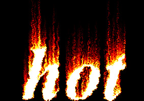
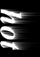
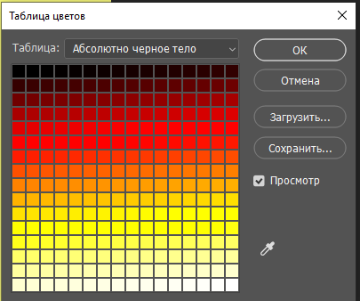

# 🔥 Вау доп-проект «Огненная надпись» (к уроку 9)

**Фотомагия в Photoshop · доп-проект к Уроку 9 · 🎓 продвинутый, ~30–40 минут**

> 🧭 Отдельный пошаговый проект. На уроке мы делали «огненный текст» **текстурой** (обтравочная маска). Здесь сделаем **настоящее пламя** — нарисуем языки огня **фильтрами**, и буквы будут гореть по-настоящему. Классический приём, которым делали огненные логотипы ещё до слоёв-стилей.
> 🆕 Туториал из старого курса — здесь все команды названы **по-современному** (в старом Photoshop они назывались иначе).
> ⚠️ Всё вручную, по шагам.

---

## 🎬 Что сделаем и что получим

Белое слово на чёрном фоне превратится в **надпись, объятую пламенем**: снизу вверх идут живые языки огня, цвет — от тёмно-красного у основания до жёлто-белого на кончиках.

**🆕 Новые приёмы этого проекта:**
- 🆕 режим **«Градации серого»** и раскраска через **«Таблицу цветов → Абсолютно чёрное тело»**;
- 🆕 фильтр **«Ветер»** (тянет языки пламени);
- 🆕 фильтр **«Рябь»** (оживляет огонь);
- **Вращение холста** — чтобы «Ветер» дул снизу вверх.

> 🖼 Старые скриншоты шагов — в [`шаги/`](шаги/) (для ориентира; результат будет свой).

---

## 🧭 Как читать

Шаги короткие, идём строго по порядку (важно!). Сохраняй почаще (`Ctrl+S`).

---

## Шаг 1. Новый документ в оттенках серого

1. **`Файл → Создать`**: ширина **1000 px**, высота **700 px**, разрешение **72**, 🆕 **Цветовой режим: «Градации серого»**, **Содержимое фона: Чёрный**. `Создать`.

> 💡 **Почему «Градации серого»?** Огонь мы сперва рисуем чёрно-белым (как уголёк), а цвет добавим в конце специальной палитрой. И фильтр «Ветер» на сером работает чище.

---

## Шаг 2. Белый текст на чёрном

1. Возьми **«Текст»** (`T`). Напиши слово — например, **`FIRE`** или **`ОГОНЬ`**.
2. Вверху: жирный шрифт, размер **~150 px**, цвет **белый**.
3. Инструментом **«Перемещение»** (`V`) сдвинь надпись **ближе к нижнему краю** холста (языкам нужно место сверху, куда «дуть»).

**👀 Результат:** белые буквы на чёрном фоне внизу кадра.

---

## Шаг 3. Сведи слои

**`Слой → Выполнить сведение`** (или `Ctrl+E` — «Слить с нижним»). Текст станет частью чёрного фона — одним слоем.

> ⚠️ Без сведения фильтры не возьмут текст как «рисунок».

---

## Шаг 4. 🆕 Повернём холст и пустим «Ветер»

Фильтр «Ветер» дует **вбок**, а нам нужно, чтобы пламя шло **вверх**. Хитрость: повернём холст на бок, подуем, потом вернём.

1. **`Изображение → Вращение изображения → 90° по часовой`** — буквы легли на бок.
2. **`Фильтр → Стилизация → Ветер`**: **Метод — «Ветер»**, **Направление — «Слева»**. `ОК`.
3. **Повтори «Ветер» 2–3 раза** — нажми **`Ctrl+F`** (повтор последнего фильтра). Чем больше повторов — тем длиннее языки.

**👀 Результат:** от краёв букв потянулись белые «хвосты» — будущие языки огня.

> 💡 *(По желанию)* **`Фильтр → Стилизация → Диффузия`** (режим «Нормальный») — чуть растреплет края, пламя станет живее.

---

## Шаг 5. Вернём холст и оживим пламя «Рябью»

1. **`Изображение → Вращение изображения → 90° против часовой`** — буквы снова стоят ровно, языки идут вверх.
2. **`Фильтр → Искажение → Рябь`**: **Количество — 100%**, **Размер — «Средний»**. `ОК`.

**👀 Результат:** ровные хвосты изогнулись и «затанцевали» — пламя стало живым.

---

## Шаг 6. 🔥 Раскрашиваем пламя

Сейчас огонь чёрно-белый. Превратим его в настоящий, специальной палитрой.

1. **`Изображение → Режим → Индексированные цвета`** (`ОК`).
2. **`Изображение → Режим → Таблица цветов…`** → в списке **«Таблица»** выбери 🆕 **«Абсолютно чёрное тело»** (Black Body). `ОК`.

**👀 Результат:** чёрно-белое пламя окрасилось как настоящее — **чёрный → красный → оранжевый → жёлтый → белый** (так светится раскалённый металл).

3. *(По желанию)* верни **`Изображение → Режим → RGB`**, чтобы сверху добавить тексту лёгкое **Внешнее свечение** (оранжевое, режим «Экран» — как на уроке) и подписать.

---

## Шаг 7. Сохрани

- **PSD** — `Файл → Сохранить как…` → Photoshop.
- **PNG** — `Файл → Экспортировать → Быстрый экспорт в PNG`.

**🎉 Готово!** Настоящая горящая надпись — на постер, обложку или аватарку.

---

## 🎯 А попробуй другие эффекты (из того же набора)

Теми же приёмами (фильтры + палитры + стили слоя) делают целую серию надписей — **каждая отдельным файлом с шагами:**
- **[❄️ Ледяная](../ледяная-надпись/ледяная-надпись.md)** — Кристаллизация + Шум + Ветер (сосульки) + голубое Тонирование;
- **[🩸 Кровавая](../кровавая-надпись/кровавая-надпись.md)** — потёки Ветром + «Линогравюра» + красный через **каналы** (🎓🎓);
- **[🧊 Объёмная 3D](../объёмный-текст/объёмный-текст.md)** — трубки Пером + градиент «Спектр» + перспектива + объём (🎓🎓🎓).

> 💡 Собери **коллекцию** «огонь / лёд / кровь / объём» — выйдет набор надписей на любой постер.

---

## ✅ Что освоили

- 🆕 **«Градации серого»** + раскраска палитрой **«Абсолютно чёрное тело»**;
- 🆕 фильтр **«Ветер»** (языки) + поворот холста;
- 🆕 фильтр **«Рябь»** (живой огонь);
- связь с уроком: сверху можно добавить **Внешнее свечение** (стиль слоя).

> 🎓 Это «взрослый» приём: так делали огненные логотипы и заставки. Самый красивый момент — когда чёрно-белые хвосты вспыхивают цветом от палитры «Абсолютно чёрное тело».

➡️ Вернуться к [основному уроку 9](../theory.md).
