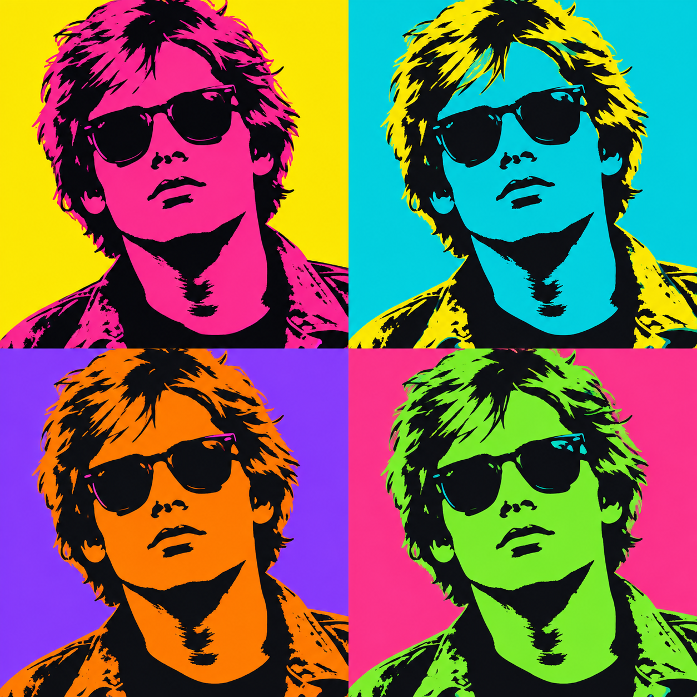

# 🥫 Доп-проект «Поп-арт реклама: свой узор» (к уроку 10)

**Фотомагия в Photoshop · доп-проект к Уроку 10 · 🎓 для 9–11 и всех смелых, ~25–35 минут**

> 🧭 Отдельный пошаговый проект. На уроке мы делали поп-арт **портрет**. Уорхол прославился ещё и **банками супа Campbell** — одним предметом, повторённым рядами. Здесь сделаем **рекламный поп-арт плакат**: предмет (банка газировки / чипсы / кроссовок) на **своём повторяющемся узоре-фоне**.
> 🆕 Новый приём: **свой узор** — `Редактирование → Определить узор` и **заливка узором** (повторяющийся фон из твоего значка).
> ⚠️ Всё вручную, без ИИ.

---

## 🎬 Что сделаем и что получим

Яркий **рекламный плакат** в стиле поп-арт: в центре — предмет, превращённый в плоские цветные пятна (как на уроке), а фон — **бесшовный узор** из маленьких звёзд/точек/молний, который ты сделаешь **сам** и зальёшь им весь слой одним кликом.

**🆕 Новые приёмы этого проекта:**
- 🆕 **Определить узор** (`Редактирование → Определить узор`) — превратить рисунок в «плитку», которая повторяется;
- 🆕 **слой-заливка «Узор»** — замостить фон этим узором (и менять масштаб);
- повтор с урока 10: Постеризация + «Цветовой диапазон» + плоская заливка.

---

## 🧭 Как читать

Шаги короткие, идём по порядку. Сохраняй почаще (`Ctrl+S`).

---

## Часть 1. Делаем свою «плитку» узора

1. **`Файл → Создать`**: ширина **100 px**, высота **100 px**, разрешение **72**, фон **Прозрачный**. `Создать`. Это маленький квадрат — одна «клетка» будущего узора.
2. Нарисуй по центру **один значок**: звезду, молнию, точку, сердце. Проще всего — инструментом **«Произвольная фигура»** (`U`, в наборе фигур есть звезда/сердце) или кистью. Цвет — яркий (например, чёрный или малиновый).

> 💡 **Бесшовность:** держи значок **по центру**, не касаясь краёв квадрата, — тогда при повторении узор ляжет ровно, без швов.

3. **`Редактирование → Определить узор…`** → дай имя «Моя звезда» → ОК.

👀 **Что произошло:** Photoshop запомнил твою клетку как **узор**. Теперь ею можно замостить любой слой.

---

## Часть 2. Заливаем фон своим узором

1. Вернись (или создай) в основной документ плаката (например, **1500×1500 px**, белый фон).
2. Внизу панели слоёв нажми **◐** → **«Узор…»**.
3. В панели «Свойства» открой список узоров → выбери свою **«Мою звезду»**.
4. Ползунком **«Масштаб»** подбери размер (например, 40–60%), чтобы значки шли частой сеткой.

👀 **Что увидишь:** весь фон покрылся повторяющимся узором из твоего значка — фирменный поп-фон.

> 💡 Хочешь другой цвет узора? Поставь этому слою-заливке режим наложения или добавь сверху **слой-заливку «Цвет»** в режиме «Умножение». А масштаб и положение узора можно менять в любой момент — это неразрушаемо.

---

## Часть 3. Предмет в поп-стиле поверх узора

1. Открой фото **предмета** (банка, кроссовок, чипсы) на простом фоне и перетащи его в документ **поверх** узора.
2. **Вырежи предмет от фона** (повтор урока 2: «Быстрое выделение» → слой-маска) — чтобы остался только предмет.
3. Сделай предмет «поп»: по шагам урока 10 — **Обесцветить → Постеризация 3–4 → `Ctrl+Alt+Shift+E` → «Цветовой диапазон» → плоские заливки**. Предмет станет из плоских кислотных пятен.

**Ожидаемый результат:** яркий предмет из плоских цветов **в центре**, вокруг — твой повторяющийся узор. Настоящий рекламный поп-арт.

---

## Часть 4. Надпись и финал

- **«Текст»** (`T`) — добавь крупное слово-слоган: **«POP!»**, **«BOOM»**, название. Жирный шрифт, обводка (стиль слоя — повтор урока 9).
- *(по желанию)* сделай **сетку 2×2** из предмета в разных цветах — как на основном уроке.
- Сохрани **PSD** (`Файл → Сохранить как…`) и **PNG** (`Файл → Экспортировать → Быстрый экспорт в PNG`).

**🎉 Готово!** Рекламный поп-арт плакат с твоим фирменным узором.

---

## 🎯 А попробуй

- **Узор из полутона:** сделай клетку с одной точкой и мелким масштабом — получится «бен-дей» фон, как в старых комиксах.
- **Серия товаров:** повтори один предмет рядами в разных цветах — прямая отсылка к банкам супа Уорхола.
- **Свой бренд:** узор из первой буквы своего имени → фирменный фон для всех работ.

---

## ✅ Что освоили

- 🆕 **Определить узор** (`Редактирование → Определить узор`) — любой рисунок становится повторяющейся плиткой;
- 🆕 **слой-заливка «Узор»** — замостить фон и менять масштаб неразрушаемо;
- связь с уроком 10: плоская заливка зон (Постеризация + «Цветовой диапазон»);
- связь с уроками 2 и 9: вырезание маской + обводка стилем слоя.

> 🎓 Свой узор — мощная вещь: так делают упаковку, обои, фоны соцсетей и мерч. Одна маленькая клетка — бесконечный фон.

➡️ Вернуться к [основному уроку 10](../theory.md).
