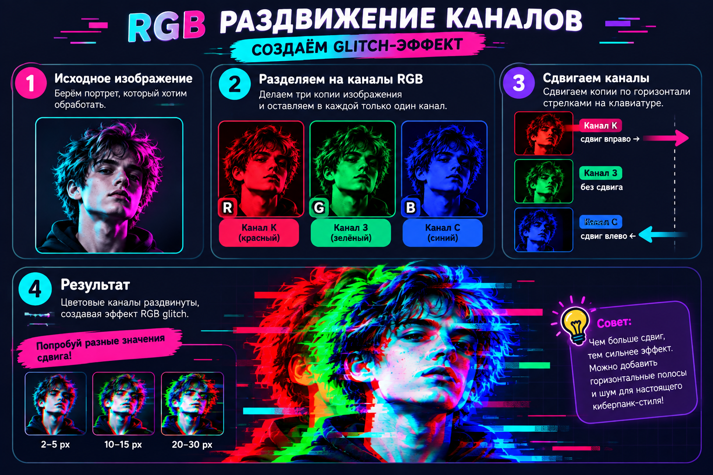
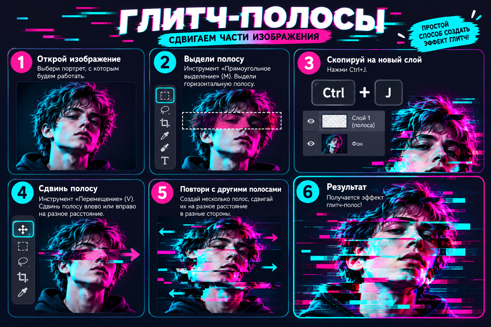
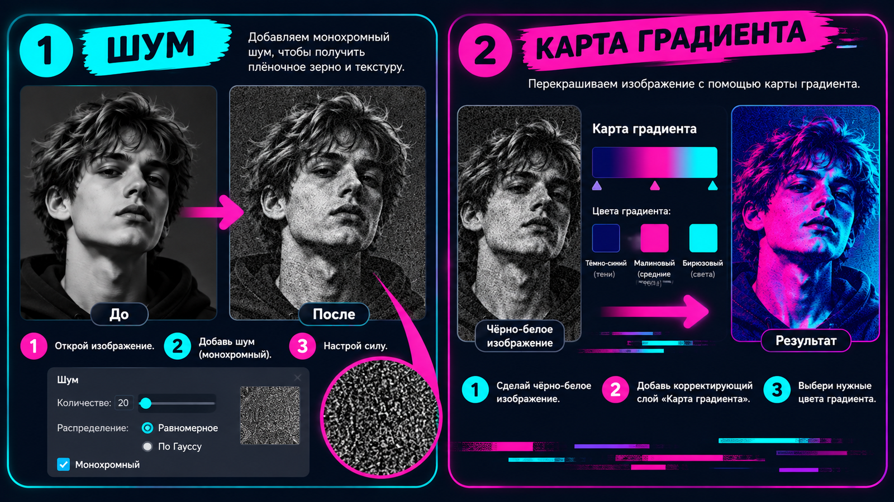
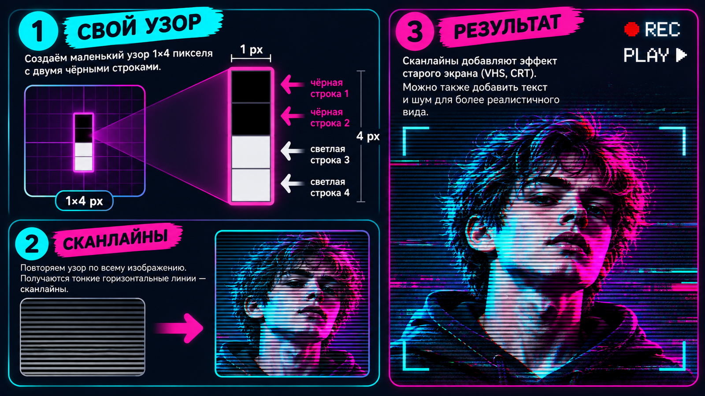

# 🎮 Шпаргалка: как собрать глитч-постер (по шагам)

**К практике урока 11 · держи рядом и отмечай галочки ✅**

> Шагов много — но если идти по порядку, всё получится. Это «рецепт» твоего постера. Подробности каждого приёма — в [теории](theory.md).

---

## 🧩 Фаза 0. Подготовка

- [ ] Открой контрастное фото на тёмном фоне: **`Файл → Открыть`** (напр. `изображения/исходники/киберпанк-портрет.jpg` или своё).
- [ ] Двойной клик по слою «Фон» → ОК (снял замок).

---

## 🔴🔵 Фаза 1. RGB-сдвиг (разъезд цвета)

- [ ] Продублируй слой: **`Ctrl+J`**.
- [ ] Двойной клик по копии → **«Параметры наложения»** → сними галочку канала **«К»** → ОК.
- [ ] «Перемещение» (**`V`**) → нажми стрелку **`←`** 8–12 раз. Появилось красно-голубое двоение. ✅

> 💡 Хочешь глубже — добавь вторую копию с каналом **«С»** и сдвинь её **вправо** (стрелка `→`).

---

## ▭ Фаза 2. Полосы-разрывы

- [ ] Сведи всё в один слой: **`Ctrl+Alt+Shift+E`** → переименуй его в **`глитч`** (двойной клик по имени).
- [ ] «Прямоугольное выделение» (**`M`**) → выдели **тонкую горизонтальную полосу**.
- [ ] **`Ctrl+J`** (полоса на свой слой) → «Перемещение» (`V`) → сдвинь вбок.
- [ ] Повтори **2–4 раза** — полосы **разной** толщины и сдвига (не «жалюзи»!). ✅

---

## ▓ Фаза 3. Помехи и неон-цвет

- [ ] Встань на слой **«глитч»** → **`Фильтр → Шум → Добавить шум`** → 4–8 %, **Монохромный** → ОК.
- [ ] Внизу панели слоёв **◐ → «Карта градиента»** → задай 3 цвета (в поле **HEX**):
  - тёмно-синий **`0A1A3F`** → маджента **`FF3D9A`** → бирюза **`00E5D0`**.
- [ ] Сильно перекрасило? Убавь **«Непрозр.»** слоя до 40–60 %. ✅

> 💾 Сохрани это как `герой_глитч.png` — пригодится для постера.

---

## ✂️ Фаза 4. Вырезаем героя на постер

- [ ] Создай документ-постер: **`Файл → Создать`** ~`1500×2000`, тёмный фон (или открой `изображения/исходники/фон-ночь.jpg`).
- [ ] Перетащи своего глитч-героя в постер.
- [ ] Добавь слою **маску** (кнопка ▢ внизу панели слоёв) → **чёрной кистью** (`B`) по маске убери фон вокруг героя. ✅

---

## 🔤 Фаза 5. Светящийся заголовок

- [ ] «Текст» (**`T`**) → впиши название крупно, жирным шрифтом (сверху или снизу, **не** на лице).
- [ ] Двойной клик по слою текста → собери **неон** (как в уроке 9):
  - **Внешнее свечение** цвет **`00E5D0`**, режим «Экран»;
  - **Обводка** цвет **`F2E1F7`**, 3–6 px, Снаружи.
- [ ] Дай заголовку лёгкий **RGB-сдвиг**: дубль текста (`Ctrl+J`) → «Параметры наложения» → выкл. канал «К» → сдвинь на 3–5 px. ✅

---

## 📺 Фаза 6. Детали «старого экрана» *(по желанию, круто смотрится)*

- [ ] **Сканлайны:** узор 1×4 px (2 строки чёрным) → `Редактирование → Определить узор` → новый слой → `Выполнить заливку → Узор` → непрозрачность ~25 %.
- [ ] **VHS-текст** моноширинным шрифтом в углах: `REC ●` (красный **`FF2D2D`**), `PLAY ►`, дата белым **`F2F2F2`**.

---

## 💾 Фаза 7. Сохрани

- [ ] **PSD:** `Файл → Сохранить как…` → Photoshop (слои целы).
- [ ] **PNG:** `Файл → Экспортировать → Быстрый экспорт в PNG`.

---

## ✅ Финальная проверка

- [ ] RGB-сдвиг (красно-голубые края);
- [ ] 2–4 **разные** полосы;
- [ ] помехи + неон-тон (бирюза/маджента);
- [ ] вырезанный герой на фоне;
- [ ] светящийся заголовок с лёгким сдвигом;
- [ ] *(бонус)* сканлайны + VHS-текст.

🎉 Готово — у тебя киберпанк-постер! Сдавай в [галерею класса](практика.md).

➡️ Вернуться к [практике](практика.md) · [теории](theory.md).
