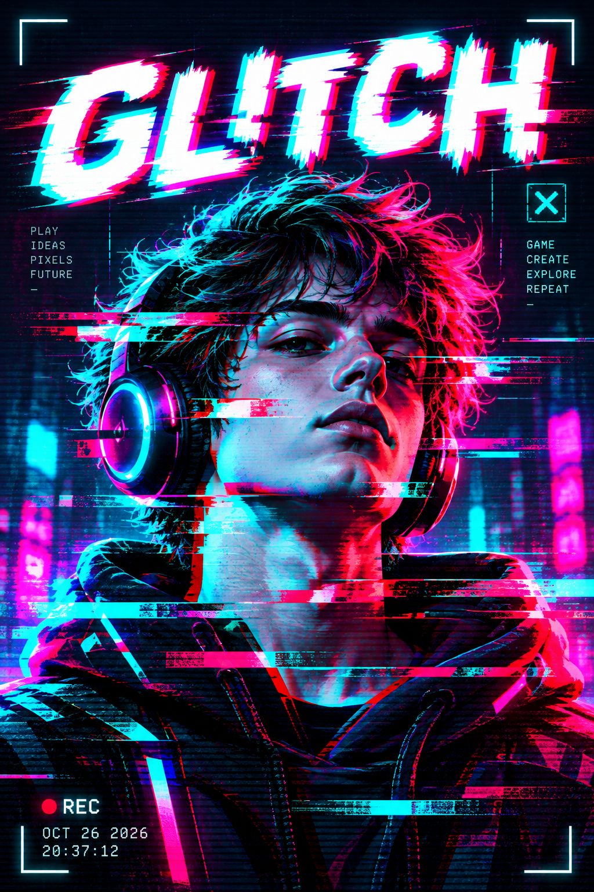

# Самостоятельная работа — Фотомагия в Photoshop, Урок 11

> 🎯 Ты — дизайнер **киберпанк-лейбла «GLITCH/ON»**. Тебе дали **один большой заказ** — сделать **обложку релиза** (трек, игра или фильм). Делаем его в **два этапа**: сначала «ломаем» героя, потом собираем из него постер. Глитч — это **управляемый хаос**: немного поломки, а не каша.

> ⚡ Сначала **разминка** (главный приём за минуту), потом **Этап 1 → Этап 2** по порядку.

> 📋 **Шагов много — не держи в голове!** Открой пошаговую шпаргалку **[«Как собрать глитч-постер»](как-сделать-постер.md)** (с галочками, цветами и картинками) и собирай постер прямо по ней.

---

## ⚡ Разминка — «RGB за минуту»

Открой любое фото → **`Ctrl+J`** → двойной клик по копии → **«Параметры наложения»** → сними галочку канала **«К»** → «Перемещение» (`V`) → стрелка `←` 8–12 раз.

**🏁 Готово, если:** по краям поползло красно-голубое двоение. Главный приём в руках!

---

## 🎬 Придумай релиз (1 минута)

Выбери, **что** выпускаешь — от этого зависят название и настроение:
- 🎧 **трек / альбом** (electronic, phonk, синтвейв);
- 🎮 **игра** в стиле киберпанк;
- 🎬 **сериал / фильм** про будущее.

Придумай **название** (1–2 слова: `NEON`, `GHOST CITY`, `OVERLOAD`) и **героя** (портрет, робот, машина, маска).

---

## 🎯 Вот каким будет твой постер (цель)



К концу практики у тебя должен получиться **вертикальный постер** с таким набором:
- 🦾 **герой** в центре (вырезан от фона) — портрет, робот или sci-fi-персонаж;
- 🔴🔵 **RGB-сдвиг** — красно-голубые края;
- ▭ пара **сдвинутых полос** поперёк героя;
- 🟣 свечение **бирюза + маджента** на тёмном фоне;
- 🔤 крупный **светящийся заголовок** сверху (с лёгким RGB-сдвигом);
- ⏺ мелкий **моноширинный** текст внизу (`REC ●`, дата).

> 🎨 **Промпт-образец** (сгенерируй и покажи детям цель — безопасный, яркий):
> ```text
> cyberpunk glitch poster for teens, a cool character (robot, gamer or sci-fi hero) head-and-shoulders, bright RGB channel split with red and cyan edges, a few horizontal shifted glitch stripes across the face, glowing teal and magenta neon on a dark background, big bold glowing title at the top with a slight RGB offset, small monospaced text at the bottom (REC dot and date), subtle scanline texture, energetic and bright, safe for kids, vertical poster --ar 2:3
> ```

---

## ✅ Этап 1 — «Сломай героя» (глитч на объекте)

Сначала сделай **сам глитч** — но **не на урочном аватаре**, а на своём герое.

**Как делать (по шагам):**
1. Открой контрастное фото на тёмном фоне (напр. `изображения/исходники/киберпанк-портрет.jpg` или своё).
2. **RGB-сдвиг:** `Ctrl+J` → двойной клик → «Параметры наложения» → выкл. канал **«К»** → «Перемещение» → сдвинь стрелками (5–15 px).
3. **Отпечаток:** `Ctrl+Alt+Shift+E` → назови слой **«глитч»**.
4. **Полосы:** `M` выдели тонкую полосу → `Ctrl+J` → сдвинь вбок. Повтори **2–4** раза, по-разному.
5. **Помехи:** `Фильтр → Шум → Добавить шум` (4–8%, монохромный).
6. **Неон-тон:** ◐ «Карта градиента» → тёмно-синий `0A1A3F` → маджента `FF3D9A` → бирюза `00E5D0`.
7. Сохрани как `герой_глитч.png` — он понадобится на Этапе 2.

**💡 Подсказки:**
- Полосы делай **разной** толщины и сдвига — иначе выйдут «жалюзи».
- Сдвиг 5–15 px — читаемо; больше — картинку «съедает».
- Глитч сильнее в **акцентах** (лицо, край), а не ровным слоем по всему кадру.
- Хочешь глубже двоение — добавь **второй** сдвиг по каналу «С» в другую сторону (Часть 2, Шаг 4).

**✅ Этап 1 готов, если:** герой «сломан» — RGB-сдвиг + разные полосы + помехи + неон-тон. Сохранён PNG.

---

## 🔗 Этап 2 — «Собери обложку» (нужен готовый Этап 1!)

Теперь из «сломанного» героя собери **цельный постер**. Подключаем навыки прошлых уроков.

**Как делать (по шагам):**
1. Создай документ-постер (напр. `1500×2000`, тёмный фон) **или** положи фон `изображения/исходники/фон-ночь.jpg`.
2. Перетащи своего **`герой_глитч.png`** (из Этапа 1) в постер.
3. **Вырежи героя** от его фона **слой-маской** *(навык урока 2)* — чёрной кистью по маске убери лишнее, оставь силуэт.
4. **Заголовок** — название «Текстом» (`T`), жирный шрифт. Дай ему **неон стилем слоя** *(урок 9)*: Внешнее свечение (`00E5D0`) + Обводка (`F2E1F7`).
5. Дай **и заголовку** лёгкий RGB-сдвиг (дубль текста → «Параметры наложения» → выкл. канал «К» → сдвинь на 3–5 px).
6. Внизу — мелкий **моноширинный** текст: трек-лист / дата / `GLITCH/ON REC ●`.

**💡 Подсказки:**
- Держи **2 неоновых цвета** на весь постер (бирюза + маджента) — иначе пёстро.
- Заголовок **не по центру лица** — сверху или снизу, крупно.
- Хочешь «экран» — накинь сверху **сканлайны** (Часть 5) с непрозрачностью ~25%.
- Отсвет от неона на герое: мягкая кисть цветом неона, режим «Экран», низкая непрозрачность.

**🏁 Готово, если:** вышла **обложка**, которую не стыдно поставить на релиз: вырезанный глитч-герой на фоне + светящийся глитч-заголовок + мелкий техно-текст. Сверяйся с **образцом постера** в начале практики (блок «🎯 Вот каким будет твой постер»).

---

## 🎯 А попробуй! (мини-миссии с подсказками)

**🔵🔴 «Тройной разъезд».** Вторая копия с одним каналом **«С» (Синий)**, сдвинь в **другую** сторону — двоение станет красно-синим, глубоким.

**🟦 «Битые блоки».** Новый слой → `M` маленький прямоугольник → залей неоном (`00E5D0`/`FF3D9A`) `Alt+Backspace` → режим **«Разница»**. Пара блоков по краям = «артефакты».

**📺 «Сканлайны».** Узор 1×4 px (2 строки чёрным) → `Определить узор` → заливка узором, непрозрачность 25%.

**⏺ «VHS».** Моноширинным шрифтом в углу: `REC ●` (красный `FF2D2D`), `PLAY ►`, дата.

**💧 «Жидкий глитч».** `Фильтр → Искажение → Смещение` с готовой картой `изображения/исходники/map.psd` — пиксели поплывут волнами (Часть 5).

---

## 📋 Что проверяем

- [ ] Этап 1: герой «сломан» — RGB-сдвиг + **разные** полосы + помехи + неон-тон;
- [ ] Этап 2: **обложка** — вырезанный герой (маска) + светящийся глитч-заголовок;
- [ ] 2 неоновых цвета, глитч в акцентах (не каша);
- [ ] Сохранено **PSD + PNG**.

## 🧩 Для 5–7 классов
- Достаточно **разминки** + **Этапа 1** в лёгком виде (RGB-сдвиг + неон-цвет; полосы — по желанию). Этап 2 — если останется время.

## 🎓 Для 9–11 классов
- Сделай **оба этапа** + **сканлайны** и **VHS-подпись**;
- Попробуй **тройной разъезд** (3 канала) и **«Смещение»** (жидкий глитч).

## 🖼 Галерея «Киберпанк класса»
Сдай PNG — соберём неоновую стену обложек. Номинации: **самый «сломанный»** (в хорошем смысле) · **самый стильный** · **лучшая обложка релиза**.

## Что сдать
- `герой_глитч_*.png` (Этап 1) + `обложка_*.psd/.png` (Этап 2). Мини-миссии — бонусом.
