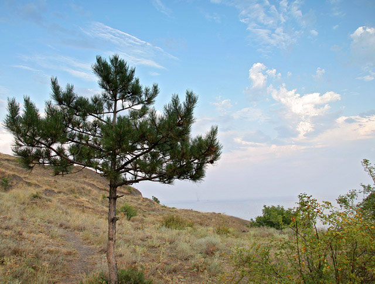
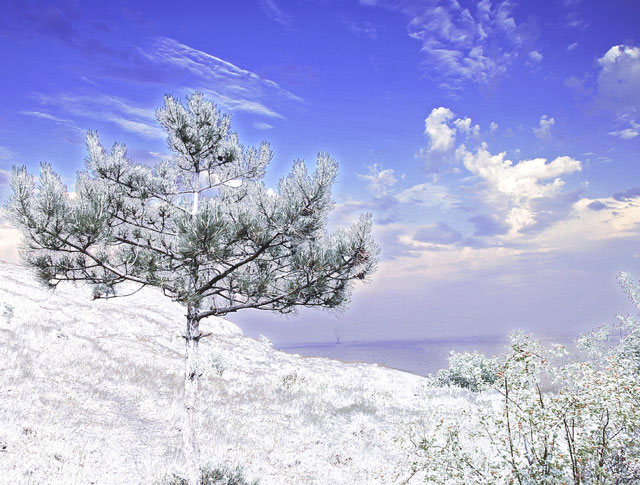
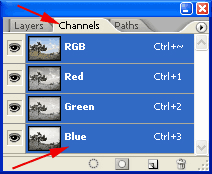
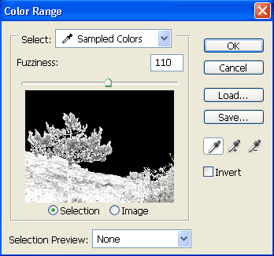
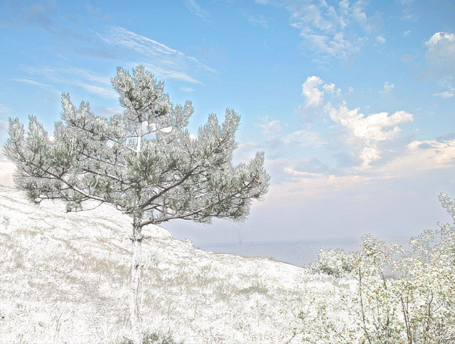
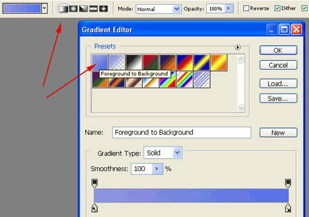
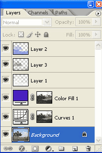

# 🧊 Доп-проект урока 13 — «Зимний пейзаж» (лето → зима)

**Превращаем летнее фото в заснеженный морозный пейзаж.**
Здесь снег берём не из шума, а **из самого фото — через каналы** (новый для нас путь).

> 🔗 Основной урок (дождь/снег/туман/молния из фильтров) — [theory.md](../theory.md).
> 📦 Исходник — `материалы/исходник-лето.jpg` (сосна у моря, лето).
> 🖼 Скриншоты — в папке `шаги/`.
> ⚠️ **Туториал взят из старого архива (эпоха Photoshop CS2, интерфейс английский) и ПОЛНОСТЬЮ обновлён** под современный русский Photoshop. Под каждым старым скрином — плашка **🆕 «сейчас»** с актуальными названиями. Всё вручную, без ИИ.

---

## 🎬 Было лето — станет зима

| Было (лето) | Стало (зима) |
|-------------|--------------|
|  |  |

Сосна на склоне у моря. Солнечный летний день мы превратим в **морозный зимний**: на светлых местах ляжет снег, небо станет глубоко-синим, тени похолодеют.

**Главная идея:** снег в жизни ложится туда, где и так **светло** (верх кроны, трава на солнце). Эти светлые места мы «достанем» из **каналов** и покрасим в белый — получится настоящий снег, повторяющий форму предметов. Потом перекрасим небо и тени в мороз.

**Какие приёмы соберём:**
- 🆕 **снег через каналы** (дублируем канал → инверсия → выделяем светлое);
- 🔁 **«Цветовой диапазон»** (из урока 10) — выделяем снег / небо / тени по цвету;
- 🔁 **Кривые**, **слои-заливки**, **режимы наложения** (из уроков 3/7/10).

---

## Часть 1 — Снег из каналов (12 минут)

### Шаг 1. Дублируем канал и инвертируем

Открой `материалы/исходник-лето.jpg`. Открой панель **«Каналы»** (`Окно → Каналы`).
Канал — это чёрно-белая «карта» одного цвета (красного, зелёного, синего). Нам нужен тот, где **снежные места самые светлые** — обычно **синий**.
Перетащи канал **«Синий»** на кнопку **«Создать канал»** (нижняя панель) — появится копия «Синий копия». Стоя на копии, нажми **`Ctrl+I`** (инверсия).

> 🆕 **Сейчас (рус. Photoshop):** на скрине английские названия — **Channels = Каналы**, **Blue = Синий**. Раньше инверсию делали галочкой «Invert» в окне дубликата — теперь проще нажать **`Ctrl+I`** на копии канала.
> 👀 После инверсии светлые участки (где ляжет снег) стали **тёмными** — канал готов отдать их в выделение.

### Шаг 2. Выделяем снег «Цветовым диапазоном»

Зайди **`Выделение → Цветовой диапазон`** (Color Range). Пипеткой (первая, обычная) кликни по **светло-серому** участку — это будущий снег. Крути ползунок **«Разброс» (Fuzziness)**, глядя на чёрно-белый предпросмотр: **белое = попадёт в выделение**. В оригинале стоит **110**. → ОК.

> 🆕 **Сейчас:** **Color Range = Цветовой диапазон**, **Fuzziness = Разброс**, **Selection = Выделение** (режим предпросмотра). Мы разбирали этот инструмент в **уроке 10** (поп-арт).
> 👀 Вокруг светлых мест побежит «муравьиная дорожка».

### Шаг 3. Переносим снег на отдельный слой

**`Ctrl+C`** (копировать выделенное) → кликни по каналу **RGB** (вернуть цветное изображение) → перейди в панель **«Слои»** → **`Ctrl+V`** (вставить).
Выделенные светлые пиксели легли на **новый слой** — это наш снег. Назови слой **«снег»**.

### Шаг 4. Чистим и отбеливаем

**Ластиком** (`E`) убери снег там, где его быть не должно (например, случайные пятна на небе).
Снег получился сероватым? **`Ctrl+L`** (Уровни) на слое «снег» → тяни **белый** ползунок (справа) **влево** — снег станет **ярко-белым**.

**Ожидаемый результат:** на светлых местах пейзажа лежит белый снег, но небо ещё летнее — сейчас исправим.

---

## Часть 2 — Морозное небо (8 минут)

### Шаг 5. Выделяем небо

Сделай активным слой с **фото** (Background). Снова **`Выделение → Цветовой диапазон`** → кликни пипеткой по **небу**. Подбери «Разброс» так, чтобы в выделение **не попали** лишние детали (деревья, земля). → ОК.

> 💡 Лишнее убери **Быстрой маской** (`Q`) или режимом «Вычесть из выделенной области» на верхней панели (из уроков 2/4).

### Шаг 6. Затемняем небо Кривыми

**`Слой → Новый корректирующий слой → Кривые`** → ОК (окно Кривых **не закрывай**).
Зажав **`Ctrl`**, кликни **по небу** на фото — на кривой появится точка именно для яркости неба. Двигай её **вниз** стрелкой **↓** на клавиатуре (так точка не «виляет»). Подбери глубину на вкус.

> 🆕 **Сейчас:** **Curves = Кривые**. `Ctrl`-клик по изображению ставит точку на кривой — в старом CS2 это не всегда работало, сейчас работает сразу.
> 👀 Небо потемнело, стало глубже и драматичнее.

### Шаг 7. Синий цвет неба

Кликни по **маске** слоя «Кривые», зажми **`Ctrl`** и кликни по маске ещё раз — снова загрузится выделение неба.
**`Слой → Новый слой-заливка → Цвет`** → выбери **сине-фиолетовый `#521BC3`** (R 82, G 27, B 195) → режим наложения слоя **«Цветность» (Color)**, силу убавь **«Непрозрачностью»**.

> 🆕 **Сейчас:** режим **Color = Цветность** (меняет цвет, не трогая яркость — поэтому облака остаются светлыми, а небо синеет).
> 👀 Небо стало морозно-синим.

---

## Часть 3 — Холодный тон снега и тени (10 минут)

### Шаг 8. Голубой градиент на снег

Вернись к слою **«снег»**, зажми **`Ctrl`** и кликни по его миниатюре (загрузить снег как выделение).
Создай новый слой **поверх**. Поставь цвета: основной **`#8E96E1`** (светло-фиолетовый), фоновый **`#4A72E5`** (светло-синий).
Возьми **Градиент** (`G`), тип **Линейный**, пресет **«От основного к фоновому»** → протяни **по всей области снега** (сверху вниз).
Режим слоя **«Перекрытие» (Overlay)**, **«Непрозр.» 65 %**. Сними выделение `Ctrl+D`.

> 🆕 **Сейчас:** **Gradient Editor = Редактор градиента**, **Foreground to Background = От основного к фоновому**, **Linear = Линейный**, **Overlay = Перекрытие**.
> 👀 Снег заиграл холодными голубыми рефлексами — как в морозный солнечный день.

### Шаг 9. Подчёркиваем тени

Сделай видимым только слой с **фото**. **`Выделение → Цветовой диапазон`** → на этот раз кликни по **тёмному** участку (тени деревьев, склон).
**`Ctrl+C`** → включи остальные слои → активируй слой «снег» → **`Ctrl+V`** (тени легли новым слоем над снегом).
Режим этого слоя **«Мягкий свет» (Soft Light)**, «Непрозр.» — по глубине теней.

> 🆕 **Сейчас:** **Soft Light = Мягкий свет** (мягко усиливает контраст — тени становятся выразительнее, но не чернеют).

**Вот так выглядит палитра слоёв в конце** (снизу вверх: фото → Кривые → Заливка неба → снег и тон):

**Готово!** Сохрани `.PSD` (слои) и `.PNG`. Был летний день — стал морозный зимний пейзаж. ❄️

---

## 🆕 Сводка: старые названия → современные (рус.)

Скриншоты выше — из оригинала (английский CS2). Вот перевод и что изменилось:

| В оригинале (англ., CS2) | 🆕 Сейчас (рус. Photoshop) |
|---------------------------|----------------------------|
| Channels · Blue | Каналы · Синий |
| галочка «Invert» в дубликате канала | проще **`Ctrl+I`** на копии канала |
| Color Range · Fuzziness | Цветовой диапазон · Разброс |
| «загрузить выделение слоя» (в CS2 через настройку клавиш) | **`Ctrl`-клик** по миниатюре слоя/маски работает сразу |
| Curves | Кривые |
| Color Fill · blend mode Color | Слой-заливка «Цвет» · режим **Цветность** |
| Gradient · Foreground to Background · Overlay | Градиент · От основного к фоновому · Перекрытие |
| Soft Light | Мягкий свет |

> 💡 Сделал зимний пейзаж? Добавь сверху **снегопад из фильтров** (из [основного урока](../theory.md), Часть 3) — и снег не только лежит, но и **падает**.
