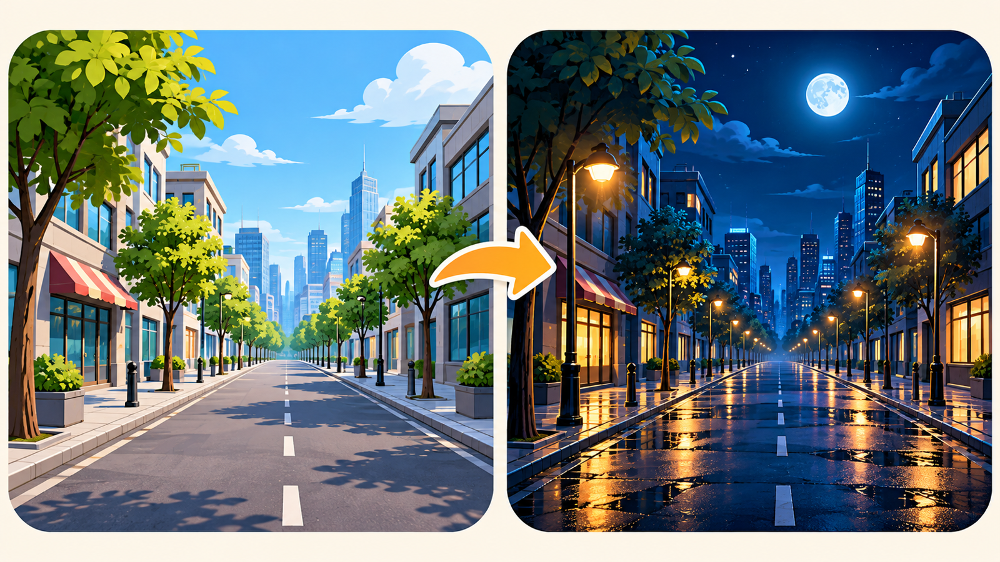
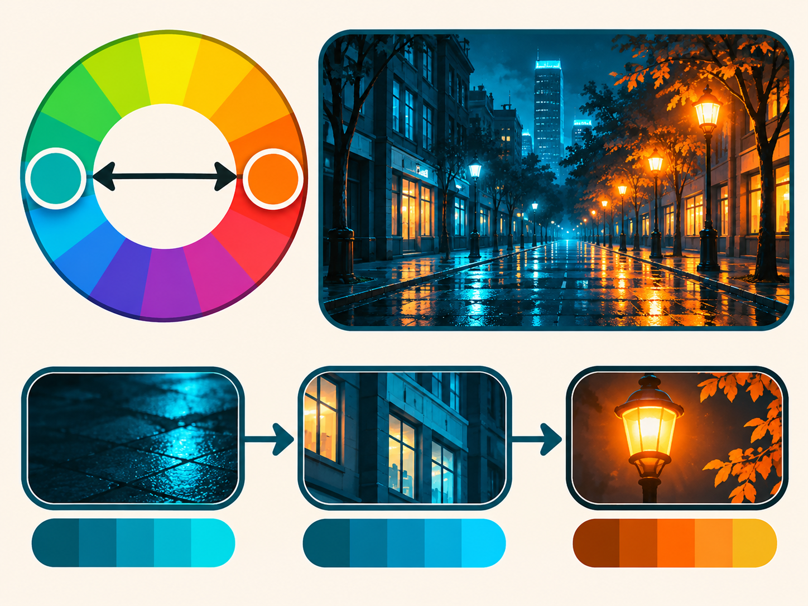
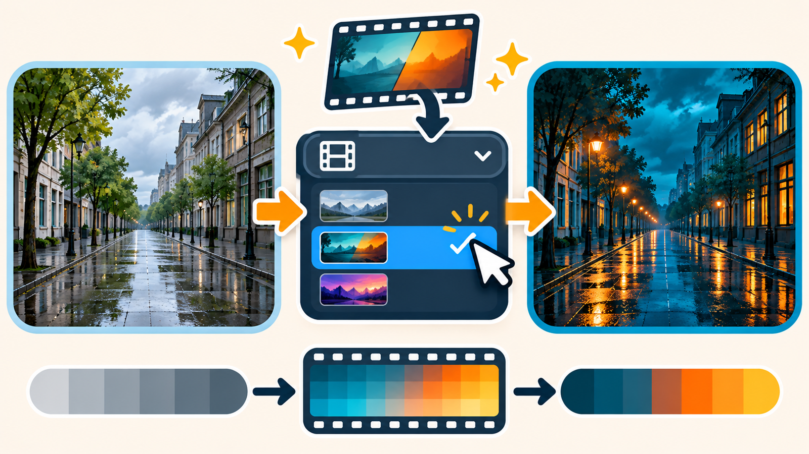
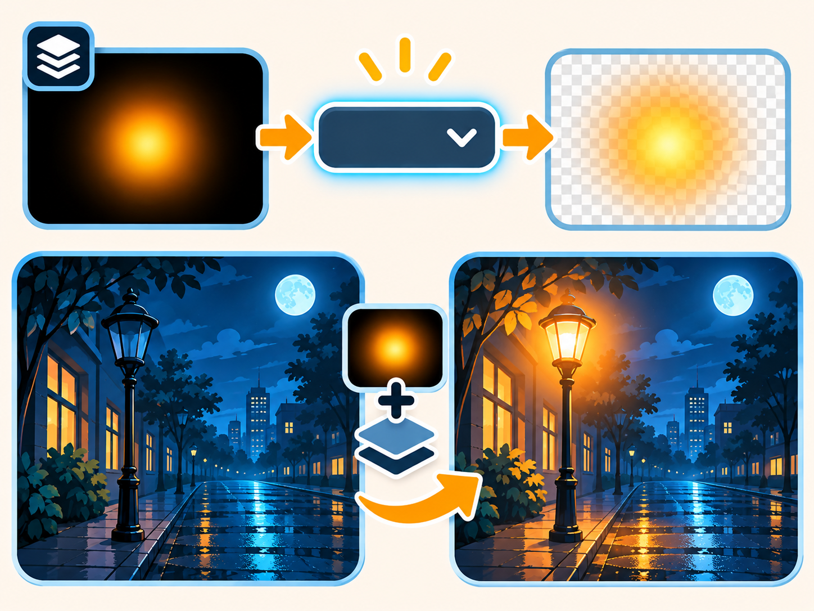
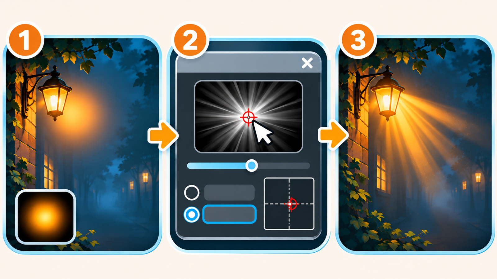
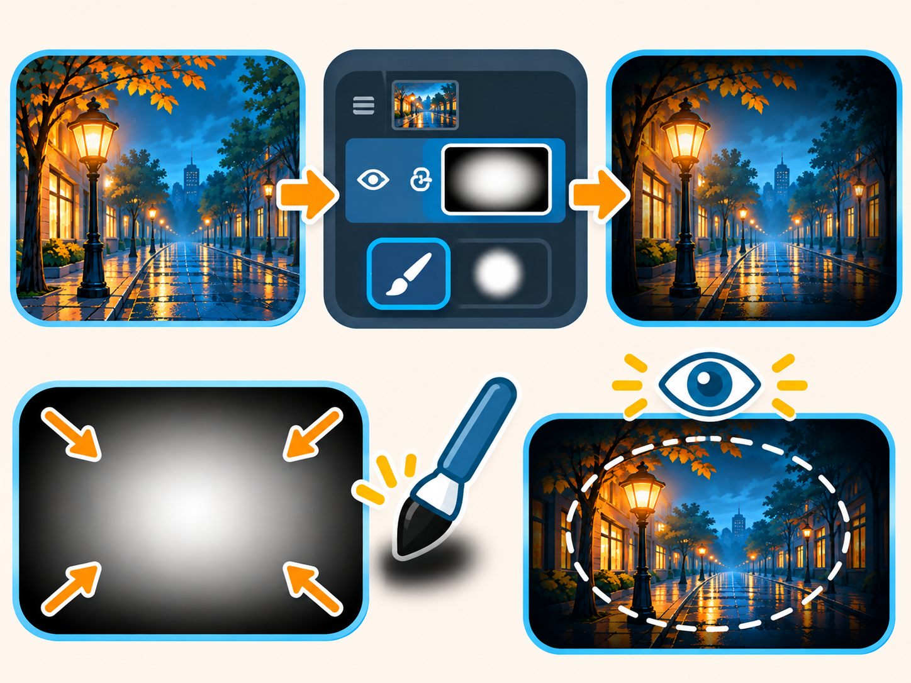

# ⭐ Шпаргалка: как сделать день → ночь

**Держи рядом, пока работаешь.** Ставь галочку ☑ за каждый готовый шаг.
Здесь коротко, с пояснениями «что происходит» и **картинками-инструкциями**.

> 🎯 **Цель:** дневное фото → ночной кинокадр: синие тени + тёплые огни + луна + лучи + виньетка.

> 🧠 **Три кита:** цвет = настроение (тёплый/холодный) · слой ◐ красит, не портя фото (маска прячет эффект) · режим **«Экран»** добавляет свет (чёрное исчезает).
> 🏷️ **Называй слои!** Их будет 8–10. Создал слой — сразу дай имя (двойной клик по названию).

---

## 🌃 ФАЗА 0 — подготовка

- [ ] Открой дневную сцену (`Файл → Открыть`).
- [ ] `Ctrl+J` — копия фона, назови **«фото»** (оригинал внизу не трогаем).

---

## 🌙 ФАЗА 1 — тёмное + синее (ночь)

*Идея: убрать дневной свет и увести тени в синеву.*

- [ ] **◐ Кривые** → середину линии вниз (потемнело, но не в чёрный). Слой **«затемнение»**.
- [ ] **◐ Цветовой баланс** → «Тени» к **Синему**, «Средние» чуть к синему. Слой **«синева»**.
- [ ] Проверка: это уже **синие сумерки**, а не «серая темнота».

> ⚠️ Без синих теней ночь не читается! Просто темнее = «серая ночь».

---

## 🎨 ФАЗА 2 — teal & orange (киношный цвет)

*Идея: тени — холодные, света — тёплые. Противоположные цвета усиливают друг друга.*

- [ ] **◐ Цветовой баланс** → «Тени» к Голубому/Синему, «Света» к Жёлтому/Красному. Слой **«teal-orange»**.
- [ ] *(9–11)* **◐ Выборочная коррекция цвета** → «Синие» глубже, «Жёлтые/Красные» теплее. Слой **«точный-цвет»**.

---

## 🎬 ФАЗА 3 — кино-грейд «Поиск цвета» (LUT)

*Идея: готовый кино-тон в один клик. LUT = таблица цвета, НЕ ИИ.*

- [ ] **◐ Поиск цвета** → выбери холодно-синий профиль (Cold_Blue / Moonlight). Слой **«грейд»**.
- [ ] **Приручи:** «Непрозр.» слоя до **50–70 %**.
- [ ] По **маске ▢** чёрной кистью (`B`, ~30 %) открой **окна, фонари, лицо** — свет остался тёплым.

---

## 💡 ФАЗА 4 — свет: огни, свечение, луна

*Идея: свет рисуем на слоях «Экран» — чёрное исчезает, остаётся свечение.*

- [ ] Новый слой **«огни»**, режим **«Экран»**, тёплая мягкая кисть (`#FFB347`) → пятна по окнам/фонарям.
- [ ] Слой **«свечение»** («Экран», под «огнями») — ореол вокруг огней (кисть крупнее, тусклее).
- [ ] Слой **«луна»** — белый круг в небе + слой **«луна-свет»** («Экран») со свечением вокруг.
- [ ] Проверка: огни **тёплые**, не синие!

---

## ☀️ ФАЗА 5 — лучи света (God rays)

*Идея: свет из точки растягиваем в лучи.*

- [ ] Новый слой **«лучи»**, яркое **пятно** у источника (луна/фонарь).
- [ ] **Фильтр → Размытие → Радиальное размытие** → метод **«Линейный»**, центр **на источник**, количество 60–100.
- [ ] Слою режим **«Экран»**, убавь «Непрозр.».

> ⚠️ Метод **«Кольцевой»** даёт завихрение — нам нужен **«Линейный»**.

---

## 🖼 ФАЗА 6 — виньетка + баланс

*Идея: тёмные края собирают взгляд в центр.*

- [ ] Новый слой **«виньетка»**, большая мягкая **чёрная** кисть (~30 %) по краям. «Непрозр.» 30–50 %.
- [ ] Отойди на шаг: тени синие? огни тёплые? в меру? — спорное убавь «Непрозр.».

---

## 💾 ФАЗА 7 — сохранить

- [ ] `.PSD` (`Файл → Сохранить как…`) — все слои целы.
- [ ] `.PNG` (`Файл → Экспортировать → Быстрый экспорт в PNG`).
- [ ] Имя: `день-ночь.psd` / `день-ночь.png`.

---

### 🎨 Цвета-подсказки
| Что | Цвет |
|-----|------|
| Тёплые огни | `#FFB347` (жёлто-оранжевый) |
| Тени ночи | синий / бирюза |
| Луна / лучи | белый → тёплый |

### ⌨️ Клавиши
`Ctrl+J` дубль · `B` кисть · `D` сбросить цвета · `X` поменять цвета · `0–9` непрозрачность кисти · `[` `]` размер кисти · `Ctrl+Z` отмена.

> ✅ Проверь: тёмное + **синие тени** + **тёплые огни**, эффекты **в меру**, всё на **подписанных слоях**.
