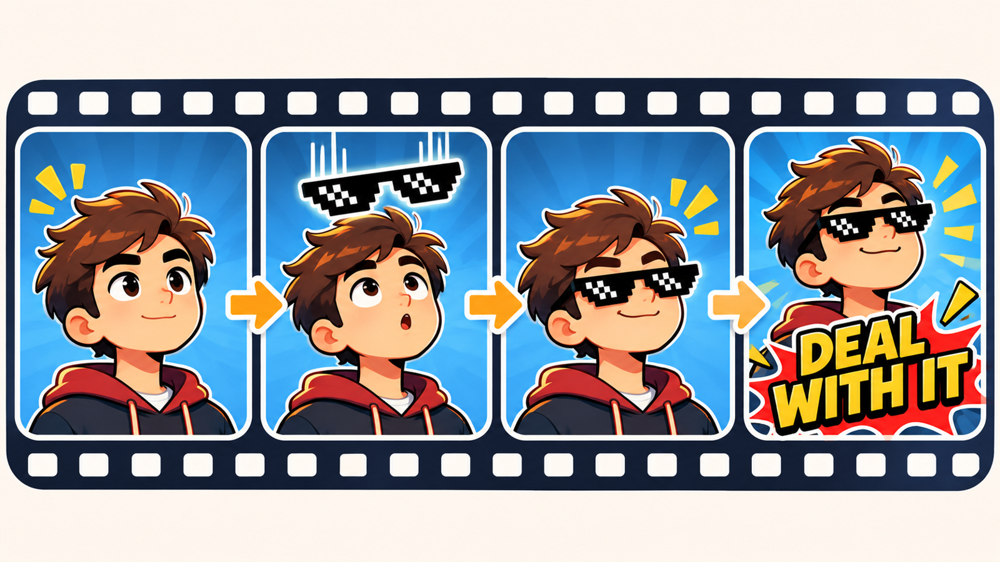
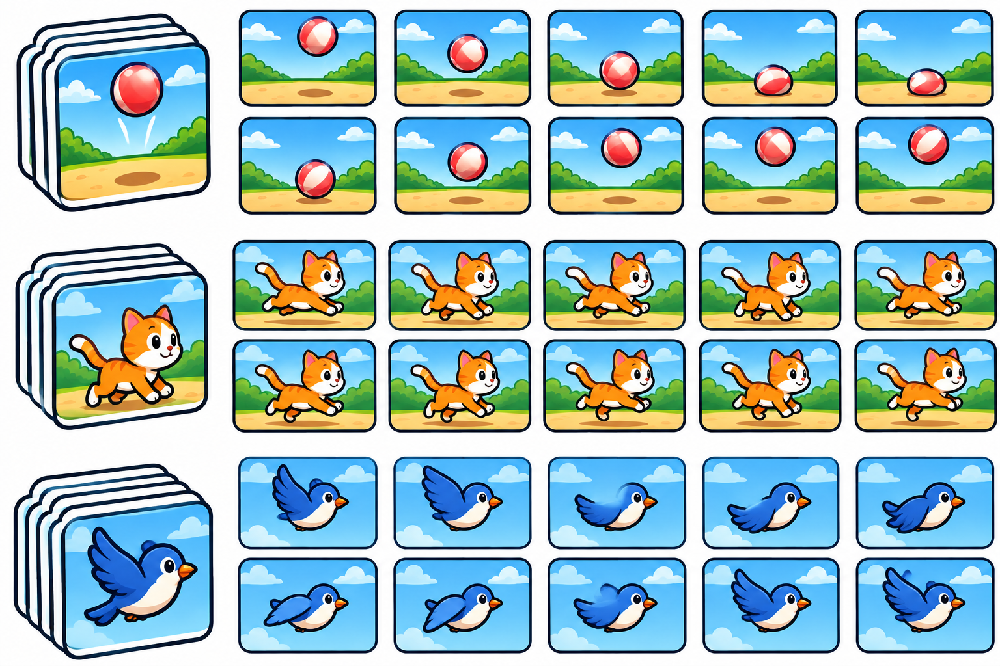
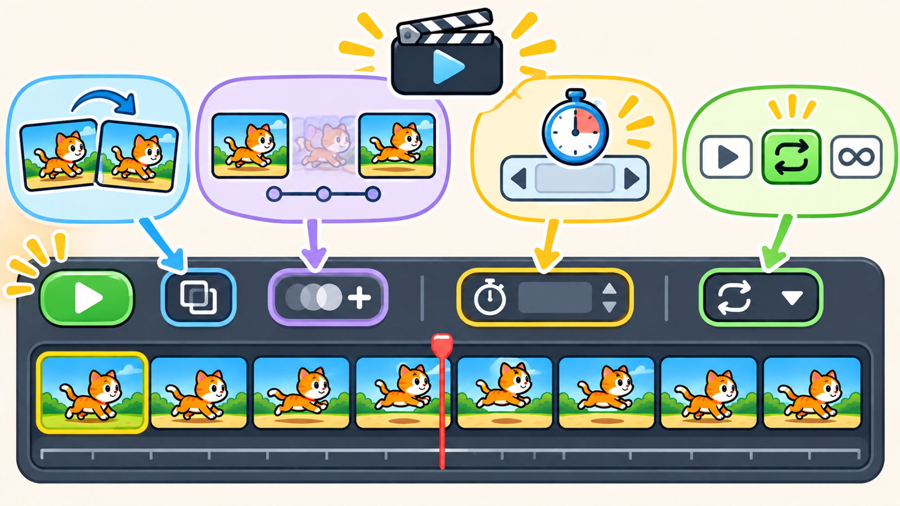
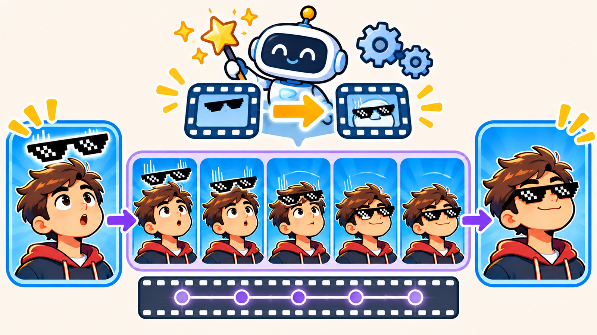
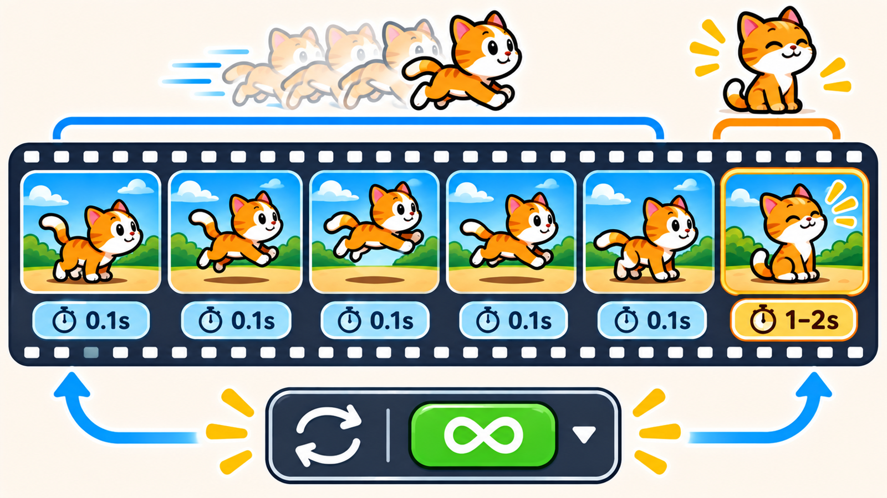
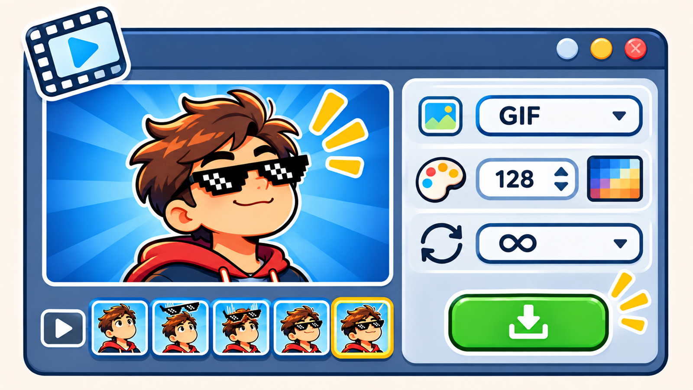

# ⭐ Шпаргалка: как сделать GIF-анимацию

**Держи рядом, пока работаешь.** Ставь галочку ☑ за каждый готовый шаг.
Здесь коротко, с пояснениями «что происходит» и **картинками-инструкциями**.

> 🎯 **Цель:** оживить картинку — очки съезжают на лицо + надпись, всё крутится по кругу (GIF).

> 🧠 **Три кита:** анимация = быстрый показ **кадров** · **Tween** («Создать промежуточные кадры») дорисовывает движение сам · **GIF** — зацикленный ролик, держим его **лёгким**.
> 🏷️ **Называй слои и не забывай прозрачный фон у PNG!**

---

## 🧩 ФАЗА 1 — готовим слои

- [ ] Открой фото лица/питомца. Слой назови **«лицо»**.
- [ ] `Файл → Поместить встроенные…` → **очки-PNG** (прозрачный фон!) → `Enter`. Слой **«очки»**.
- [ ] `Ctrl+T` — подгони очки под глаза (с `Shift`). `Enter`.
- [ ] Инструментом **«Перемещение»** `V` подними очки **вверх за край** (в начале их не видно).
- [ ] **Текст** `T` → внизу впиши **DEAL WITH IT**. Слой **«текст»** → **выключи глазик 👁**.

---

## 🎞 ФАЗА 2 — открой Шкалу времени

- [ ] `Окно → Шкала времени` → кнопка по центру → **«Создать анимацию кадра»**.
- [ ] Появился **кадр 1** — это старт (очки вверху, текст выключен).

---

## ✨ ФАЗА 3 — плавное движение (Tween)

*Идея: ставим старт и финиш, середину рисует программа.*

- [ ] **Копия кадра** (листок внизу) → кадр 2.
- [ ] На кадре 2 инструментом `V` опусти **«очки»** вниз, на глаза.
- [ ] Выдели **оба** кадра (клик + `Shift`+клик).
- [ ] **«Создать промежуточные кадры»** → **5 кадров**, Параметры: **Положение** → ОК.
- [ ] ▶ Play — очки поехали! 😎

> ⚠️ Кнопка Tween серая? Выдели **два** кадра.

---

## ⏱ ФАЗА 4 — текст, тайминг, цикл

- [ ] Встань на **последний** кадр → включи глазик **👁** у слоя **«текст»**.
- [ ] Кадрам **движения** — время **0,1 с**; **последнему** — **1–2 с** (финал держим).
- [ ] Внизу слева **«Однократно» → «Постоянно»** (крутится по кругу).
- [ ] ▶ Проверь весь ролик.

---

## 💾 ФАЗА 5 — экспорт в GIF

- [ ] `Изображение → Размер изображения` → ширина **600–800 px** (GIF любит быть лёгким).
- [ ] `Файл → Экспортировать → Сохранить для Web (старый)…`.
- [ ] Формат **GIF**; «Цвета» — **128/64**; «Параметры повтора» — **«Постоянно»**.
- [ ] **Сохранить…** → папка → готово!
- [ ] Сохрани и **`.psd`** (вернуться к кадрам).

---

### ⌨️ Клавиши
`V` перемещение · `T` текст · `Ctrl+T` размер · `Shift`+клик — выделить несколько кадров · `Ctrl+Z` отмена.

> ✅ Проверь: движение **плавное** (Tween, не прыжок) · финалу — **пауза** · цикл **«Постоянно»** · GIF **лёгкий** · у PNG **прозрачный фон**.
