# 🖼️ Гайд: «Семейная карточка» (картинка в картинке)

> Пошаговая инструкция к **Заданию 2** самостоятельной работы. Делай по шагам — и получится эффект «фото в фото»: герои **в цвете** внутри белой наклонной рамки, а фон вокруг — **чёрно-белый**.
> 🧰 Имена инструментов — для **Photoshop 2025** (рус. интерфейс). В скобках — английские названия.
> 📸 **Возьми СВОЁ фото** (семья / друзья с согласия) или бесплатное с [Pexels](https://www.pexels.com/ru-ru/). Пример в гайде — пляжное фото (на нём есть водяной знак банка картинок, у тебя своего фото его не будет).

**Что получится:**

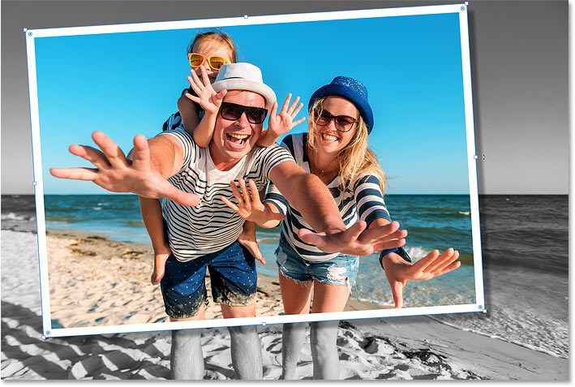

---

## Часть 1 — Два слоя: цветной верх и ч/б фон

**Шаг 1. Открой фото.** `Файл → Открыть` (File → Open).

**Шаг 2. Сделай копию фонового слоя.** Перетащи слой **«Фон»** (Background) на кнопку **«Создать новый слой»** внизу панели слоёв. Появится копия поверх оригинала.

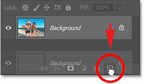

**Шаг 3. Переименуй копию в «Small».** Дважды кликни по названию копии и впиши **Small** (это будет цветная карточка), `Enter`.

**Шаг 4. Выключи слой «Small».** Нажми его **глазик 👁** — пока он нам мешает.

**Шаг 5. Выдели нижний «Фон».** Кликни по нему — его сделаем чёрно-белым.

**Шаг 6. Добавь корректирующий слой «Чёрно-белое».** Внизу панели слоёв нажми **◐** (Создать новый корректирующий слой или слой-заливку) → выбери **«Чёрно-белое»** (Black & White).

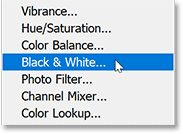

👀 Фон стал чёрно-белым. Корр.слой встал **между** «Фон» и «Small», поэтому красит только фон.

**Шаг 7. Нажми «Авто».** В панели **«Свойства»** (Properties) нажми кнопку **«Авто»** (Auto) — Photoshop сам подберёт хорошее ч/б. (Можно подвигать ползунки цветов вручную.)

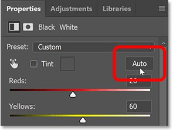

**Шаг 8. Включи «Small».** Выбери слой **«Small»** и верни ему **глазик 👁** — цвет вернулся (пока на весь кадр).

---

## Часть 2 — Рамка-прямоугольник

**Шаг 9. Возьми инструмент «Прямоугольник» (Rectangle, `U`).** На панели инструментов — именно **«Прямоугольник»** (фигура), НЕ «Прямоугольная область» (это выделение).

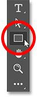

**Шаг 10. Режим — «Фигура».** Вверху слева в списке режима выбери **«Фигура»** (Shape), не «Контур» и не «Пикселы».

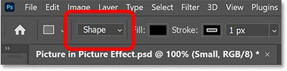

**Шаг 11. Заливка — чёрный.** Кликни образец **«Заливка»** (Fill) → палитра → поставь **R=G=B=0** (чёрный) → ОК. (Цвет не важен, чёрный просто виднее.)

**Шаг 12. Обводка — «Без цвета».** Кликни образец **«Обводка»** (Stroke) → значок **«Нет цвета»** (белый квадрат с красной чертой), `Enter`.

**Шаг 13. Нарисуй прямоугольник вокруг героев.** Протяни рамку от левого-верхнего угла героев к правому-нижнему — так, чтобы внутрь попало всё, что должно остаться цветным.

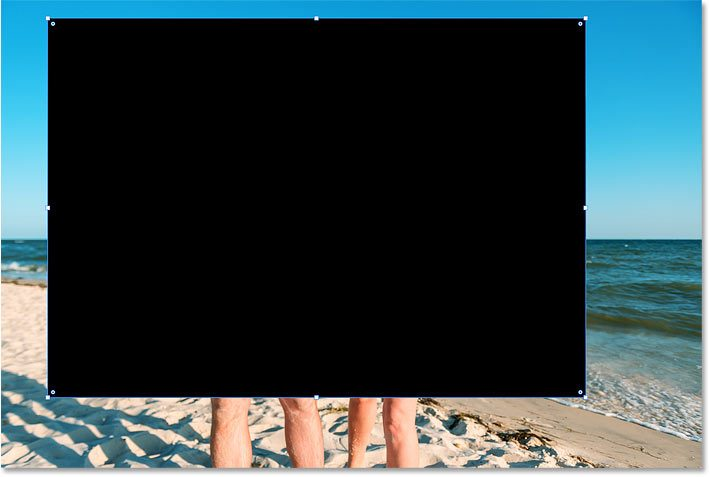

> 💡 Двигать рамку прямо во время рисования — зажми **пробел** и тащи.

**Шаг 14. Проверь положение.** Чтобы видеть фото сквозь фигуру, убавь **непрозрачность** слоя-фигуры до **50 %** (клавиша `5`). Поправь размер за уголки-маркеры. Потом верни **100 %** (клавиша `0`).

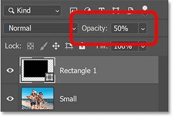

---

## Часть 3 — Вставляем фото в рамку (обтравочная маска)

**Шаг 15. Подними «Small» НАД слоем-фигурой.** В панели слоёв перетащи **«Small»** выше слоя **«Прямоугольник 1»** (синяя полоса появится над ним — отпусти).

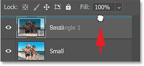

**Шаг 16. Сделай обтравочную маску.** Выдели слой **«Small»** и нажми **`Alt+Ctrl+G`** (или меню панели слоёв → **«Создать обтравочную маску»** / Create Clipping Mask).

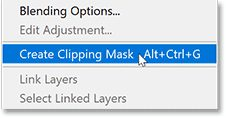

👀 Цветное фото теперь видно **только внутри прямоугольника**, а вокруг — чёрно-белый фон. Магия!

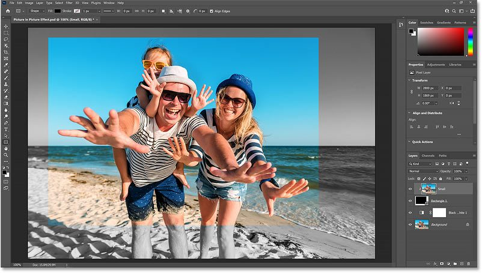

---

## Часть 4 — Белая рамка и тень (стили слоя)

**Шаг 17. Выдели слой-фигуру «Прямоугольник 1».** Стили вешаем на неё.

**Шаг 18. Добавь белую обводку.** Внизу панели слоёв нажми **fx** (Стили слоя) → **«Обводка»** (Stroke):
- **Цвет** — белый (R=G=B=255);
- **Положение** — **«Внутри»** (Inside) — углы останутся чёткими;
- **Размер** — ~**40 px** (зависит от фото).

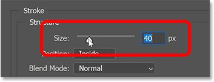

**Шаг 19. Добавь тень.** В том же окне слева включи **«Тень»** (Drop Shadow):
- **Угол** — 135°, **Смещение** — ~50 px;
- **Размер** (мягкость) — ~15 px; **Непрозрачность** — ~35 %.
- ОК.

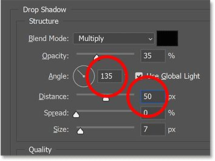

---

## Часть 5 — Наклон и финал

**Шаг 20. Поверни рамку.** Слой **«Прямоугольник 1»** активен, инструмент **«Прямоугольник»** выбран → наведи мышь чуть **за угловой маркер** (курсор станет изогнутой стрелкой ↻) → поверни рамку на небольшой угол. Фото внутри останется на месте — повернётся только рамка с обводкой и тенью.

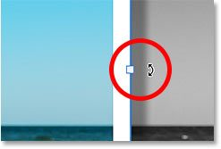

**Шаг 21. Проверь края и заверши.** Убедись, что рамка не обрезала лица/руки (поправь размер маркерами). Нажми **`Enter`**.

**Сохрани:** `.PSD` (все слои) + `.JPG`/`.PNG` (готовая карточка).

---

## ✅ Что должно получиться (проверь себя)
- [ ] Фон — **чёрно-белый**, герои в рамке — **в цвете**;
- [ ] У рамки есть **белая обводка** и **тень**;
- [ ] Рамка **чуть наклонена** (как настоящая фотокарточка);
- [ ] Лица/руки героев **не обрезаны** рамкой;
- [ ] Сохранено PSD + JPG.

> 🧰 **Приёмы задания:** корректирующий слой «Чёрно-белое», инструмент «Прямоугольник» (фигура), **обтравочная маска** (`Alt+Ctrl+G`), **стили слоя** (Обводка, Тень), поворот фигуры. Остальные скрины шагов — в папке `шаги/`.
