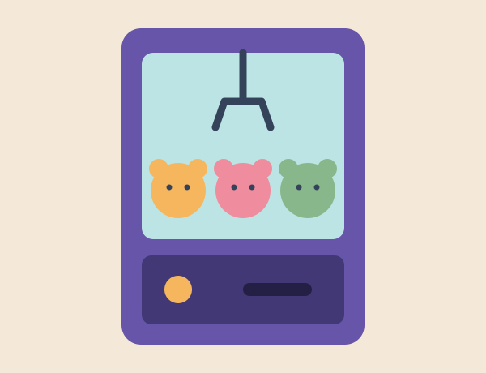
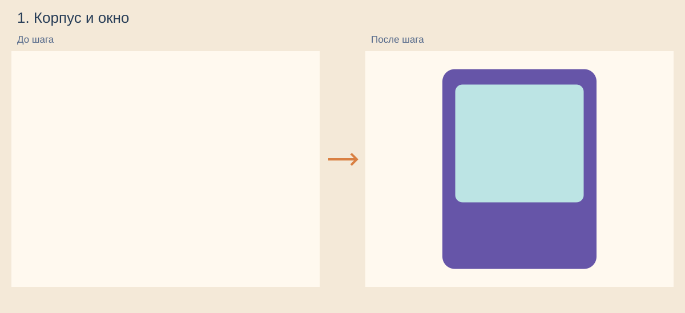
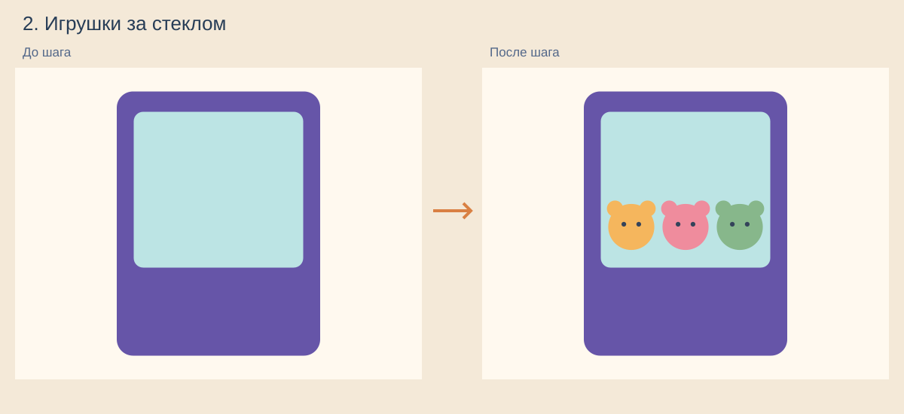
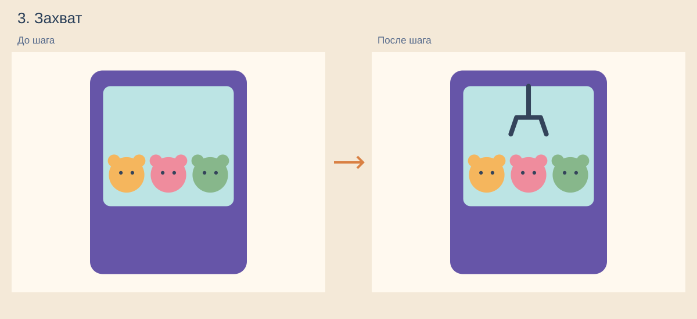
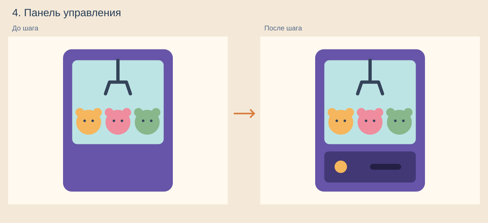

# Автомат с игрушками

Дополнительная работа к уроку 1 · начальный уровень

Нарисуй витрину игрового автомата: внутри лежат игрушки, сверху висит захват, а внизу находится панель управления. Это одна большая иллюстрация, а не набор иконок.

## Перед началом

Открой Figma и создай новый Design file. Назови его «Автомат с игрушками». Все размеры ниже указаны в пикселях. X и Y отсчитываются от верхнего левого угла родительского фрейма. Чтобы ввести точные размеры, выдели объект и найди поля W и H в правой панели Design. Цвет вводится в Fill. Не импортируй готовый рисунок вместо своей работы: он нужен для сравнения.

## Как выполнить

### Шаг 1. Корпус и окно

Создай фрейм (F) 600 × 460, заливка #F4E9D8.

Прямоугольником R нарисуй корпус X150 Y35 W300 H390, радиус 24, цвет #6655A8. Поверх поставь окно X175 Y65 W250 H230, радиус 14. Выдели корпус и окно через Shift, выбери Subtract selection в меню булевых операций. Окно должно стать настоящим отверстием. Под корпус помести прямоугольник цвета #BCE4E4 размером 250 × 230 на месте окна. В Layers перетащи его ниже корпуса.

### Шаг 2. Игрушки за стеклом

Внутри окна собери три игрушки из кругов и прямоугольников.

Для первой используй круг 68 × 68 и два круга 24 × 24 для ушей. Выдели три круга и нажми Union selection. Поставь глаза из кругов 7 × 7. Сделай ещё две игрушки других цветов, расположи их на нижней части окна. Не закрывай верх окна: там будет механизм.

### Шаг 3. Захват

Нарисуй вертикальный прямоугольник 8 × 55 и горизонтальный 46 × 10.

Добавь два узких прямоугольника 10 × 35 по бокам, поверни их на 25 и −25 градусов. Объедини детали захвата, кроме троса. Цвет #34435A. Проверь, что захват не касается игрушек.

### Шаг 4. Панель управления

В нижней части корпуса поставь прямоугольник X175 Y315 W250 H85 с радиусом 12, цвет #413875.

Добавь круг 34 × 34 для кнопки и прямоугольник 85 × 16 для щели. Над панелью можно написать название автомата инструментом T. Выдели фрейм и экспортируй PNG через Export.

## Основные настройки

| Параметр | Значение |
|---|---|
| Фрейм | 600 × 460 |
| Основной инструмент | Rectangle (R), Ellipse (O) |
| Операции | Union, Subtract |

## Если что-то не получается

Если вычитание не сработало, проверь порядок слоёв: фигура, которая вырезает отверстие, должна лежать выше основы. Раскрой булеву группу в Layers, чтобы поправить исходные фигуры. Если объект оказался за фреймом, перетащи его внутрь фрейма в Layers.

## Проверь работу

- [ ] В корпусе есть отверстие Subtract, игрушки собраны из фигур.
- [ ] Все детали внутри фрейма, панель не перекрывает окно.
- [ ] Слои названы понятно, рисунок не обрезан случайно.

## Если хочется усложнить

Добавь ещё одну игрушку, используя Intersect: оставь только часть круга внутри прямоугольника.

## Что сдать

Ссылку на редактируемый файл Figma и PNG готовой работы.
