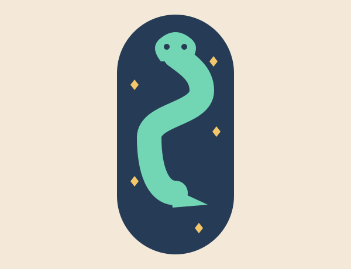
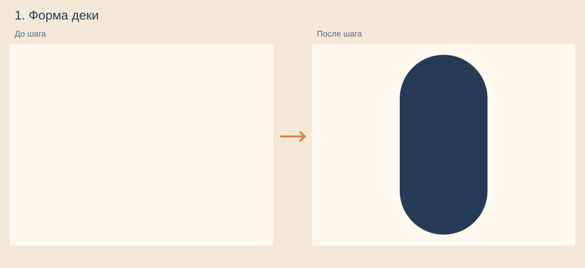
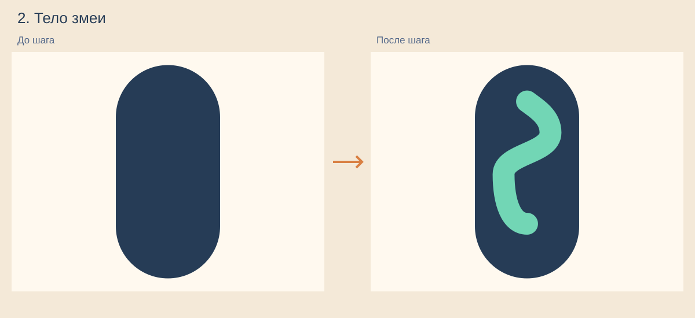
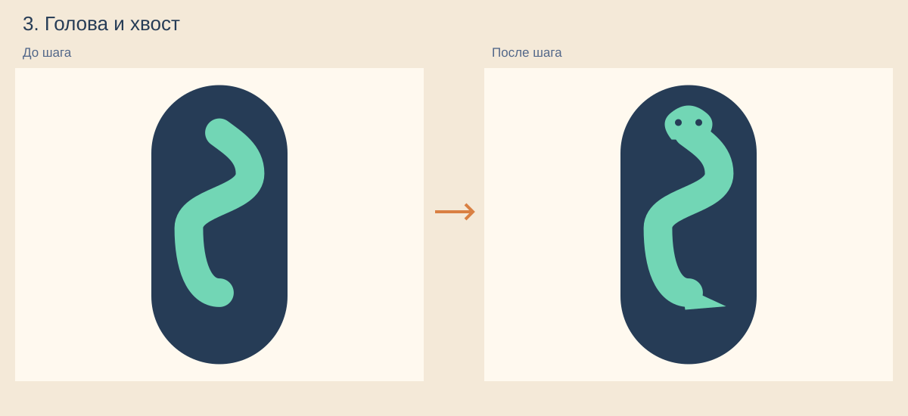
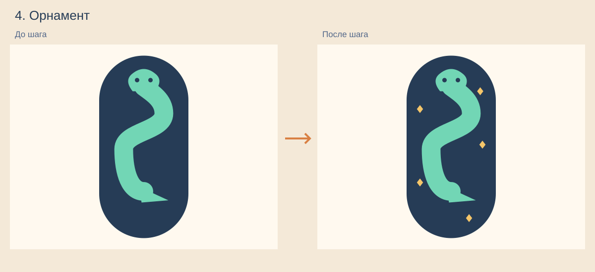

# Дизайн скейтборда

Дополнительная работа к уроку 2 · средний уровень

Представь, что тебе заказали рисунок для деки скейтборда. Сделай длинную доску с рисунком морской змеи. Здесь перо понадобится для иллюстрации, а не для логотипа.

## Перед началом

Открой Figma и создай новый Design file. Назови его «Дизайн скейтборда». Все размеры ниже указаны в пикселях. X и Y отсчитываются от верхнего левого угла родительского фрейма. Чтобы ввести точные размеры, выдели объект и найди поля W и H в правой панели Design. Цвет вводится в Fill. Не импортируй готовый рисунок вместо своей работы: он нужен для сравнения.

## Как выполнить

### Шаг 1. Форма деки

Создай фрейм 600 × 460 с фоном #F4E9D8.

Нарисуй R прямоугольник X200 Y25 W200 H410, радиус 100, Fill #263C56. Назови слой Дека. Дважды кликни по нему, если хочешь посмотреть опорные точки; менять их пока не нужно.

### Шаг 2. Тело змеи

Нажми P.

В пределах деки поставь точку (300,95), затем (345,155) с протяжкой вниз, (255,235) с протяжкой вниз и (300,330) с протяжкой вправо. Закончи открытый контур Esc. В Fill убери заливку, в Stroke поставь #72D6B5, толщину 42 и круглые окончания (Cap Round в расширенных настройках обводки). Если линия ломается, дважды кликни по ней и поправь направление усов. Координаты служат ориентиром, не обязательно попадать в пиксель.

### Шаг 3. Голова и хвост

Пером нарисуй замкнутую голову около верхнего конца линии: начни с (275,105), затем (265,75) с протяжкой вверх, (300,55) с протяжкой вправо, (335,75) с протяжкой вниз, (325,105), замкни контур.

Заливка #72D6B5, обводку убери. Добавь два тёмных глаза. Внизу нарисуй треугольный хвост пером, соедини его с концом линии.

### Шаг 4. Орнамент

Добавь несколько маленьких ромбов и кругов вокруг змеи.

Для ромба поставь четыре точки пером обычными кликами и замкни контур. Цвет #F5C66A. Не накладывай орнамент на глаза и не выходи за край деки. Экспортируй фрейм в PNG.

## Основные настройки

| Параметр | Значение |
|---|---|
| Фрейм | 600 × 460 |
| Перо | P |
| Окончания обводки | Round |

## Если что-то не получается

Если вместо плавной линии получился угол, проверь, что в нужной точке ты протянул мышь, а не просто кликнул. В режиме редактирования выдели точку и потяни её направляющую. Для открытой линии используй Stroke, для замкнутой фигуры — Fill. Не добавляй точки только ради исправления небольшого изгиба.

## Проверь работу

- [ ] Тело — открытая кривая с обводкой, голова и хвост — замкнутые контуры.
- [ ] На изгибах нет случайных острых углов.
- [ ] Слои названы понятно, рисунок не обрезан случайно.

## Если хочется усложнить

Сделай вторую расцветку деки, не меняя форму змеи.

## Что сдать

Ссылку на редактируемый файл Figma и PNG готовой работы.
